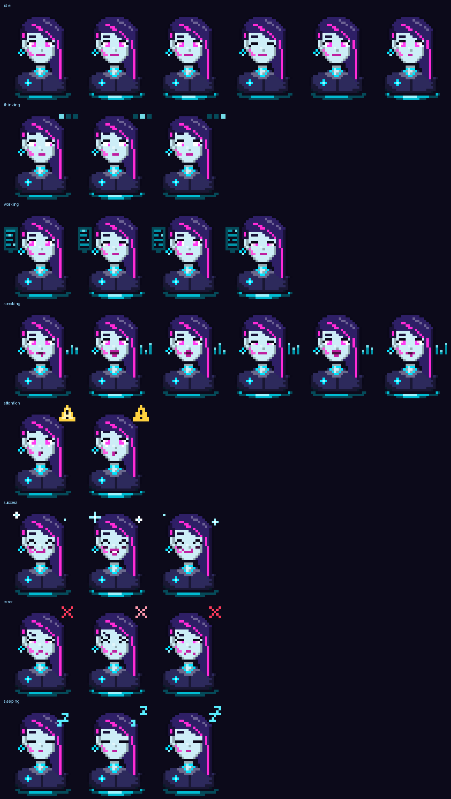

# Claude Desktop Avatar

Ein Jarvis-artiger Begleiter als **Mod für Claude Code**: eine animierte Figur, die frei verschiebbar über deinem Windows-Desktop schwebt, ähnlich den Haustieren der Codex-App. Sie zeigt und sagt an, woran Claude gerade arbeitet, meldet sich, wenn Claude dich braucht, nimmt Aufträge per Klick oder Stimme an und behält alle offenen Sitzungen im Blick.



Die erste Vorlage ist **Vela**, eine eigene Figur dieses Projekts: eine holografische Netz-KI im Neon-Stil, selbstbewusst und knapp im Ton.

## Was sie kann

- **Auf dem Desktop:** randloses Fenster über allen anderen, frei verschiebbar, rastet an Bildschirmkanten ein und merkt sich den Platz. Sie schwebt leicht, flackert wie ein Hologramm und hat Scanlines und Leuchten.
- **Zeigen, was passiert:** Laufschrift unter der Figur („Liest app.ts“, „Tests laufen“, Plan 3/7 mit Fortschrittsbalken), Sprechblase mit Schreibmaschineneffekt, eigene Animationen für Denken, Arbeiten, Sprechen, Achtung, Erfolg, Fehler und Schlafen.
- **Ansagen:** Sprachausgabe von Windows (System.Speech) mit Lippenbewegung, kurze Töne. Drei Stufen (leise, normal, gesprächig), Ruhezeiten, Drosselung, damit es nicht nervt.
- **Wenn Claude dich braucht:** Freigaben, Rückfragen und Plan-Freigaben werden sofort angesagt; die Figur leuchtet gelb, auf Wunsch kommt eine Systembenachrichtigung.
- **Aufträge:** Klick auf die Figur oder Tastenkürzel (Standard `Strg+Alt+Leertaste`) öffnet die Schnelleingabe. Mit 🎤 startet das Windows-Diktat (Win+H). In Claude Code geht es auch mit `/voice`.
- **Befehle an den Avatar**, die er selbst erledigt: „Vela, Status“, „Vela, stopp“, „Vela, was machst du gerade?“, „Vela, fass zusammen“, „Vela, leiser“, „Vela, Kontingent“ und mehr.
- **Alle Sitzungen:** Jede offene Claude-Code-Sitzung meldet ihren Stand; genau eine spricht für alle. Fährst du mit der Maus über die Figur, siehst du alle Sitzungen. Aufträge lassen sich gezielt an eine andere Sitzung schicken.
- **Sprachmodus:** Claude antwortet dann mit einem vorlesbaren ersten Satz, den der Avatar vorliest.
- **Aussehen:** Vorlagen mit Farben, Visier, Ohrring, Tattoo, Größe 2× bis 8× (auch per Strg+Mausrad), Persönlichkeit (neon, freundlich, knapp, förmlich, Butler) und eigener Name.
- **Rücksichtsvoll:** Bei Vollbild-Apps oder Präsentationen versteckt sie sich und schweigt. Mit dem „Geistmodus“ klickst du durch sie hindurch. Im Infobereich gibt es ein Symbol mit Menü.
- **Ohne Windows** (macOS, Linux, Web): Seitenleiste in Claude Code mit animierter Figur, Statuszeile und Band über der Eingabe.

Alles läuft in deiner Claude-Code-Sitzung über dein Abo, ohne API-Schlüssel und ohne Installer. Deutsch und Englisch.

## Installation

An der Eingabe einer Claude-Code-Sitzung im Terminal:

```text
/plugin install avatar --marketplace AyGeeI/claude-desktop-avatar
```

Danach `y`, um den Marketplace hinzuzufügen, und mit Enter den Bereich „user“ wählen. Es folgt eine Seite mit Optionen (Name, Sprache, Ausführlichkeit, Sprachausgabe, Desktop-Fenster, Stimmen, Ruhezeiten, Tastenkürzel, Benachrichtigungen); alles lässt sich später mit `/avatar` ändern. Die Mod ist sofort aktiv.

Aus einer Shell geht es genauso:

```bash
claude plugin install avatar --marketplace AyGeeI/claude-desktop-avatar
```

**Desktop-App:** Dort gibt es den Befehl nicht. Einmal im Terminal mit dem Bereich „user“ installiert, läuft die Mod aber auch in den lokalen Sitzungen der Desktop-App.

**Voraussetzungen:** Windows 10 oder 11 mit Windows PowerShell 5.1 und .NET Framework 4.8 (beides ist bei Windows dabei). Beim ersten Start übersetzt der Avatar sein Fenster einmal (ein paar Sekunden); danach startet er sofort.

## Bedienung

| Am Desktop | Wirkung |
|---|---|
| Klick | Schnelleingabe öffnen (Enter senden, Esc schließen, ↑ letzte Eingaben, Tab wechselt die Sitzung) |
| Doppelklick | Status ansagen |
| Ziehen | verschieben (rastet an Kanten ein) |
| Rechtsklick | Menü: Fragen, Status, Sitzungen, Zusammenfassen, Wiederholen, Stoppen, Ausführlichkeit, Sprachmodus, Sprachausgabe, Größe, Geistmodus, Test, Über, Ausblenden |
| Strg+Mausrad | Größe ändern |
| Maus darüber | alle Sitzungen anzeigen |
| `Strg+Alt+Leertaste` | Schnelleingabe von überall |

| In Claude Code | Wirkung |
|---|---|
| `/avatar` | Seitenleiste mit Status |
| `/avatar aussehen` | Vorlage, Farben, Größe, Stil, Stimmen, Name |
| `/avatar einrichten` | Einrichtung prüfen (Desktop-Fenster, Stimmen, Sprache) |
| `/avatar leise` · `normal` · `gesprächig` | Ausführlichkeit |
| `/avatar sprache an` · `aus` | Sprachmodus |
| `/avatar ton an` · `aus` | Sprachausgabe |
| `/avatar zeigen` · `verstecken` | Desktop-Fenster |
| `/avatar geist an` · `aus` | Durchklickbar machen |
| `/avatar name Nova` | Umbenennen |
| `/avatar vorlage <id>` · `stil butler` | Vorlage oder Persönlichkeit wechseln |
| `/avatar test` · `neustart` | Testlauf aller Zustände · Desktop-Fenster neu starten |
| „Vela, …“ am Anfang eines Auftrags | Befehl an den Avatar (Status, stopp, leiser, zusammenfassen, wiederholen, Kontingent, Hilfe …) |

## Eigene Vorlagen

Vorlagen liegen in `templates/` der Mod oder in `%USERPROFILE%\.claude-desktop-avatar\templates\`. Das Format (Manifest, Pixel-Frames mit Paletten-Parametern, Overlays, Mundformen für die Lippenbewegung, Effekte) steht in [docs/avatar-templates.md](docs/avatar-templates.md). Vela entsteht aus [`tools/make-vela.py`](tools/make-vela.py) und ist ein gutes Beispiel zum Abwandeln; die Töne aus [`tools/make-sounds.py`](tools/make-sounds.py).

## Entwicklung

```text
claude plugin validate .
claude plugin test .
python3 tools/make-vela.py --preview --icon
python3 tools/make-sounds.py
```

Aufbau: [`hooks/register.tsx`](hooks/register.tsx) verbindet die Hooks mit dem Controller ([`src/controller.ts`](src/controller.ts)); der Desktop-Begleiter ist [`companion/Companion.cs`](companion/Companion.cs) (C# 5, WPF), gestartet über [`companion/avatar.ps1`](companion/avatar.ps1). Mod und Begleiter sprechen über `%USERPROFILE%\.claude-desktop-avatar\companion\state.json` und JSON-Zeilen auf stdout.

## Dokumentation

| Dokument | Inhalt |
|---|---|
| [Projektplan](docs/PLAN.md) | Vision, Anforderungen, Architektur, Stand, Risiken, Entscheidungen |
| [Mod-Konzept](docs/mod-design.md) | Ereignisse, Erzähler, Sprache, Desktop-Begleiter, Anzeige, mehrere Sitzungen, Befehle |
| [Avatar-Vorlagen](docs/avatar-templates.md) | Vorlagenformat, Parameter, Zustände, Effekte, Persona |

## Datenschutz

Die Mod schickt nichts ins Netz. Status-Dateien liegen nur lokal unter `%USERPROFILE%\.claude-desktop-avatar\`. Die Sprachausgabe nutzt die Stimmen von Windows. Das Windows-Diktat (Win+H) ist eine Funktion von Windows und folgt dessen Einstellungen.

## Lizenz

Code: [MIT](LICENSE). Vorlage Vela und die Töne: [CC BY 4.0](templates/vela/LICENSE).

## Hinweis

Nicht kommerzielles, unabhängiges Projekt, nicht mit Anthropic verbunden. „Claude“ ist eine Marke von Anthropic. „Jarvis“ dient nur als Vergleich.
