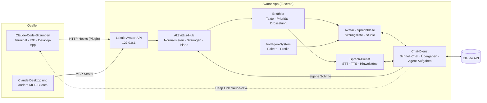
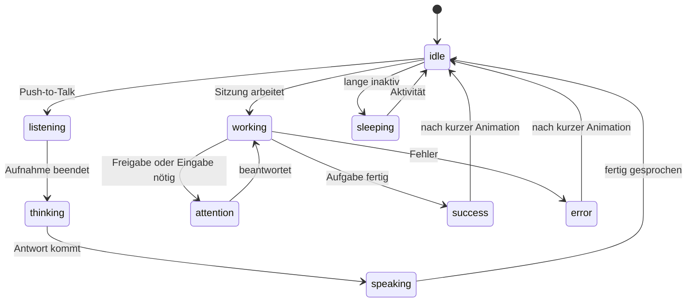
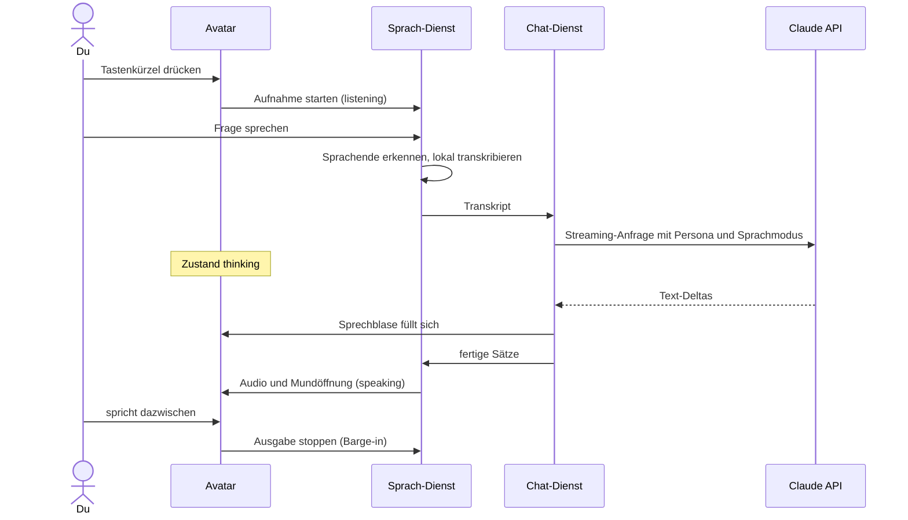
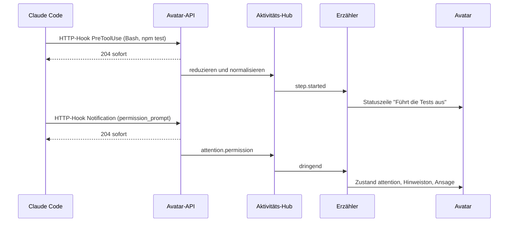

# Claude Desktop Avatar – Projektplan

> **Status:** Entwurf v0.1 · **Stand:** 4. November 2026 · „Claude Desktop Avatar" ist ein Arbeitstitel (siehe Abschnitt 10).
>
> Detailkonzepte: [Avatar-Vorlagen](avatar-templates.md) · [Anbindung an Claude](claude-integration.md)

## Auf einen Blick

- **Was:** Ein Desktop-Begleiter, der frei verschiebbar über allen Fenstern sitzt, per Klick, Tastenkürzel oder Stimme einen Claude-Chat startet und dir mit Text und Ton erzählt, woran deine Claude-Sitzungen gerade arbeiten.
- **Aussehen:** Vorlagen (Templates) mit anpassbaren Farben, Teilen, Größe, Stimme, Name und Persönlichkeit. Eigene Vorlagen entstehen ohne Programmierung (SVG oder Sprites), 3D folgt später.
- **Live-Schritte:** Claude-Code-Sitzungen melden sich über ein Claude-Code-Plugin mit offiziellen HTTP-Hooks: Werkzeug-Schritte, Aufgabenliste, „braucht Freigabe", „fertig". Normale Chats in Claude Desktop sind nur eingeschränkt erreichbar (über einen MCP-Server), weil es dafür keine offizielle Schnittstelle gibt.
- **Chat:** eigener Schnell-Chat über die Claude API (eigener API-Schlüssel) und Übergabe größerer Aufgaben an dein Claude Code per Deep Link.
- **Technik:** Electron, TypeScript und React. Sprache läuft lokal (whisper.cpp, System-Stimmen oder Piper), Cloud-Dienste sind optional.
- **Weg:** sechs Phasen, von Machbarkeits-Spikes über ein MVP (Avatar, Live-Schritte, Text-Chat) bis zu Stimme, Vorlagen-Studio, Integrationen und Release.

## 1. Vision & Kernfunktionen

Claude arbeitet zunehmend selbstständig, oft in mehreren Sitzungen gleichzeitig. Der Avatar macht diese Arbeit sichtbar, ohne dass du zwischen Terminals und Fenstern wechseln musst, und er ist der kürzeste Weg zu einer neuen Frage. Er soll sich wie ein persönlicher Begleiter anfühlen: individuell gestaltet, unaufdringlich und nur dann laut, wenn es wichtig ist.

| # | Deine Idee | Umsetzung im Plan |
|---|---|---|
| F1 | Avatar auf dem Desktop, verschiebbar | Transparentes, rahmenloses Fenster, immer im Vordergrund und außerhalb der Figur klick-durchlässig. Ziehen mit der Maus; die Position wird pro Monitor-Anordnung gemerkt. |
| F2 | Aussehen anpassbar, z. B. über Templates | Vorlagen-System mit Parametern, Avatar-Profile, Avatar-Studio mit Live-Vorschau, Import/Export als `.avatarpack` |
| F3 | Schnell einen Chat starten, per Schrift oder Sprache | Klick oder globales Tastenkürzel öffnet ein Eingabefeld am Avatar. Push-to-Talk mit lokaler Spracherkennung. Antworten erscheinen in der Sprechblase und werden auf Wunsch vorgelesen. |
| F4 | Aktuelle Schritte aktiver Chats ausgeben, mit Schrift und Ton | Ein Aktivitäts-Hub sammelt Ereignisse aus Claude Code, eigenen Chats und MCP. Ein „Erzähler" formuliert kurze Texte, spielt Hinweistöne und spricht Wichtiges aus. |

**Abgrenzung:** Claude Desktop hat auf dem Mac bereits „Quick Entry" (Doppeltippen auf Option) und Diktat. Der Avatar ersetzt den Abo-Chat nicht. Er ergänzt ihn plattformübergreifend um Präsenz, Sprachausgabe und Live-Schritte und übergibt größere Aufgaben an Claude Code.

## 2. Nutzungsszenarien

1. **Parallel arbeiten:** Du lässt drei Claude-Code-Sitzungen in verschiedenen Projekten laufen. Am Avatar steht „webshop · Schritt 4/6 · Tests ausführen". Braucht eine Sitzung eine Freigabe, winkt der Avatar, spielt einen Ton und sagt: „Webshop braucht deine Freigabe."
2. **Kurze Frage nebenbei:** Du drückst das Tastenkürzel und fragst: „Wie formatiere ich in Python ein Datum nach ISO 8601?" Die Antwort erscheint in der Sprechblase und wird vorgelesen. Das Codebeispiel öffnest du im erweiterten Panel.
3. **Aufgabe delegieren:** „Starte im Projekt Webshop: Behebe den fehlschlagenden Checkout-Test." Der Avatar fragt nach und öffnet Claude Code im Projektordner mit vorbefülltem Auftrag. Du bestätigst mit Enter, danach erscheint der Fortschritt am Avatar.
4. **Eigener Look:** Du wählst die Vorlage „Blob", stellst Petrol als Farbe ein, setzt ihm Kopfhörer auf, nennst ihn „Pixel" und gibst ihm eine ruhigere Stimme. Das Profil teilst du als Datei mit deinem Team.
5. **Konzentriert arbeiten:** Im Nicht-stören-Modus schläft der Avatar. Nur dringende Hinweise kommen als dezenter Ton.

## 3. Anforderungen

Prioritäten: **M** = Muss (MVP) · **S** = Soll · **K** = Kann (später)

### 3.1 Funktional

**F1 – Desktop-Präsenz**

| ID | Anforderung | Prio |
|---|---|---|
| F1.1 | Transparentes, rahmenloses Fenster über allen anderen Fenstern, nicht in der Taskleiste | M |
| F1.2 | Ziehen verschiebt den Avatar, ein Klick ohne Bewegung öffnet den Schnell-Chat, ein Rechtsklick das Kontextmenü | M |
| F1.3 | Klicks außerhalb der Figur gehen an die Fenster darunter | M |
| F1.4 | Die Position wird pro Monitor-Anordnung gemerkt; nach einem Monitorwechsel landet der Avatar wieder im sichtbaren Bereich | M |
| F1.5 | Tray- bzw. Menüleisten-Symbol: ein-/ausblenden, Nicht stören, Profil wechseln, Einstellungen, Beenden | M |
| F1.6 | Autostart mit dem System | S |
| F1.7 | Andocken am Bildschirmrand, Größe änderbar | S |
| F1.8 | Augen folgen dem Mauszeiger, Leerlauf-Animationen, Einschlafen bei Inaktivität | K |
| F1.9 | Automatisch ausblenden bei Vollbild-Apps und Präsentationen (best effort) | K |

**F2 – Anpassbarkeit**

| ID | Anforderung | Prio |
|---|---|---|
| F2.1 | Mitgelieferte Vorlagen: mindestens 2 im MVP, 3–5 bis Phase 3 | M |
| F2.2 | Parameter einer Vorlage (Farben, Teile, Größe) mit Live-Vorschau ändern | M |
| F2.3 | Avatar-Profile (Vorlage + Werte + Name + Stimme + Persona), mehrere Profile umschaltbar | S |
| F2.4 | Import/Export von Vorlagen und Profilen (`.avatarpack`) | S |
| F2.5 | Eigene Vorlagen ohne App-Änderung: Ordner + `avatar.json`, Entwicklermodus mit Hot Reload und Validierung | S |
| F2.6 | Renderer: SVG (M), Sprites (S), Rive (K), 3D/VRM (K) | – |
| F2.7 | Community-Galerie für Vorlagen | K |

**F3 – Schnell-Chat**

| ID | Anforderung | Prio |
|---|---|---|
| F3.1 | Texteingabe per Klick oder globalem Tastenkürzel; die Antwort wird in die Sprechblase gestreamt und lässt sich zum Panel erweitern (Markdown, Code kopieren) | M |
| F3.2 | Verlauf lokal speichern, „Neuer Chat", Modell einstellbar | M |
| F3.3 | Spracheingabe per Push-to-Talk mit lokaler Spracherkennung (Deutsch) | M (Phase 2) |
| F3.4 | Antworten vorlesen mit Lippen-Sync; Unterbrechen durch Sprechen oder Klick (Barge-in) | S |
| F3.5 | Aufgabe an Claude Code übergeben: Projekt wählen, Deep Link mit vorbefülltem Auftrag | S |
| F3.6 | „Frag nach dem Stand": Der Chat kennt die aktiven Sitzungen (nur reduzierte Zusammenfassungen) | S |
| F3.7 | Kontext anhängen: Zwischenablage, Screenshot (nur auf ausdrücklichen Klick) | K |
| F3.8 | Agent-Aufgaben im Hintergrund (Claude Agent SDK) mit Freigaben am Avatar | K |
| F3.9 | Aktivierungswort („Hey Pixel"), lokal und opt-in | K |

**F4 – Live-Schritte**

| ID | Anforderung | Prio |
|---|---|---|
| F4.1 | Claude-Code-Sitzungen über ein Plugin anbinden (HTTP-Hooks) | M |
| F4.2 | Anzeige pro Sitzung: aktueller Schritt, Fortschritt der Aufgabenliste („Schritt 3/7"), Status (arbeitet, wartet, fertig, Fehler) | M |
| F4.3 | Dringendes (Freigabe oder Eingabe nötig, Abbruch) mit Zustand `attention`, Hinweiston und Sprachansage | M |
| F4.4 | Sitzungsliste mit Projektname, Status und letztem Schritt; einzelne Sitzungen stummschaltbar | M |
| F4.5 | Bündelung und Drosselung, damit keine Ansage-Flut entsteht | M |
| F4.6 | Ausführlichkeitsstufen (Still, Normal, Gesprächig), getrennt für Text und Ton; Ruhezeiten | S |
| F4.7 | Claude Desktop und andere MCP-Clients über einen MCP-Server (`avatar_status`, `avatar_say`) | K |
| F4.8 | Freigaben direkt am Avatar beantworten (opt-in) | K |
| F4.9 | Optionale KI-Zusammenfassung längerer Schrittfolgen | K |

### 3.2 Nicht-funktional

| Bereich | Ziel |
|---|---|
| Ressourcen | Leerlauf unter 1 % CPU; RAM-Ziel unter 250 MB (in Phase 0 messen); flüssige Animation (2D 60 fps, 3D 30 fps), im Leerlauf gedrosselt |
| Latenz | Hook bis Anzeige unter 300 ms; die Avatar-API beantwortet Hooks in unter 10 ms; Sprache: erste Audioausgabe unter 3 s nach Ende der Frage (Ziel) |
| Robustheit | Claude Code arbeitet unverändert weiter, wenn der Avatar nicht läuft oder hängt (fail-open) |
| Datenschutz | Lokal zuerst, keine Telemetrie. Cloud-Dienste außer dem Chat selbst nur nach ausdrücklicher Aktivierung |
| Sicherheit | Electron-Härtung (Context Isolation, Sandbox, CSP), lokale API nur auf Loopback, Vorlagen sind reine Daten |
| Plattformen | Windows 10/11, macOS (aktuelle Versionen, Apple Silicon und Intel), Linux mit X11; Wayland mit dokumentierten Einschränkungen |
| Barrierefreiheit | Tastaturbedienung, Screenreader-Beschriftungen, System-Einstellung „Bewegung reduzieren", jede Sprachausgabe auch als Text |
| Sprachen | Deutsch zuerst, Englisch ab Phase 5; alle Erzähler-Texte als i18n-Vorlagen |

### 3.3 Nicht-Ziele (vorerst)

- Kein Auslesen von claude.ai- oder Claude-Desktop-Chats auf inoffiziellen Wegen (Screen-Scraping, Browser-Automatisierung, interne Datenformate)
- Keine Anmeldung mit dem Claude-Abo im Avatar (Begründung in [Anbindung an Claude](claude-integration.md), Abschnitt 11)
- Keine Cloud-Synchronisation, keine Mobile-App
- Kein eigenes Hosting von Sprachmodellen

## 4. Architektur

### 4.1 Überblick



**Grundprinzip:** Alle Quellen liefern Ereignisse an **eine** lokale Avatar-API. Der Aktivitäts-Hub übersetzt sie in ein gemeinsames Ereignismodell, und der Erzähler entscheidet, was als Text, Ton oder Sprache ausgegeben wird. Die Kernlogik (Hub, Erzähler, Zustandsautomaten, Vorlagen-Schema) liegt in framework-unabhängigen TypeScript-Paketen. So bleibt ein späterer Wechsel des Desktop-Frameworks möglich.

### 4.2 Komponenten

| Komponente | Aufgabe | Technik |
|---|---|---|
| Shell (Main-Prozess) | Fenster, Tray, globale Tastenkürzel, Autostart, Updates, Schlüsselablage | Electron, `globalShortcut`, `safeStorage`, electron-updater |
| Avatar-Renderer | Vorlage darstellen, Zustände, Lippen-Sync, Trefferfläche | React, Renderer-Adapter (SVG, Sprite, Rive, VRM), XState |
| Sprechblase & Panels | Status, Antworten, Eingabe, Sitzungsliste | React |
| Lokale Avatar-API | Ereignisse von Hooks und MCP empfangen | Node `http` oder Fastify, nur `127.0.0.1` |
| Aktivitäts-Hub | Ereignisse normalisieren und reduzieren, Sitzungen und Aufgabenlisten verwalten | Kernpaket `core` |
| Erzähler | Ereignisse in kurze Texte, Töne und Ansagen übersetzen; Priorität, Bündelung, Drosselung | Kernpaket `core`, i18n |
| Chat-Dienst | Schnell-Chat, Verlauf, Chat-Werkzeuge, Übergaben, Agent-Aufgaben | `@anthropic-ai/sdk`, `@anthropic-ai/claude-agent-sdk`, SQLite |
| Sprach-Dienst | Aufnahme, Sprachende-Erkennung, STT, TTS, Wiedergabe-Warteschlange, Barge-in | Web Audio, Silero VAD, whisper.cpp, System-TTS, Piper |
| Vorlagen-System | Vorlagen laden und prüfen, Profile, Import/Export | Paket `avatar-format` (Zod, JSON Schema), DOMPurify |
| Claude-Code-Plugin | Hook-Ereignisse an die Avatar-API senden | `plugins/avatar-bridge` (nur Konfiguration) |
| MCP-Server | Avatar-Werkzeuge für Claude Desktop und andere MCP-Clients | `@modelcontextprotocol/sdk`, `.mcpb`-Paket |

### 4.3 Fenster & Interaktion

| Fenster | Eigenschaften |
|---|---|
| Avatar | transparent, rahmenlos, immer im Vordergrund, auf allen Arbeitsflächen, nicht in der Taskleiste, stiehlt keinen Fokus; außerhalb der Figur klick-durchlässig |
| Sprechblase | folgt dem Avatar und richtet sich nach dem Bildschirmrand aus; zeigt Status, Antworten und Aktionsknöpfe |
| Schnell-Chat | kleines, fokussierbares Eingabe-Panel am Avatar; Esc schließt es; per Tastenkürzel von überall erreichbar |
| Sitzungen | Popover mit allen aktiven Sitzungen |
| Studio & Einstellungen | normales Fenster, wird erst bei Bedarf geladen |

- **Ziehen vs. Klicken:** Eine eigene Zieh-Logik ersetzt `-webkit-app-region: drag`, damit Klick, Doppelklick und Ziehen (ab ca. 4 px Bewegung) unterscheidbar bleiben.
- **Klick-Durchlässigkeit:** Unter Windows und macOS dient `setIgnoreMouseEvents(true, { forward: true })` als Grundzustand; sobald der Zeiger die Figur berührt, schaltet die App die Durchlässigkeit ab. Unter Linux gibt es kein `forward`. Dort fragt der Main-Prozess die Zeigerposition ab (ca. 30–60 Hz) und prüft sie gegen die Trefferfläche der Figur.
- **Mehrere Monitore & HiDPI:** Positionen werden relativ zum jeweiligen Monitor gespeichert und bei Änderungen der Anzeige in den sichtbaren Bereich geklemmt.
- **Linux/Wayland:** Wayland erlaubt Anwendungen weder freie Fensterpositionierung noch zuverlässig „immer im Vordergrund". Unter Linux startet der Avatar deshalb standardmäßig über XWayland (`--ozone-platform=x11`). Eine native Lösung über das layer-shell-Protokoll kommt später.
- **Kontextmenü:** Profil/Vorlage, Nicht stören, Ausführlichkeit, Sitzungen, Avatar-Studio, Einstellungen, Ausblenden, Beenden.

### 4.4 Avatar-Zustände



- Gleichzeitig zutreffende Zustände werden priorisiert: `dragging` > `listening` > `speaking` > `attention` > `thinking` > `working` > `success`/`error` > `hover` > `sleeping` > `idle`.
- Zusatzinformationen zeichnet die App unabhängig von der Vorlage als **Overlays**: Badge mit der Anzahl wartender Sitzungen, Fortschrittsring, Mikrofon-Symbol. So funktioniert jede Vorlage auch mit wenigen eigenen Zuständen.
- Fehlt einer Vorlage ein Zustand, greift ihr Fallback (z. B. `working` → `thinking` → `idle`). Details stehen im [Vorlagenformat](avatar-templates.md), Abschnitt 6.

### 4.5 Abläufe

**Sprachfrage im Schnell-Chat**



**Ein Schritt in einer Claude-Code-Sitzung**



## 5. Technologie-Entscheidungen

| Thema | Vorschlag | Begründung | Alternativen |
|---|---|---|---|
| Desktop-Framework | **Electron** | Klick-Durchlässigkeit mit Ereignis-Weiterleitung (Windows/macOS), Node im Main-Prozess für SDKs und lokalen Server, eine Rendering-Engine auf allen Systemen | Tauri 2 (kleiner, sparsamer; siehe unten) |
| Sprache | TypeScript (strict) | ein Stack für App, Kernpakete und MCP-Server | – |
| UI | React + Vite (electron-vite) | großes Ökosystem, gute Werkzeuge | Svelte, Solid |
| Zustandslogik | XState v5 | Avatar- und Sitzungszustände testbar und visualisierbar | eigener Reducer |
| Claude | `@anthropic-ai/sdk` (Messages API, Streaming), `@anthropic-ai/claude-agent-sdk` für Agent-Aufgaben | offizielle SDKs | – |
| MCP | `@modelcontextprotocol/sdk`, Paket als `.mcpb` | Installation per Klick in Claude Desktop | – |
| Persistenz | SQLite (`better-sqlite3`) für den Verlauf, JSON für Einstellungen | robust, lokal, leicht zu sichern | IndexedDB |
| Schemas | Zod, daraus JSON Schema | eine Quelle für Typen und Validierung (Vorlagen, Ereignisse, IPC) | Ajv mit handgeschriebenen Schemas |
| Avatar 2D | SVG + CSS, Sprites; Rive optional | niedrige Einstiegshürde für Vorlagen | Lottie; Live2D (proprietäre SDK-Lizenz) |
| Avatar 3D | three.js + `@pixiv/three-vrm` (später) | offener VRM-Standard, Modelle z. B. aus VRoid Studio | – |
| Sprache ein/aus | whisper.cpp, Silero VAD, System-TTS, Piper | lokal, kostenlos, gutes Deutsch | Cloud-Anbieter (opt-in) |
| Paketierung | electron-builder, GitHub Releases, electron-updater | etablierter Standard inkl. Auto-Update | Electron Forge |
| Tests | Vitest; Playwright für Electron-E2E; aufgezeichnete Hook-Payloads als Contract-Tests | – | – |
| Monorepo | pnpm Workspaces | einfach, schnell | Nx, Turborepo |

**Warum Electron und nicht Tauri 2?** Tauri wäre deutlich kleiner (Installer wenige MB statt rund 100 MB) und sparsamer im Speicher. Für diesen Avatar überwiegen drei Punkte:

1. Electron bringt Klick-Durchlässigkeit mit Weiterleitung von Mausereignissen unter Windows und macOS mit. Tauri kennt nur ein globales Ein/Aus, die Zeigerposition müsste man also auf allen Systemen selbst abfragen.
2. Anthropic-SDK, Claude Agent SDK, MCP-SDK und lokaler Server laufen direkt im Node-Main-Prozess, ohne zusätzlichen Sidecar-Prozess.
3. Eine einheitliche Chromium-Engine statt drei verschiedener System-WebViews vereinfacht SVG-, Canvas- und WebGL-Renderer.

Spike A in Phase 0 überprüft die Entscheidung mit gemessenen Werten für RAM und CPU.

## 6. Sprache – Ein- und Ausgabe

**Eingabe:** Push-to-Talk → Aufnahme (16 kHz mono, Echo-Unterdrückung) → Sprachende erkennen (Silero VAD oder Taste loslassen) → Spracherkennung → Text an den Chat. Zwischenergebnisse erscheinen live in der Sprechblase.

**Ausgabe:** Die gestreamte Antwort wird in Sätze zerlegt und satzweise synthetisiert, damit der Avatar schon nach dem ersten Satz zu sprechen beginnt. Die Lautstärke des Audiosignals steuert die Mundöffnung; dieser Lippen-Sync funktioniert mit jeder Stimme. Eine Warteschlange mit Prioritäten verhindert Überlappungen: Dringende Ansagen gehen vor, veraltete werden verworfen. Sobald du sprichst, verstummt der Avatar (Barge-in).

| Baustein | Standard | Optional | Hinweise |
|---|---|---|---|
| Spracherkennung (STT) | whisper.cpp lokal als Sidecar-Prozess | Cloud-STT mit eigenem Schlüssel | Gutes Deutsch. Modell-Download bei Bedarf (ca. 150 MB bis 1,6 GB). Mit GPU oder Apple Silicon deutlich schneller. Die Spracherkennung der Web Speech API steht in Electron nicht verlässlich zur Verfügung. |
| Sprachausgabe (TTS) | System-Stimmen | Piper lokal (deutsche Stimmen, z. B. „Thorsten"); Cloud-TTS (z. B. ElevenLabs, Azure) | Piper steht inzwischen unter GPL-3.0, deshalb nur als separater Prozess einbinden. Stimmen haben eigene Lizenzen. Azure liefert Viseme für genaueren Lippen-Sync. |
| Sprachende (VAD) | Silero VAD | – | lokal, wenige MB |
| Aktivierungswort | – | openWakeWord (lokal, opt-in) | Porcupine als kommerzielle Alternative |
| Hinweistöne | Ton-Set der App | Töne aus der Vorlage | kurz (unter 1,5 s), Lautstärke getrennt von der Sprache einstellbar |

**Push-to-Talk:** Electrons `globalShortcut` meldet nur das Drücken einer Taste, nicht das Loslassen. Standard ist deshalb der Umschalt-Modus: drücken, sprechen, Ende per Sprachpause oder erneutem Drücken. „Gedrückt halten" kommt optional über einen globalen Tastatur-Hook (z. B. `uiohook-napi`). macOS verlangt dafür die Berechtigung zur Eingabeüberwachung.

**Latenzbudget (Ziel, in Spike C messen):**

| Schritt | Ziel |
|---|---|
| Sprachende erkennen | unter 0,3 s |
| Spracherkennung (ca. 5 s Audio, lokal) | 0,3–1 s mit GPU/Apple Silicon, auf CPU länger |
| Claude bis zum ersten vollständigen Satz | ca. 1–2 s (abhängig von Modell und Effort) |
| Erste Sprachausgabe (lokal) | unter 0,3 s |
| **Gesamt bis zum ersten Ton** | **unter 3 s** |

**Sprechbare Antworten:** Im Sprachmodus bekommt Claude die Vorgabe, kurz (1–3 Sätze) und ohne Markdown zu antworten. Längere Inhalte und Code landen im Panel statt im Lautsprecher.

## 7. Datenschutz & Sicherheit

- **Lokal zuerst:** Hook-Ereignisse, Spracherkennung, Sprachausgabe und Verlauf bleiben standardmäßig auf dem Rechner. Hinaus gehen nur deine Chat-Anfragen an die Claude API und, falls aktiviert, Cloud-STT/-TTS und die KI-Zusammenfassung. Die Einstellungen zeigen das offen an.
- **Datensparsamkeit:** Hook-Payloads enthalten unter anderem Befehle, Dateiinhalte und Prompts. Der Aktivitäts-Hub reduziert sie sofort auf kurze Zusammenfassungsfelder (Werkzeug, Dateiname, gekürzter Befehl) und speichert keine Rohdaten.
- **Lokale API:** nur `127.0.0.1`, Prüfung von `Host`- und `Origin`-Header (Schutz vor DNS-Rebinding und Browser-Anfragen), Größen- und Ratenlimits, optionales Token.
- **Schlüssel:** API-Schlüssel liegen verschlüsselt im System-Schlüsselbund (Electron `safeStorage`), nie als Klartext in Dateien.
- **Electron-Härtung:** Context Isolation, Sandbox, kein Node in den Renderern, strikte Content Security Policy, validierte IPC-Nachrichten (Zod), keine Fremdinhalte.
- **Vorlagen:** reine Daten ohne ausführbaren Code. SVG und CSS werden bereinigt, Pakete auf Größe, Dateitypen und Pfade geprüft. Persona-Texte aus fremden Vorlagen fließen erst nach Bestätigung in den System-Prompt (Schutz vor Prompt-Injection).
- **Freigaben:** Werkzeug-Freigaben am Avatar sind opt-in, funktionieren nur per Klick (nie per Sprache) und zeigen immer den vollständigen Befehl.
- **Mikrofon:** nur aktiv, solange Push-to-Talk läuft (sichtbares Symbol). Ein Aktivierungswort ist opt-in und wird ausschließlich lokal ausgewertet.

## 8. Projektstruktur (Vorschlag)

```text
claude-desktop-avatar/
├── apps/
│   └── desktop/                # Electron-App
│       └── src/
│           ├── main/           # Fenster, Tray, Hotkeys, Avatar-API, Dienste
│           ├── preload/        # schmale, typisierte IPC-Brücke
│           └── renderer/       # Avatar, Sprechblase, Panels, Studio (React)
├── packages/
│   ├── core/                   # Ereignismodell, Aktivitäts-Hub, Erzähler, Zustandsautomaten
│   ├── avatar-format/          # Vorlagen-Schema, Loader, Validator-CLI
│   ├── renderers/              # svg, sprite, rive, vrm
│   ├── voice/                  # Schnittstellen und Adapter für STT/TTS
│   └── mcp-server/             # MCP-Server für Claude Desktop (.mcpb)
├── plugins/
│   ├── avatar-bridge/          # Claude-Code-Plugin: Hooks → Avatar
│   └── avatar-approvals/       # optional: Freigaben am Avatar
├── .claude-plugin/
│   └── marketplace.json        # Plugin-Marketplace dieses Repos
├── templates/                  # mitgelieferte Avatar-Vorlagen
├── schemas/                    # veröffentlichte JSON-Schemas
└── docs/                       # Plan, Konzepte, ADRs
```

## 9. Roadmap

Die Aufwände sind eine grobe Orientierung für eine Person in Vollzeit und hängen stark von den Spike-Ergebnissen ab.

### Phase 0 – Fundament & Machbarkeit (ca. 1–2 Wochen)

- Monorepo, Linting/Formatierung, CI auf Windows, macOS und Linux, leere Electron-App
- **Spike A – Fenster:** transparenter, verschiebbarer Always-on-top-Avatar mit Klick-Durchlässigkeit auf allen drei Systemen (inkl. Linux-Variante und Wayland-Test), mehrere Monitore, HiDPI; RAM und CPU messen
- **Spike B – Hooks:** HTTP-Hooks an einen lokalen Server; echte Payloads aller benötigten Ereignisse aufzeichnen (Aufgaben-Tools, Notification-Typen, `last_assistant_message`); prüfen, wie Claude Code reagiert, wenn der Avatar nicht läuft; Code-Tab der Desktop-App und IDE-Erweiterungen testen
- **Spike C – Stimme:** Push-to-Talk → whisper.cpp (Deutsch) → Claude-Streaming → System-TTS bzw. Piper; Latenzen messen
- ADRs zu Framework, Hook-Transport (HTTP oder Command) und STT/TTS-Standard

**Fertig, wenn:** Messwerte vorliegen und die Entscheidungen dokumentiert sind.

### Phase 1 – MVP „Sehen & Zeigen" (ca. 3–4 Wochen)

- Avatar-Fenster mit Ziehen, gemerkter Position, Tray, Autostart, Nicht stören
- 2 SVG-Vorlagen mit Farb- und Teile-Auswahl (einfacher Studio-Dialog); Zustände `idle`, `thinking`, `working`, `attention`, `success`, `error`, `sleeping`
- Claude-Code-Plugin `avatar-bridge` und Marketplace in diesem Repo; Aktivitäts-Hub, Erzähler (Text), Sitzungsliste, Fortschritt aus der Aufgabenliste, Hinweistöne
- Text-Schnell-Chat: API-Schlüssel im Schlüsselbund, Streaming in Sprechblase und Panel, Verlauf, globales Tastenkürzel
- Übergabe an Claude Code per Deep Link

**Fertig, wenn:**

- eine Freigabe-Anfrage aus Claude Code in unter 1 s mit Projektname, Zustand `attention` und Ton am Avatar erscheint,
- eine Textfrage eine gestreamte Antwort liefert,
- die Avatar-Position Neustarts und Monitorwechsel übersteht,
- Claude Code ohne laufenden Avatar normal weiterarbeitet.

### Phase 2 – Stimme (ca. 2–3 Wochen)

- Push-to-Talk (Umschalten, optional Halten), Sprachende-Erkennung, lokale Spracherkennung mit Modell-Assistent, Cloud-STT optional
- Sprachausgabe mit System-Stimmen und Piper, satzweises Streaming, Barge-in, Lippen-Sync
- Gesprochene Ansagen mit Ausführlichkeitsstufen und Ruhezeiten; Sprachmodus-Prompt
- „Frag nach dem Stand" (aktive Sitzungen als Chat-Kontext)

**Fertig, wenn:** eine gesprochene Frage im Median nach unter 3 s eine gesprochene Antwort bekommt (Referenz-Hardware festlegen) und Ansagen Stufen und Ruhezeiten respektieren.

### Phase 3 – Vorlagen & Avatar-Studio (ca. 2–3 Wochen)

- Vorlagenformat v1 finalisieren (Schema, Doku), Validator-CLI, Import/Export `.avatarpack`
- Avatar-Studio: Galerie, Parameter-Editor, Stimme und Persona, Zustands-Vorschau, Entwicklermodus mit Hot Reload
- Sprite- und Rive-Renderer, 3–5 mitgelieferte Vorlagen, Anleitung für Vorlagen-Ersteller

**Fertig, wenn:** jemand ohne Änderung am App-Code eine neue Vorlage erstellen, validieren, importieren und teilen kann.

### Phase 4 – Integrationen & Agent (ca. 2–3 Wochen)

- MCP-Server (`avatar_status`, `avatar_say`, `avatar_notify`) als `.mcpb` für Claude Desktop
- Optionales Plugin `avatar-approvals`: Freigaben am Avatar beantworten (`PermissionRequest`-Hook)
- Agent-Aufgaben im Hintergrund mit dem Claude Agent SDK, Freigaben in der Sprechblase, Abbruch
- Optionale KI-Zusammenfassung im Erzähler

**Fertig, wenn:** ein Claude-Desktop-Chat über den MCP-Server Status und Ansagen am Avatar auslösen kann und sich eine Agent-Aufgabe vollständig über den Avatar steuern lässt.

### Phase 5 – Feinschliff & Veröffentlichung (ca. 2–4 Wochen)

- 3D-Renderer (VRM), Aktivierungswort (opt-in), englische Oberfläche, Barrierefreiheit
- Signierte Builds (Apple-Notarisierung, Windows-Codesignatur), Auto-Update, Linux-Pakete (AppImage, deb)
- Dokumentations-Website, Vorlagen-Galerie

**Fertig, wenn:** signierte Releases für alle drei Plattformen über GitHub Releases verfügbar sind.

## 10. Risiken & Gegenmaßnahmen

| Risiko | Auswirkung | Gegenmaßnahme |
|---|---|---|
| Wayland erlaubt keine freie Positionierung und kein verlässliches „immer im Vordergrund" | eingeschränktes Linux-Erlebnis | Standardstart über XWayland, später layer-shell; Einschränkungen dokumentieren |
| Die Hook-Schnittstelle von Claude Code ändert sich (schnelle Releases) | Ereignisse fehlen oder werden falsch gedeutet | Adapter-Schicht, tolerante Parser, Contract-Tests mit aufgezeichneten Payloads, Mindestversion prüfen |
| HTTP-Hooks sind in Firmenumgebungen gesperrt (`allowedHttpHookUrls`) | keine Live-Schritte | Fallback über asynchrone Command-Hooks mit kleinem Weiterleiter; Anleitung für Admins |
| Synchrone Hooks bremsen Claude Code | spürbare Verzögerung | sofortige Antwort der API (unter 10 ms), Verarbeitung danach, kurzer `timeout` |
| Keine offizielle Schnittstelle zu claude.ai- und Desktop-Chats | F4 für normale Chats nur eingeschränkt | MCP-Werkzeuge als Best effort, Erwartung klar kommunizieren, kein Scraping |
| Kein Claude-Abo-Login in Drittprodukten erlaubt | Avatar-Chats kosten API-Guthaben | eigener API-Schlüssel mit Kostenanzeige; Abo-Nutzung über Deep-Link-Übergabe an das eigene Claude Code |
| Hook-Payloads enthalten Code, Befehle und eventuell Geheimnisse | Datenabfluss | sofortige Reduktion, keine Rohdaten-Speicherung, Cloud-Funktionen opt-in |
| Ansagen nerven oder stören | Nutzer schalten den Avatar ab | zurückhaltende Standards, Bündelung, Ruhezeiten, Stummschalten pro Sitzung |
| Speicherbedarf von Electron | geringere Akzeptanz | in Phase 0 messen, Fenster erst bei Bedarf laden, Animationen drosseln, Tauri als Option offenhalten |
| Lizenzen (Piper GPL-3.0, Stimmen, Modelle, Rive-Editor) | Probleme bei der Verteilung | Sidecar-Prozesse, Lizenzprüfung je Komponente, Modelle und Stimmen als separater Download |
| Markenrecht „Claude" (Name, Logo) | Umbenennung kurz vor dem Release | Markenrichtlinien von Anthropic früh prüfen, kein Claude-Logo als Avatar, Hinweis „inoffiziell" |
| Vorlagen als Angriffsvektor (SVG-Skripte, Prompt-Injection über Persona-Texte) | Sicherheitslücke | reine Daten, Bereinigung, CSP, Persona-Texte erst nach Bestätigung |
| Echo: Die Sprachausgabe landet im Mikrofon | Fehlerkennung | Echo-Unterdrückung, Push-to-Talk statt Dauerlauschen, Ausgabe beim Zuhören stoppen |

## 11. Offene Entscheidungen

| # | Frage | Empfehlung |
|---|---|---|
| 1 | Welche Plattformen zuerst? | Windows und macOS; Linux (X11) direkt mitziehen |
| 2 | Welche „aktiven Chats" sind gemeint? | Claude-Code-Sitzungen und Avatar-eigene Chats voll; normale Claude-Desktop-Chats nur über den MCP-Server |
| 3 | Wie werden Avatar-Chats bezahlt? | eigener API-Schlüssel; größere Aufgaben per Deep Link an das eigene Claude Code (Abo) übergeben |
| 4 | Sprache lokal oder in der Cloud? | lokal als Standard, Cloud optional |
| 5 | 2D oder 3D zum Start? | 2D (SVG), 3D (VRM) in Phase 5 |
| 6 | Name und Branding | Arbeitstitel behalten, vor der Veröffentlichung prüfen |
| 7 | Lizenz des Projekts | MIT (oder Apache-2.0 mit Patentklausel) |
| 8 | Sprachen | Deutsch zuerst, Englisch in Phase 5 |

## 12. Nächste Schritte

1. Offene Entscheidungen aus Abschnitt 11 klären.
2. Phase 0 starten: Repo-Gerüst und die drei Spikes.
3. Spike-Ergebnisse und Entscheidungen als ADRs unter `docs/adr/` festhalten.
4. Pro Phase einen GitHub-Meilenstein mit Issues anlegen.
