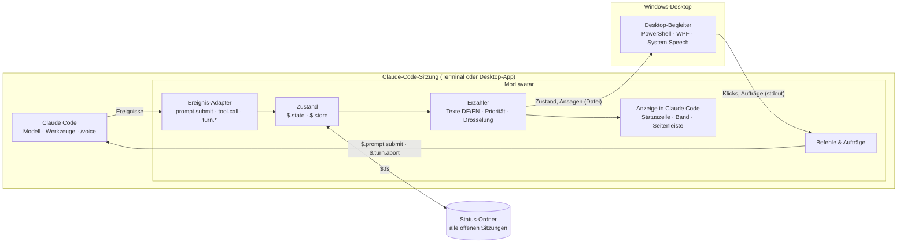
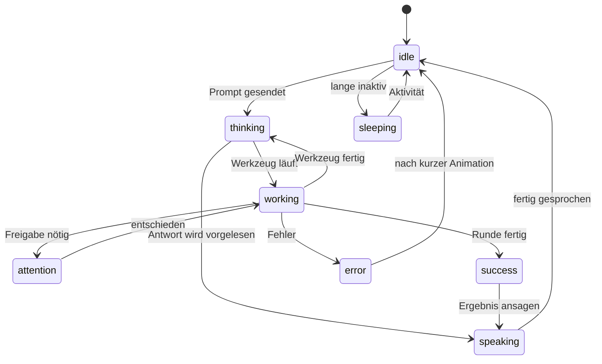
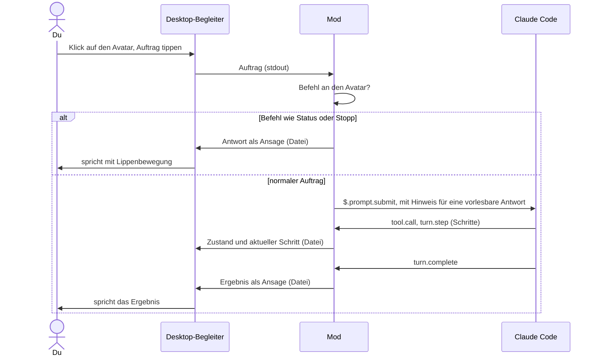

# Claude Desktop Avatar – Projektplan

> **Status:** Entwurf v0.4 · **Stand:** 5. November 2026 · **Neu:** Der Avatar sitzt frei verschiebbar auf dem Desktop, ähnlich wie die Haustiere in der Codex-App. Möglich macht das ein Begleiter-Fenster, das die Mod mit Windows-Bordmitteln startet.
>
> Detailkonzepte: [Mod-Konzept](mod-design.md) · [Avatar-Vorlagen](avatar-templates.md)

## Auf einen Blick

- **Was:** ein Jarvis-artiger Assistent für Claude Code. Er sitzt als animierte Figur irgendwo auf deinem Desktop, hört auf Sprachbefehle, sagt dir, woran Claude gerade arbeitet, und meldet sich, wenn Claude dich braucht.
- **Keine eigene App, kein Installer:** Er ist eine Erweiterung (Plugin mit Mod) für Claude Code, installiert mit einer Zeile und aktiv, solange Claude Code geöffnet ist. Das Desktop-Fenster startet die Mod selbst mit dem, was Windows schon mitbringt: PowerShell, WPF und die Windows-Sprachausgabe.
- **Auf dem Desktop:** transparent, randlos, immer im Vordergrund, frei verschiebbar, mit Sprechblase und Eingabefeld. Klicks neben der Figur gehen an die Fenster darunter.
- **Sprechen:** über die eingebaute Spracheingabe von Claude Code (`/voice`), auf Deutsch und Englisch. Kurze Aufträge lassen sich auch direkt am Desktop-Avatar eintippen.
- **Hören:** Ansagen und kurze Antworten über die Windows-Sprachausgabe, lokal und mit Lippenbewegung.
- **In Claude Code:** zusätzlich Statuszeile, Band über der Eingabe, eigener „Denkt nach"-Spinner und auf Wunsch eine Seitenleiste mit Details. Diese Ansicht dient auch als Rückfall, falls das Desktop-Fenster nicht starten kann.
- **Über dein Abo:** Alles läuft in deiner Sitzung, ohne API-Schlüssel. Plattform: Windows 11. Lizenz: MIT, nicht kommerziell.
- **Weg:** fünf Phasen, vom Machbarkeits-Prototyp über ein MVP (Desktop-Avatar, Live-Schritte, Ansagen) und die Jarvis-Sprachsteuerung bis zu Vorlagen und mehreren Sitzungen.

## 1. Vision & Kernfunktionen

Wie Jarvis bei Iron Man soll der Avatar ein Begleiter sein, mit dem man spricht, statt nur zu tippen. Wie die Haustiere in der Codex-App sitzt er dabei sichtbar auf dem Desktop. Er nimmt Aufträge entgegen, gibt sie an Claude Code weiter und berichtet knapp, was passiert. Er meldet sich, wenn Claude eine Freigabe braucht oder fertig ist. Als Mod nutzt er, was Claude Code schon mitbringt (Sitzung, Abo, Spracheingabe), und ergänzt Präsenz, Stimme und Überblick.

| # | Deine Idee | Umsetzung |
|---|---|---|
| F1 | Avatar auf dem Desktop, verschiebbar | Ein **Desktop-Begleiter**: Die Mod startet ein kleines Windows-Fenster mit dem Avatar, transparent, immer im Vordergrund und überall hin ziehbar. Die Position wird gemerkt. In Claude Code gibt es zusätzlich eine kompakte Anzeige. |
| F2 | Aussehen anpassbar, z. B. über Templates | Vorlagen mit Parametern (Farben, Teile, Name, Stimme, Stil). Die Pixel-Variante dient für Desktop und Terminal, die Vektor-Variante für die Ansicht in der Desktop-App. Angepasst wird mit Live-Vorschau. |
| F3 | Schnell einen Chat starten, per Schrift oder Sprache | `/voice` in Claude Code oder ein Klick auf den Desktop-Avatar, der ein Eingabefeld öffnet. Aufträge gehen als normaler Prompt an deine Sitzung; Befehle an den Avatar selbst („Jarvis, Status") erledigt die Mod direkt. |
| F4 | Aktuelle Schritte aktiver Chats ausgeben, mit Schrift und Ton | Die Mod sieht jeden Werkzeugaufruf, die Aufgabenliste und das Ende jeder Runde. Der Avatar zeigt das in der Sprechblase, spielt Töne und spricht Wichtiges aus. Über einen gemeinsamen Status-Ordner kennt er alle offenen Claude-Code-Sitzungen. |

## 2. Was eine Mod kann – und wie das Desktop-Fenster entsteht

Mods sind Plugins mit einem Hooks-Modul (TypeScript), das sich in die Ereignisse und die Oberfläche von Claude Code einklinkt. Die Oberflächen heißen `terminal`, `desktop` (Code-Tab der Claude-Desktop-App), `vscode` und `mobile`.

| Fähigkeit | Mod-Schnittstelle | Nutzen für den Avatar |
|---|---|---|
| Prozesse starten | `$.process.spawn` (lebt so lange wie die Sitzung) | **startet den Desktop-Begleiter** und liest seine Meldungen |
| Dateien | `$.fs` | Zustand an den Begleiter übergeben, gemeinsamer Status mehrerer Sitzungen, Vorlagen |
| Ereignisse | `session.start`, `prompt.submit`, `tool.call`, `turn.start`, `turn.step`, `turn.complete` | Schritte, Fortschritt, Ende einer Runde |
| Prompts | `$.prompt.submit`, `$.prompt.fill`, `$.prompt.suggest`, `$.turn.abort` | Aufträge senden, Vorschläge machen, „Stopp" |
| KI-Aufrufe über die Sitzung | `$.model.complete`, `$.model.fork`, `$.model.classify` | „Was machst du gerade?", Zusammenfassungen, Befehlserkennung; abgerechnet über dein Abo |
| Anzeige in Claude Code | `$.ui.status`, `ui.render` für `AbovePrompt`, `Spinner` und `Pane`, `$.ui.toast`, `$.ui.notify` | Statuszeile, Band, Spinner, Seitenleiste, Hinweise, Systembenachrichtigung |
| Grafik in Claude Code | `Svg` (Desktop-App, VS Code, Mobil), `Raster` (Terminal) | Avatar in der Seitenleiste |
| Sprachausgabe, Töne | `$.audio.speak`, `$.audio.play` | Rückfall, wenn der Begleiter nicht läuft |
| Speicher, Zeitgeber, Befehle | `$.store`, `$.state`, `$.clock`, `$.command.register`, `userConfig` | Einstellungen, Profil, Animation, `/avatar …` |

**Wie das Desktop-Fenster entsteht:** Über ihre Oberflächen-Schnittstelle kann eine Mod nur in Claude Code zeichnen. Sie darf aber Prozesse starten, die so lange leben wie die Sitzung; die Referenz nennt genau das als Muster. Unter Windows startet die Mod damit die eingebaute Windows PowerShell (5.1) mit einem Skript, das im Plugin liegt. Das Skript öffnet ein WPF-Fenster, das transparent und randlos ist, immer im Vordergrund bleibt und nicht in der Taskleiste erscheint. Windows lässt Klicks auf völlig transparente Pixel eines solchen Fensters an das Fenster darunter durch. So reagiert nur die Figur selbst. Im selben Prozess laufen die Windows-Sprachausgabe (`System.Speech`, mit Viseme-Ereignissen für die Mundbewegung) und der Windows-Player für Töne. Installiert wird nichts: PowerShell, WPF und `System.Speech` gehören zu Windows.

**Zum Vergleich:** Die Haustiere der Codex-App sind in die App eingebaut und schweben als Overlay über dem Desktop. Claude Code selbst hat laut Berichten mit `/buddy` nur ein Haustier im Terminal. Dieser Plan bringt ein Codex-ähnliches Desktop-Haustier zu Claude Code, als Mod mit Begleiter-Fenster.

**Grenzen, die den Plan prägen:**

- **Begleiter nur unter Windows:** Das Fenster nutzt Windows-Bordmittel. Firmenrichtlinien (AppLocker, eingeschränkter PowerShell-Sprachmodus) können es blockieren. Dann bleibt die Anzeige in Claude Code.
- **Kein Mikrofonzugriff der Mod:** Die Spracheingabe läuft über `/voice` und braucht ein Claude-Code-Fenster im Vordergrund. Laut Doku wird das Audio auf Anthropics Servern in Text umgewandelt (siehe Abschnitt 11, Frage A). Gesprochene Aufträge direkt am Desktop-Avatar ginge nur mit der Windows-eigenen Spracherkennung; deren Qualität ist offen.
- **Nur Claude Code:** In normalen Chats von Claude Desktop, in Cowork und auf claude.ai laufen keine Mods.
- **Ohne Begleiter:** `$.audio.play` spielt laut Doku in einem Windows-Terminal nichts ab, und wie sich `$.audio.speak` unter Windows verhält, ist nicht dokumentiert. Beides betrifft nur den Rückfall.

## 3. Nutzungsszenarien

1. **Immer im Blick:** Der Avatar sitzt unten rechts über deinem Browser. Die Sprechblase zeigt „webshop · Schritt 4/6 · Tests ausführen". Braucht Claude eine Freigabe, winkt er, ein Ton erklingt, und er sagt: „Ich brauche deine Freigabe für npm install." Entschieden wird im Dialog von Claude Code, nie per Sprache.
2. **Schnell gefragt:** Du klickst auf den Avatar, tippst „Wie formatiere ich ein Datum nach ISO 8601 in Python?" und drückst Enter. Die Frage geht an deine Claude-Code-Sitzung, und der Avatar liest den Anfang der Antwort vor.
3. **„Jarvis, wie ist der Stand?"** In Claude Code hältst du die Leertaste und fragst. Die Mod erkennt den Befehl und antwortet aus dem gemeinsamen Status: „Webshop: Schritt 4 von 6. Das API-Projekt wartet auf dich."
4. **Auftrag per Stimme:** „Behebe den fehlschlagenden Checkout-Test." Der Avatar meldet die Schritte in der Sprechblase und sagt am Ende: „Fertig. Alle Tests sind grün."
5. **„Jarvis, stopp!"** Die laufende Runde wird abgebrochen.
6. **Eigener Look und Ruhe:** Mit `/avatar aussehen` wählst du Vorlage, Farbe, Name, Stimme und Stil. Läuft eine Präsentation oder eine Vollbild-App, blendet sich der Avatar aus.

## 4. Anforderungen

Prioritäten: **M** = Muss (MVP) · **S** = Soll · **K** = Kann (später)

### 4.1 Funktional

**F1 – Präsenz**

| ID | Anforderung | Prio |
|---|---|---|
| F1.1 | Desktop-Avatar: transparentes, randloses Fenster, immer im Vordergrund, nicht in der Taskleiste, stiehlt keinen Fokus | M |
| F1.2 | Frei verschiebbar per Ziehen; Position pro Monitor-Anordnung gemerkt; nach einem Monitorwechsel wieder im sichtbaren Bereich | M |
| F1.3 | Klicks neben der Figur gehen an die Fenster darunter | M |
| F1.4 | Sprechblase mit aktuellem Schritt, Fortschritt und kurzen Antworten | M |
| F1.5 | Rechtsklick-Menü: Status, leise, Aussehen, ausblenden, beenden | M |
| F1.6 | Bei Vollbild-Apps und Präsentationen automatisch ausblenden bzw. stumm | S |
| F1.7 | In Claude Code: Statuszeile, Band über der Eingabe, eigener Spinner | M |
| F1.8 | In Claude Code: Seitenleiste mit Details und anderen Sitzungen; Rückfall, wenn das Desktop-Fenster nicht starten kann | S |
| F1.9 | HUD-Hintergrund in der Desktop-App | K |

**F2 – Aussehen**

| ID | Anforderung | Prio |
|---|---|---|
| F2.1 | 2 mitgelieferte Vorlagen mit Pixel-Variante (Desktop, Terminal) und Vektor-Variante (Seitenleiste der Desktop-App) | M |
| F2.2 | Farben, Teile, Name, Stimme, Stil und Größe anpassen, mit Live-Vorschau | M |
| F2.3 | Eigene Vorlagen als Ordner, mit automatischem Neuladen beim Bearbeiten | S |
| F2.4 | Profile exportieren und importieren, Vorlagen teilen | K |

**F3 – Sprechen & Hören**

| ID | Anforderung | Prio |
|---|---|---|
| F3.1 | Spracheingabe über `/voice` (Deutsch und Englisch), mit Einrichtungshilfe | M |
| F3.2 | Klick auf den Desktop-Avatar öffnet ein Eingabefeld für schnelle Aufträge | S |
| F3.3 | Befehle an den Avatar selbst („<Name>, Status / stopp / leiser / Zusammenfassung") erledigt die Mod, ohne Claude zu fragen | S |
| F3.4 | Antworten vorlesen (kurzer, vorlesbarer Einstieg) mit Lippenbewegung am Desktop-Avatar | M |
| F3.5 | „Stopp" bricht die laufende Runde ab | S |
| F3.6 | Spracheingabe direkt am Desktop-Avatar (Maustaste halten), lokal über die Windows-Spracherkennung | K |

**F4 – Live-Schritte & Ansagen**

| ID | Anforderung | Prio |
|---|---|---|
| F4.1 | Schritte aus Werkzeugaufrufen, Fortschritt aus der Aufgabenliste („Schritt 3/7") | M |
| F4.2 | Dringendes (Freigabe nötig, Fehler) mit Animation, Ton, Ansage und Systembenachrichtigung | M |
| F4.3 | Ausführlichkeitsstufen, Ruhezeiten, Bündelung und Drosselung | M |
| F4.4 | Überblick über alle offenen Claude-Code-Sitzungen; ein einziger Desktop-Avatar für alle; nur eine Instanz spricht | S |
| F4.5 | „Was machst du gerade?" als KI-Zusammenfassung aus der Sitzung | S |
| F4.6 | Hinweis auf Nutzungslimits des Abos | K |
| F4.7 | Normale Claude-Desktop-Chats über eine kleine Desktop-Erweiterung (`.mcpb`), die in den gemeinsamen Status meldet | K |

### 4.2 Nicht-funktional

| Bereich | Ziel |
|---|---|
| Installation | nur das Plugin. Der Begleiter nutzt Windows PowerShell 5.1, WPF und `System.Speech`, die in Windows enthalten sind; keine Downloads |
| Robustheit | Die Mod darf die Sitzung nie stören: Jeder Hook reicht an `next(e)` weiter. Stürzt der Begleiter ab, startet ihn die Mod neu (höchstens dreimal) und wechselt sonst zur Anzeige in Claude Code |
| Ressourcen | Begleiter im Leerlauf unter 1 % CPU und unter 150 MB RAM (in Phase 0 messen); Animation höchstens ca. 12 Bilder pro Sekunde, im Leerlauf weniger |
| Latenz | Schritt bis Anzeige unter 300 ms; Ansage beginnt unter 1 s nach dem Ereignis; Start des Begleiters unter 3 s |
| Datenschutz | Es verlässt nichts den Rechner, was Claude Code nicht ohnehin sendet; Ausnahme ist das Audio von `/voice` (Abschnitt 11) |
| Plattform | Windows 11; Claude Code im Terminal oder im Code-Tab der Desktop-App. Der Desktop-Avatar funktioniert in beiden Fällen gleich |
| Sprachen | Deutsch und Englisch, abhängig von der Spracheinstellung von Claude Code (`language`) |
| Barrierefreiheit | alles Gesprochene auch als Text; Animationen abschaltbar; der Avatar lässt sich jederzeit ausblenden |

### 4.3 Nicht-Ziele

- keine eigene App und kein Installer; das Begleiter-Fenster ist ein Skript der Mod
- kein Auslesen normaler Claude-Desktop- oder claude.ai-Chats auf inoffiziellen Wegen
- kein API-Schlüssel-Modus, keine kommerzielle Nutzung, kein 3D
- vorerst keine Versionen für macOS oder Linux

## 5. Architektur



- **Ereignis-Adapter:** übersetzt die Ereignisse der Sitzung in ein kleines, eigenes Ereignismodell.
- **Zustand und Erzähler:** halten Avatar-Zustand, Plan und letzte Schritte und entscheiden, was als Text, Ton oder Ansage ausgegeben wird.
- **Desktop-Begleiter:** ein PowerShell-Skript im Plugin, das die Mod beim Start der Sitzung über `$.process.spawn` startet. Es zeichnet den Avatar, die Sprechblase und das Eingabefeld, spricht über `System.Speech` mit Lippenbewegung und spielt Töne. Den Zustand liest es aus einer Datei, die die Mod schreibt; Klicks und getippte Aufträge meldet es über seine Ausgabe (stdout) zurück.
- **Befehle & Aufträge:** erledigen Befehle an den Avatar selbst oder schicken Aufträge per `$.prompt.submit` an die Sitzung.
- **Gemeinsamer Status-Ordner:** Jede Sitzung schreibt ihren Stand in eine kleine Datei. Nur eine Sitzung startet den Desktop-Avatar und spricht, und er zeigt alle Sitzungen.

Details stehen im [Mod-Konzept](mod-design.md).

### 5.1 Avatar-Zustände



### 5.2 Ablauf: Auftrag am Desktop-Avatar



## 6. Technologie

| Thema | Entscheidung | Begründung |
|---|---|---|
| Form | Claude-Code-Plugin mit Hooks-Modul (Mod) | keine eigene App, kein Installer; Installation über `/plugin install` |
| Mod-Code | TypeScript (TSX): `hooks/register.tsx` plus eigene Module unter `src/`, statisch importiert | Die Mod-Schnittstelle ist TypeScript; dynamisches `import()` ist nicht erlaubt |
| Desktop-Begleiter | Windows PowerShell 5.1 mit WPF (`AllowsTransparency`, `Topmost`, `DragMove`) | in Windows enthalten; transparente Pixel lassen Klicks durch |
| Sprachausgabe | `System.Speech` im Begleiter: Stimmen je Sprache, Abbrechen, Viseme-Ereignisse für die Mundbewegung; ohne Begleiter `$.audio.speak` | lokal, in Windows enthalten |
| Töne | Windows-Player (`System.Media.SoundPlayer`, WAV) im Begleiter | `$.audio.play` ist im Windows-Terminal stumm |
| Spracheingabe | `/voice` von Claude Code | eingebaut, Deutsch und Englisch, über das Abo, verbraucht keine Tokens |
| Verbindung Mod ↔ Begleiter | Mod → Begleiter: Zustandsdatei (vom Begleiter überwacht); Begleiter → Mod: JSON-Zeilen auf stdout | `$.process.spawn` schreibt stdin nur einmal beim Start; stdout kommt laufend an |
| Grafik | Desktop: Pixel-Vorlagen, scharf vergrößert. In Claude Code: `Svg` in der Desktop-App, `Raster` mit Halbblock-Zeichen im Terminal | WPF zeigt SVG nicht direkt an; Pixel-Art sieht in jeder Größe scharf aus |
| KI-Hilfen | `$.model.fork` und `$.model.complete` mit `haiku` | über die Sitzung abgerechnet; nur auf Anfrage oder sparsam |
| Tests | `claude plugin validate`, `claude plugin test` (Terminal und Desktop); Pester-Tests für das Skript des Begleiters | offizielle Werkzeuge für Mods, Standard für PowerShell |
| Entwicklung | `claude --plugin-dir <Ordner>` bzw. `CLAUDE_CODE_PLUGIN_DIRS` mit automatischem Neuladen | schnelle Schleife ohne Neuinstallation |

## 7. Datenschutz & Sicherheit

- **Nichts Zusätzliches nach außen:** Mod und Begleiter senden selbst nichts ins Internet. KI-Aufrufe der Mod laufen über deine Sitzung und dein Abo, wie jeder Prompt.
- **Spracheingabe:** `/voice` überträgt das Audio zur Umwandlung in Text an Anthropic. Die Mod weist bei der Einrichtung darauf hin.
- **Sprachausgabe:** lokal über Windows.
- **Begleiter:** Das Skript liegt als lesbarer Text im Plugin. Die Mod startet es mit einer festen Argumentliste, ohne Shell-Zeichenkette und ohne verschlüsselte Befehle. Der Begleiter liest nur seine Zustandsdatei und die Vorlagen, schreibt nur seine Position und öffnet keine Netzwerkverbindung.
- **Dateien im Benutzerprofil:** Zustand, Status-Ordner und Position enthalten nur kurze, reduzierte Angaben (Projektname, Zustand, aktueller Schritt, Fortschritt), keine Dateiinhalte, Befehle im Wortlaut oder Prompts. Veraltete Dateien werden aufgeräumt.
- **Freigaben:** Die Mod entscheidet nie selbst über Werkzeug-Freigaben und nimmt sie nie per Sprache entgegen; sie kündigt sie nur an.
- **Aufträge vom Desktop-Avatar:** gehen als normaler Prompt in die Sitzung, mit allen Freigabe-Regeln von Claude Code.
- **Vorlagen:** reine Daten; weder Mod noch Begleiter führen etwas daraus aus.

## 8. Projektstruktur (Vorschlag)

Das Repository ist zugleich die Mod und ihr Marketplace:

```text
claude-desktop-avatar/
├── .claude-plugin/
│   ├── plugin.json            # Manifest der Mod (Name, Version, userConfig, types)
│   └── marketplace.json       # macht das Repo installierbar
├── hooks/
│   ├── hooks.json             # { "modules": ["./register.tsx"] }
│   └── register.tsx           # Einstieg: registriert alle Hooks
├── src/
│   ├── events.ts              # Ereignis-Adapter
│   ├── narrator.ts            # Texte DE/EN, Stufen, Drosselung
│   ├── voice.ts               # Befehle, Vorlesen, Warteschlange
│   ├── companion.ts           # Begleiter starten, überwachen, Zustandsdatei schreiben
│   ├── sessions.ts            # gemeinsamer Status-Ordner, Sprecher-Wahl
│   ├── templates.ts           # Vorlagen laden und prüfen
│   └── render/                # Statuszeile, Band, Spinner, Seitenleiste
├── companion/
│   └── avatar.ps1             # Desktop-Begleiter (WPF, System.Speech, Töne)
├── templates/                 # mitgelieferte Vorlagen
├── sounds/                    # Hinweistöne (WAV)
├── types/index.d.ts           # Typvertrag für $.state
├── tests/                     # claude plugin test, Pester
└── docs/                      # Plan und Konzepte
```

## 9. Roadmap

Die Aufwände sind eine grobe Orientierung für eine Person in Vollzeit.

### Phase 0 – Machbarkeit (ca. 1–1,5 Wochen)

Ein Prototyp prüft unter Windows:

- **Begleiter-Fenster:** Start über `$.process.spawn` aus Terminal und Desktop-App (ohne aufblitzendes Konsolenfenster), Transparenz, Klicks durch transparente Pixel, Ziehen, immer im Vordergrund, mehrere Monitore mit unterschiedlicher Skalierung, Start- und Speicherbedarf, Beenden mit der Sitzung
- **Sprachausgabe im Begleiter:** Stimmen für Deutsch und Englisch, Abbrechen, Viseme-Ereignisse für die Mundbewegung; Töne über den Windows-Player
- **Verbindung:** Zustandsdatei hin, stdout zurück, Latenz
- **Sitzung:** welche Daten `tool.call`, `turn.step` und `turn.complete` liefern, wie „Freigabe nötig" erkennbar ist (`tool.check` oder Benachrichtigungs-Ereignis)
- **`/voice`:** Tap-Modus mit automatischem Senden; Befehle wie „<Name>, Status" in `prompt.submit` erkennen
- **Mehrere Sitzungen:** gemeinsamer Status-Ordner und Sprecher-Wahl mit zwei offenen Sitzungen
- **Rückfall:** Anzeige in Claude Code und `$.audio.speak`, wenn der Begleiter nicht startet

**Fertig, wenn:** zu jedem Punkt ein Ergebnis und, wo nötig, eine Entscheidung dokumentiert ist.

### Phase 1 – MVP „Sehen & Hören" (ca. 3 Wochen)

- Desktop-Avatar mit 2 Vorlagen, Zuständen, Sprechblase, Ziehen, gemerkter Position, Rechtsklick-Menü und Ausblenden
- Erzähler auf Deutsch und Englisch mit Ausführlichkeitsstufen
- Ansagen für „Freigabe nötig", „fertig" und „Fehler" mit Ton, Lippenbewegung und Systembenachrichtigung
- In Claude Code: Statuszeile, Band, Spinner; `/avatar` mit den wichtigsten Befehlen; Optionen bei der Installation
- Marketplace in diesem Repo; Tests für Mod und Begleiter

**Fertig, wenn:**

- die Mod mit einer Zeile installiert ist und der Avatar beim Start von Claude Code auf dem Desktop erscheint, dort, wo er zuletzt war,
- ein Werkzeugschritt in unter 300 ms in der Sprechblase steht,
- eine Freigabe-Anfrage mit Animation, Ton und Ansage gemeldet wird,
- der Avatar mit dem Schließen der letzten Sitzung verschwindet und Fehler die Sitzung nie stören.

### Phase 2 – Jarvis-Sprachsteuerung & schnelle Aufträge (ca. 2 Wochen)

- Einrichtungshilfe für `/voice`; Befehle an den Avatar (Status, Stopp, leiser/lauter, Zusammenfassung)
- Eingabefeld am Desktop-Avatar für schnelle Aufträge
- Vorlesen mit vorlesbarem Einstieg; „Was machst du gerade?" über `$.model.fork`; Begrüßung; Persona-Stile (knapp, freundlich, Butler)

**Fertig, wenn:** ein Auftrag per Stimme oder per Klick auf den Avatar vollständig läuft (absenden, Schritte sehen, Ergebnis hören) und „Stopp" die Runde zuverlässig abbricht.

### Phase 3 – Aussehen & Vorlagen (ca. 2 Wochen)

- Vorlagenformat v1, Anpassen mit Live-Vorschau am Desktop-Avatar
- eigene Vorlagen im Benutzerordner mit automatischem Neuladen und verständlichen Prüffehlern
- 3–5 Vorlagen, Anleitung für Vorlagen-Ersteller; Seitenleiste mit Vektor-Avatar in der Desktop-App

**Fertig, wenn:** sich eine neue Vorlage ohne Änderung am Code erstellen, prüfen und nutzen lässt.

### Phase 4 – Mehrere Sitzungen & Feinschliff (ca. 2 Wochen)

- ein Desktop-Avatar für alle Sitzungen, Sprecher-Wahl, Aufträge an eine gewählte Sitzung
- Ausblenden bei Vollbild und Präsentationen, Hinweise auf Nutzungslimits, Barrierefreiheit, README mit Installationszeile
- Optional: Spracheingabe am Desktop-Avatar (F3.6), Desktop-Erweiterung für normale Claude-Desktop-Chats (F4.7)

**Fertig, wenn:** mit drei offenen Sitzungen genau ein Avatar auf dem Desktop sitzt, jede Meldung genau einmal angesagt wird und die Sprechblase alle drei kennt.

## 10. Risiken & Gegenmaßnahmen

| Risiko | Auswirkung | Gegenmaßnahme |
|---|---|---|
| Firmenrichtlinien blockieren PowerShell-Skripte oder schränken die Sprache ein (AppLocker, eingeschränkter Sprachmodus) | kein Desktop-Avatar | sauber erkennen und auf die Anzeige in Claude Code wechseln; im README erklären |
| Virenscanner beäugen PowerShell-Prozesse | Begleiter wird blockiert | lesbares Skript, keine verschlüsselten Befehle, keine Tastatur-Hooks, kein Netzwerk |
| Beim Start aus der Desktop-App blitzt ein Konsolenfenster auf | störend | in Phase 0 prüfen; der Begleiter blendet nur eine eigene Konsole aus, nie das Terminal |
| Unscharfe Darstellung auf Monitoren mit unterschiedlicher Skalierung | weniger schön | DPI-Bewusstsein pro Monitor aktivieren (Phase 0); Pixel-Art mit Nearest-Neighbor skalieren |
| Begleiter stürzt ab oder hängt | Avatar verschwindet | Herzschlag überwachen, bis zu dreimal neu starten, dann Rückfall |
| Die Mod-Schnittstelle ist jung und ändert sich | Teile brechen nach Updates | Mindestversion von Claude Code, Tests mit `claude plugin test`, Änderungen verfolgen |
| `/voice` schickt das Audio an Anthropic | widerspricht „Sprache lokal" | Entscheidung bei dir (Abschnitt 11, Frage A); optional Windows-Spracherkennung am Desktop-Avatar |
| `/voice` braucht die Anmeldung mit dem Claude-Konto; ein gesetzter `ANTHROPIC_API_KEY` schaltet es ab | keine Spracheingabe | Hinweis in der Einrichtung |
| Mehrere Sitzungen sprechen gleichzeitig oder starten mehrere Avatare | doppelt | Sprecher-Wahl über eine Lock-Datei mit Herzschlag; nur der Sprecher startet den Begleiter |
| Ansagen nerven | Mod wird abgeschaltet | zurückhaltende Standards, Bündelung, Ruhezeiten, `/avatar leise`, Ausblenden per Rechtsklick |
| Name „Jarvis" ist eine Marke von Marvel | Ärger bei öffentlicher Verbreitung | Standardname neutral, Umbenennen in den Einstellungen; „Jarvis" nur als persönliche Wahl |

## 11. Entscheidungen & offene Fragen

**Entschieden:**

| # | Frage | Entscheidung | Folgen im Plan |
|---|---|---|---|
| 1 | Plattform | Windows | Windows 11; Claude Code im Terminal oder in der Desktop-App |
| 2 | Welche Chats? | alle | alle Claude-Code-Sitzungen mit gemeinsamem Überblick. Normale Desktop-Chats, Cowork und claude.ai erreichen Mods nicht; für Desktop-Chats bleibt eine kleine Erweiterung als spätere Option (F4.7) |
| 3 | Bezahlung | vorerst nur über das Abo | erfüllt: Die Mod ist Teil deiner Sitzung |
| 4 | Sprache lokal oder Cloud? | lokal, Cloud optional | Sprachausgabe lokal; Spracheingabe siehe Frage A |
| 5 | 2D oder 3D? | nur 2D | Pixel und Vektor (SVG) |
| 6 | Name | vorerst so lassen | Arbeitstitel bleibt; die Mod heißt `avatar`, der Name des Assistenten ist frei wählbar |
| 7 | Lizenz | MIT | `LICENSE` liegt im Repo |
| 8 | Sprachen | Deutsch und Englisch | beide von Anfang an |
| 9 | Auslieferung | Mod für Claude Code, kein Installer, nicht kommerziell | Plan ab v0.3 |
| 10 | Avatar frei auf dem Desktop? | ja, wie die Haustiere in der Codex-App | Desktop-Begleiter mit Windows-Bordmitteln, gestartet von der Mod (v0.4) |

**Offene Frage:**

- **A – Spracheingabe:** Ist `/voice` in Ordnung, obwohl das Audio bei Anthropic in Text umgewandelt wird? Empfehlung: ja, denn der Text geht als Prompt ohnehin an Anthropic, die Erkennung ist gut, und es ist nichts zu installieren. Allerdings muss dafür ein Claude-Code-Fenster im Vordergrund sein. Die lokale Alternative wäre die Windows-eigene Spracherkennung direkt am Desktop-Avatar (Maustaste halten). Ihre Qualität, vor allem für Deutsch, müsste Phase 0 erst prüfen.

## 12. Nächste Schritte

1. Frage A klären.
2. Phase 0: Prototyp der Mod und des Begleiter-Fensters schreiben und unter Windows ausprobieren.
3. Ergebnisse als ADRs unter `docs/adr/` festhalten.
4. Pro Phase einen GitHub-Meilenstein mit Issues anlegen.
