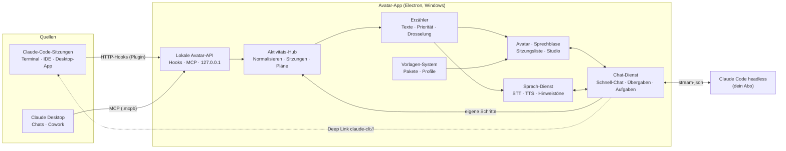
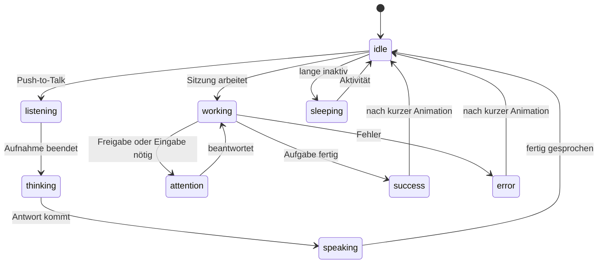
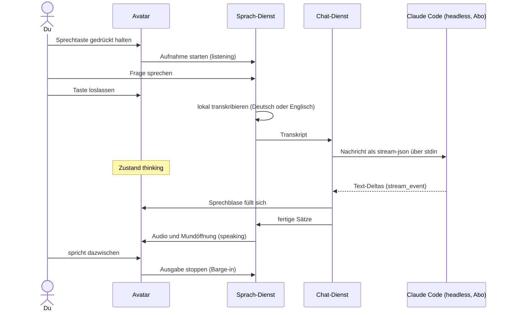
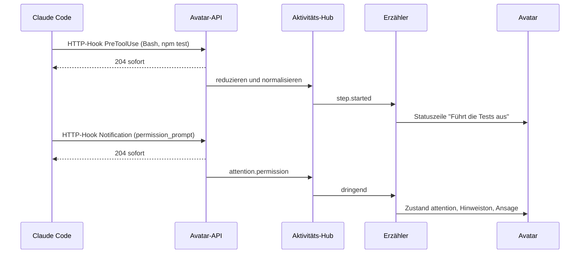

# Claude Desktop Avatar – Projektplan

> **Status:** Entwurf v0.2 · **Stand:** 5. November 2026 · Deine Entscheidungen zu den offenen Fragen sind eingearbeitet (Abschnitt 11).
>
> Detailkonzepte: [Avatar-Vorlagen](avatar-templates.md) · [Anbindung an Claude](claude-integration.md)

## Auf einen Blick

- **Was:** Ein Desktop-Begleiter für Windows, der frei verschiebbar über allen Fenstern sitzt, per Klick, Tastenkürzel oder Stimme einen Claude-Chat startet und dir mit Text und Ton erzählt, woran deine Claude-Sitzungen gerade arbeiten.
- **Plattform:** Windows 11. macOS und Linux sind vorerst nicht geplant.
- **Aussehen:** 2D-Vorlagen (SVG, Sprites, optional Rive) mit anpassbaren Farben, Teilen, Größe, Stimme, Name und Persönlichkeit. Eigene Vorlagen entstehen ohne Programmierung.
- **Chat über dein Abo:** Der Avatar steuert dein installiertes, angemeldetes Claude Code im Hintergrund oder übergibt Aufgaben per Deep Link an ein Terminal. Ein API-Schlüssel ist nicht nötig, und der Avatar fasst keine Zugangsdaten an.
- **Live-Schritte aus allen Chats, soweit technisch möglich:** Claude-Code-Sitzungen vollständig über ein Plugin mit offiziellen HTTP-Hooks; Chats und Cowork-Aufgaben in Claude Desktop teilweise über einen MCP-Server des Avatars. claude.ai im Browser, Cloud-Sitzungen und die Smartphone-Apps sind nicht erreichbar.
- **Sprachen:** Oberfläche, Ansagen und Sprachsteuerung auf Deutsch und Englisch.
- **Technik:** Electron, TypeScript und React. Sprache läuft lokal (whisper.cpp, Windows-Stimmen oder Piper), Cloud-Dienste sind optional. Lizenz: MIT.
- **Weg:** sechs Phasen, von Machbarkeits-Spikes über ein MVP (Avatar, Live-Schritte, Text-Chat) bis zu Stimme, Claude-Desktop-Anbindung, Vorlagen-Studio und Release.

## 1. Vision & Kernfunktionen

Claude arbeitet zunehmend selbstständig, oft in mehreren Sitzungen gleichzeitig. Der Avatar macht diese Arbeit sichtbar, ohne dass du zwischen Terminals und Fenstern wechseln musst, und er ist der kürzeste Weg zu einer neuen Frage. Er soll sich wie ein persönlicher Begleiter anfühlen: individuell gestaltet, unaufdringlich und nur dann laut, wenn es wichtig ist.

| # | Deine Idee | Umsetzung im Plan |
|---|---|---|
| F1 | Avatar auf dem Desktop, verschiebbar | Transparentes, rahmenloses Fenster, immer im Vordergrund und außerhalb der Figur klick-durchlässig. Ziehen mit der Maus; die Position wird pro Monitor-Anordnung gemerkt. |
| F2 | Aussehen anpassbar, z. B. über Templates | 2D-Vorlagen mit Parametern, Avatar-Profile, Avatar-Studio mit Live-Vorschau, Import/Export als `.avatarpack` |
| F3 | Schnell einen Chat starten, per Schrift oder Sprache | Klick, globales Tastenkürzel oder Push-to-Talk mit lokaler Spracherkennung. Die Antwort kommt über dein Abo (lokales Claude Code), erscheint in der Sprechblase und wird auf Wunsch vorgelesen. |
| F4 | Aktuelle Schritte aktiver Chats ausgeben, mit Schrift und Ton | Ein Aktivitäts-Hub sammelt Ereignisse aus Claude Code, eigenen Chats und Claude Desktop. Ein „Erzähler" formuliert kurze Texte, spielt Hinweistöne und spricht Wichtiges aus. |

**Abgrenzung:** Der Avatar ersetzt Claude Desktop nicht. Er nutzt dein Abo über das offizielle Claude Code und ergänzt es um Präsenz, Sprachsteuerung und Live-Schritte. Unter Windows schließt er außerdem eine Lücke: Die Schnelleingabe „Quick Entry" von Claude Desktop gibt es bisher nur auf dem Mac.

## 2. Nutzungsszenarien

1. **Parallel arbeiten:** Du lässt drei Claude-Code-Sitzungen in verschiedenen Projekten laufen. Am Avatar steht „webshop · Schritt 4/6 · Tests ausführen". Braucht eine Sitzung eine Freigabe, winkt der Avatar, spielt einen Ton und sagt: „Webshop braucht deine Freigabe."
2. **Kurze Frage nebenbei:** Du hältst die Sprechtaste gedrückt und fragst: „Wie formatiere ich in Python ein Datum nach ISO 8601?" Die Antwort kommt über dein Abo, erscheint in der Sprechblase und wird vorgelesen. Das Codebeispiel öffnest du im erweiterten Panel. Fragst du auf Englisch, antwortet der Avatar auf Englisch.
3. **Aufgabe delegieren:** „Starte im Projekt Webshop: Behebe den fehlschlagenden Checkout-Test." Der Avatar fragt nach und öffnet Claude Code im Projektordner mit vorbefülltem Auftrag. Du bestätigst mit Enter, danach erscheint der Fortschritt am Avatar.
4. **Desktop-Chat im Blick:** In Claude Desktop läuft eine längere Recherche. Über den MCP-Server des Avatars meldet Claude „Recherche · Quellen vergleichen", und sobald das Ergebnis fertig ist, sagt der Avatar Bescheid.
5. **Eigener Look:** Du wählst die Vorlage „Blob", stellst Petrol als Farbe ein, setzt ihm Kopfhörer auf, nennst ihn „Pixel" und gibst ihm eine ruhigere Stimme. Das Profil teilst du als Datei mit deinem Team.
6. **Konzentriert arbeiten:** Im Nicht-stören-Modus oder während einer Präsentation schläft der Avatar. Nur dringende Hinweise kommen als dezenter Ton.

## 3. Anforderungen

Prioritäten: **M** = Muss (MVP) · **S** = Soll · **K** = Kann (später)

### 3.1 Funktional

**F1 – Desktop-Präsenz**

| ID | Anforderung | Prio |
|---|---|---|
| F1.1 | Transparentes, rahmenloses Fenster über allen anderen Fenstern, nicht in der Taskleiste | M |
| F1.2 | Ziehen verschiebt den Avatar, ein Klick ohne Bewegung öffnet den Schnell-Chat, ein Rechtsklick das Kontextmenü | M |
| F1.3 | Klicks außerhalb der Figur gehen an die Fenster darunter | M |
| F1.4 | Die Position wird pro Monitor-Anordnung gemerkt; nach einem Monitorwechsel landet der Avatar wieder im sichtbaren Bereich | M |
| F1.5 | Symbol im Infobereich der Taskleiste: ein-/ausblenden, Nicht stören, Profil wechseln, Sprache, Einstellungen, Beenden | M |
| F1.6 | Autostart mit Windows | S |
| F1.7 | Andocken am Bildschirmrand, Größe änderbar | S |
| F1.8 | Augen folgen dem Mauszeiger, Leerlauf-Animationen, Einschlafen bei Inaktivität | K |
| F1.9 | Bei Vollbild-Apps, Präsentationen und Windows-Ruhezeiten automatisch ausblenden bzw. stumm schalten | S |

**F2 – Anpassbarkeit**

| ID | Anforderung | Prio |
|---|---|---|
| F2.1 | Mitgelieferte Vorlagen: mindestens 2 im MVP, 3–5 bis Phase 4 | M |
| F2.2 | Parameter einer Vorlage (Farben, Teile, Größe) mit Live-Vorschau ändern | M |
| F2.3 | Avatar-Profile (Vorlage + Werte + Name + Stimme + Persona), mehrere Profile umschaltbar | S |
| F2.4 | Import/Export von Vorlagen und Profilen (`.avatarpack`) | S |
| F2.5 | Eigene Vorlagen ohne App-Änderung: Ordner + `avatar.json`, Entwicklermodus mit Hot Reload und Validierung | S |
| F2.6 | Renderer: SVG (M), Sprites (S), Rive (K); kein 3D | – |
| F2.7 | Texte in Vorlagen (Namen, Beschriftungen, Begrüßung) auf Deutsch und Englisch | S |
| F2.8 | Community-Galerie für Vorlagen | K |

**F3 – Schnell-Chat**

| ID | Anforderung | Prio |
|---|---|---|
| F3.1 | Texteingabe per Klick oder globalem Tastenkürzel; die Antwort kommt über dein lokales Claude Code (Abo), wird in die Sprechblase gestreamt und lässt sich zum Panel erweitern (Markdown, Code kopieren) | M |
| F3.2 | Die Einrichtung prüft, ob Claude Code installiert und mit dem Abo angemeldet ist, und hilft sonst weiter | M |
| F3.3 | Verlauf lokal speichern, „Neuer Chat", Modell wählbar (Opus, Sonnet, Haiku) | M |
| F3.4 | Spracheingabe per Push-to-Talk mit lokaler Spracherkennung (Deutsch und Englisch) | M (Phase 2) |
| F3.5 | Antworten vorlesen mit Lippen-Sync; Unterbrechen durch Sprechen oder Klick (Barge-in) | S |
| F3.6 | Aufgabe an Claude Code übergeben: Projekt wählen, Deep Link mit vorbefülltem Auftrag | S |
| F3.7 | „Frag nach dem Stand": Der Chat kennt die aktiven Sitzungen (nur reduzierte Zusammenfassungen) | S |
| F3.8 | Hintergrund-Aufgaben in einem Projekt (Claude Code headless) mit Freigaben am Avatar | K |
| F3.9 | Kontext anhängen: Zwischenablage, Screenshot (nur auf ausdrücklichen Klick) | K |
| F3.10 | Aktivierungswort („Hey Pixel"), lokal und opt-in | K |

**F4 – Live-Schritte**

| ID | Anforderung | Prio |
|---|---|---|
| F4.1 | Claude-Code-Sitzungen (Terminal, IDE, Code-Tab der Desktop-App) über ein Plugin anbinden (HTTP-Hooks) | M |
| F4.2 | Anzeige pro Sitzung: aktueller Schritt, Fortschritt der Aufgabenliste („Schritt 3/7"), Status (arbeitet, wartet, fertig, Fehler) | M |
| F4.3 | Dringendes (Freigabe oder Eingabe nötig, Abbruch) mit Zustand `attention`, Hinweiston und Sprachansage | M |
| F4.4 | Sitzungsliste mit Projektname, Status und letztem Schritt; einzelne Sitzungen stummschaltbar | M |
| F4.5 | Bündelung und Drosselung, damit keine Ansage-Flut entsteht | M |
| F4.6 | Ausführlichkeitsstufen (Still, Normal, Gesprächig), getrennt für Text und Ton; Ruhezeiten | S |
| F4.7 | Chats und Cowork-Aufgaben in Claude Desktop über den MCP-Server des Avatars (`avatar_status`, `avatar_say`) | S |
| F4.8 | Optionaler MCP-Proxy: vorhandene MCP-Server durch den Avatar leiten, um ihre Werkzeugaufrufe in Desktop-Chats als Schritte zu sehen | K |
| F4.9 | Freigaben direkt am Avatar beantworten (opt-in) | K |
| F4.10 | Optionale KI-Zusammenfassung längerer Schrittfolgen | K |

### 3.2 Nicht-funktional

| Bereich | Ziel |
|---|---|
| Ressourcen | Leerlauf unter 1 % CPU; RAM-Ziel unter 250 MB (in Phase 0 messen); flüssige Animation mit 60 fps, im Leerlauf gedrosselt |
| Latenz | Hook bis Anzeige unter 300 ms; die Avatar-API beantwortet Hooks in unter 10 ms; Sprache: erste Audioausgabe unter 3 s nach Ende der Frage (Ziel, mit dauerhaft laufendem Chat-Prozess) |
| Robustheit | Claude Code arbeitet unverändert weiter, wenn der Avatar nicht läuft oder hängt (fail-open) |
| Voraussetzungen | Claude-Abo und installiertes Claude Code; kein API-Schlüssel |
| Datenschutz | Lokal zuerst, keine Telemetrie. Cloud-Dienste für Sprache nur nach ausdrücklicher Aktivierung |
| Sicherheit | Electron-Härtung (Context Isolation, Sandbox, CSP), lokale API nur auf Loopback, keine Claude-Zugangsdaten im Avatar, Vorlagen sind reine Daten |
| Plattform | Windows 11 (x64; ARM64 später), Windows 10 ohne Garantie. Die Kernpakete bleiben plattformunabhängig, damit macOS oder Linux später möglich sind |
| Barrierefreiheit | Tastaturbedienung, Screenreader-Beschriftungen, Windows-Einstellung für reduzierte Animationen, jede Sprachausgabe auch als Text |
| Sprachen | Deutsch und Englisch von Anfang an (Oberfläche, Erzähler, Sprachein- und -ausgabe); Standard ist die Windows-Anzeigesprache |

### 3.3 Nicht-Ziele (vorerst)

- Kein Auslesen von claude.ai- oder Claude-Desktop-Chats auf inoffiziellen Wegen (Auslesen der Oberfläche, Screen-Scraping, interne Datenformate)
- Keine eigene Anmeldung: Der Avatar fragt keine Claude-Zugangsdaten ab, speichert keine und leitet keine weiter
- Kein API-Schlüssel-Modus (später als zusätzlicher Anbieter möglich)
- Kein 3D, keine Versionen für macOS oder Linux
- Keine Cloud-Synchronisation, keine Mobile-App, kein eigenes Hosting von Sprachmodellen

## 4. Architektur

### 4.1 Überblick



**Grundprinzip:** Alle Quellen liefern Ereignisse an **eine** lokale Avatar-API. Der Aktivitäts-Hub übersetzt sie in ein gemeinsames Ereignismodell, und der Erzähler entscheidet, was als Text, Ton oder Sprache ausgegeben wird. Für eigene Chats startet der Avatar dein installiertes Claude Code als Hintergrundprozess; Anmeldung und Abrechnung bleiben vollständig bei Claude Code. Die Kernlogik (Hub, Erzähler, Zustandsautomaten, Vorlagen-Schema, Claude-Code-Steuerung) liegt in framework-unabhängigen TypeScript-Paketen.

### 4.2 Komponenten

| Komponente | Aufgabe | Technik |
|---|---|---|
| Shell (Main-Prozess) | Fenster, Infobereich-Symbol, globale Tastenkürzel, Autostart, Updates, Windows-Integration | Electron, `globalShortcut`, electron-updater, `koffi` für einzelne Win32-Aufrufe |
| Avatar-Renderer | Vorlage darstellen, Zustände, Lippen-Sync, Trefferfläche | React, Renderer-Adapter (SVG, Sprite, Rive), XState |
| Sprechblase & Panels | Status, Antworten, Eingabe, Sitzungsliste | React, i18next |
| Lokale Avatar-API | Hook-Ereignisse empfangen, MCP-Server per HTTP bereitstellen | Node `http` oder Fastify, nur `127.0.0.1` |
| Aktivitäts-Hub | Ereignisse normalisieren und reduzieren, Sitzungen und Aufgabenlisten verwalten | Kernpaket `core` |
| Erzähler | Ereignisse in kurze Texte, Töne und Ansagen übersetzen (Deutsch/Englisch); Priorität, Bündelung, Drosselung | Kernpaket `core`, i18n |
| Chat-Dienst | Schnell-Chat, Verlauf, Übergaben, Hintergrund-Aufgaben | Paket `claude-code-client` (steuert `claude -p` über `stream-json`), SQLite |
| Sprach-Dienst | Aufnahme, Sprachende-Erkennung, STT, TTS, Wiedergabe-Warteschlange, Barge-in | Web Audio, Silero VAD, whisper.cpp, Windows-Stimmen, Piper |
| Vorlagen-System | Vorlagen laden und prüfen, Profile, Import/Export | Paket `avatar-format` (Zod, JSON Schema), DOMPurify |
| Claude-Code-Plugin | Hook-Ereignisse an die Avatar-API senden | `plugins/avatar-bridge` (nur Konfiguration) |
| MCP-Server | Avatar-Werkzeuge für den eigenen Chat (HTTP) und für Claude Desktop (stdio-Brücke als `.mcpb`); optional MCP-Proxy | `@modelcontextprotocol/sdk` |

### 4.3 Fenster & Interaktion

| Fenster | Eigenschaften |
|---|---|
| Avatar | transparent, rahmenlos, immer im Vordergrund, nicht in der Taskleiste, stiehlt keinen Fokus; außerhalb der Figur klick-durchlässig |
| Sprechblase | folgt dem Avatar und richtet sich nach dem Bildschirmrand aus; zeigt Status, Antworten und Aktionsknöpfe |
| Schnell-Chat | kleines, fokussierbares Eingabe-Panel am Avatar; Esc schließt es; per Tastenkürzel von überall erreichbar |
| Sitzungen | Popover mit allen aktiven Sitzungen |
| Studio & Einstellungen | normales Fenster, wird erst bei Bedarf geladen |

- **Ziehen vs. Klicken:** Eine eigene Zieh-Logik ersetzt `-webkit-app-region: drag`, damit Klick, Doppelklick und Ziehen (ab ca. 4 px Bewegung) unterscheidbar bleiben.
- **Klick-Durchlässigkeit:** `setIgnoreMouseEvents(true, { forward: true })` ist der Grundzustand. Sobald der Zeiger die Figur berührt, schaltet die App die Durchlässigkeit ab.
- **Mehrere Monitore & Skalierung:** Positionen werden relativ zum jeweiligen Monitor gespeichert und bei Änderungen der Anzeige in den sichtbaren Bereich geklemmt. Unterschiedliche Windows-Skalierungen (z. B. 100 % und 150 %) werden berücksichtigt.
- **Vollbild & Präsentationen:** Die Windows-Funktion `SHQueryUserNotificationState` meldet Vollbild-Apps, den Präsentationsmodus und Ruhezeiten. Der Avatar blendet sich dann aus oder bleibt stumm.
- **Virtuelle Desktops:** Das Verhalten wird in Spike A geprüft. Notfalls holt ein Befehl im Infobereich-Menü den Avatar auf den aktuellen Desktop.
- **Kontextmenü:** Profil/Vorlage, Nicht stören, Ausführlichkeit, Sprache, Sitzungen, Avatar-Studio, Einstellungen, Ausblenden, Beenden.

### 4.4 Avatar-Zustände



- Gleichzeitig zutreffende Zustände werden priorisiert: `dragging` > `listening` > `speaking` > `attention` > `thinking` > `working` > `success`/`error` > `hover` > `sleeping` > `idle`.
- Zusatzinformationen zeichnet die App unabhängig von der Vorlage als **Overlays**: Badge mit der Anzahl wartender Sitzungen, Fortschrittsring, Mikrofon-Symbol. So funktioniert jede Vorlage auch mit wenigen eigenen Zuständen.
- Fehlt einer Vorlage ein Zustand, greift ihr Fallback (z. B. `working` → `thinking` → `idle`). Details stehen im [Vorlagenformat](avatar-templates.md), Abschnitt 6.

### 4.5 Abläufe

**Sprachfrage im Schnell-Chat**



**Ein Schritt in einer Claude-Code-Sitzung**



## 5. Technologie-Entscheidungen

| Thema | Vorschlag | Begründung | Alternativen |
|---|---|---|---|
| Desktop-Framework | **Electron** | Klick-Durchlässigkeit mit Ereignis-Weiterleitung eingebaut, eine Sprache für alles, ausgereifte Windows-Paketierung | Tauri 2 (kleiner; siehe unten) |
| Sprache | TypeScript (strict) | ein Stack für App, Kernpakete, MCP-Server und Hilfsskripte | – |
| UI | React + Vite (electron-vite) | großes Ökosystem, gute Werkzeuge | Svelte, Solid |
| Zustandslogik | XState v5 | Avatar- und Sitzungszustände testbar und visualisierbar | eigener Reducer |
| Claude | Claude Code CLI im Headless-Modus (`-p`, `stream-json` für Ein- und Ausgabe) | nutzt dein Abo über die offizielle Anmeldung; Streaming, Sitzungen, Modellwahl | später optional: Anthropic-SDK mit API-Schlüssel |
| MCP | `@modelcontextprotocol/sdk`: HTTP-Server in der App, stdio-Brücke als `.mcpb` für Claude Desktop | ein Werkzeug-Satz für alle MCP-Clients | – |
| Windows-Integration | `koffi` (FFI) für einzelne Win32-Aufrufe, `uiohook-napi` für die Sprechtaste | kein eigenes natives Modul nötig | eigenes N-API-Modul |
| Internationalisierung | i18next | Deutsch und Englisch von Anfang an | FormatJS |
| Persistenz | SQLite (`better-sqlite3`) für den Verlauf, JSON für Einstellungen | robust, lokal, leicht zu sichern | IndexedDB |
| Schemas | Zod, daraus JSON Schema | eine Quelle für Typen und Validierung (Vorlagen, Ereignisse, IPC) | Ajv mit handgeschriebenen Schemas |
| Avatar | SVG + CSS, Sprites; Rive optional | niedrige Einstiegshürde für Vorlagen, rein 2D | Lottie; Live2D (proprietäre SDK-Lizenz) |
| Sprache ein/aus | whisper.cpp, Silero VAD, Windows-Stimmen, Piper | lokal, kostenlos, Deutsch und Englisch | Cloud-Anbieter (opt-in) |
| Paketierung | electron-builder (NSIS-Installer pro Benutzer), GitHub Releases, electron-updater | etablierter Standard inkl. Auto-Update und Codesignatur | Electron Forge, MSIX |
| Tests | Vitest; Playwright für Electron-E2E; aufgezeichnete Hook-Payloads und `stream-json`-Mitschnitte als Contract-Tests | – | – |
| Monorepo | pnpm Workspaces | einfach, schnell | Nx, Turborepo |

**Warum Electron und nicht Tauri 2?** Unter Windows nutzt Tauri ebenfalls eine Chromium-Engine (WebView2) und wäre deutlich kleiner (Installer wenige MB statt rund 100 MB). Für Electron sprechen trotzdem drei Punkte:

1. Klick-Durchlässigkeit mit Weiterleitung von Mausereignissen ist eingebaut. Tauri kennt nur ein globales Ein/Aus, die Zeigerposition müsste man selbst abfragen.
2. Eine Sprache für alles: App, Kernpakete, MCP-Server und die Steuerung von Claude Code sind TypeScript, ein Rust-Backend entfällt.
3. Installer, Auto-Update und Codesignatur unter Windows sind mit electron-builder erprobt.

Spike A misst RAM und CPU. Verfehlt Electron das RAM-Ziel deutlich, wird Tauri neu bewertet.

## 6. Sprache – Ein- und Ausgabe

**Eingabe:** Sprechtaste → Aufnahme (16 kHz mono, Echo-Unterdrückung) → Sprachende erkennen (Taste loslassen oder Silero VAD) → Spracherkennung → Text an den Chat. Zwischenergebnisse erscheinen live in der Sprechblase. Die Sprache (Deutsch oder Englisch) erkennt whisper.cpp automatisch; alternativ lässt sie sich fest einstellen.

**Ausgabe:** Die gestreamte Antwort wird in Sätze zerlegt und satzweise synthetisiert, damit der Avatar schon nach dem ersten Satz zu sprechen beginnt. Die Lautstärke des Audiosignals steuert die Mundöffnung; dieser Lippen-Sync funktioniert mit jeder Stimme. Eine Warteschlange mit Prioritäten verhindert Überlappungen: Dringende Ansagen gehen vor, veraltete werden verworfen. Sobald du sprichst, verstummt der Avatar (Barge-in).

| Baustein | Standard | Optional | Hinweise |
|---|---|---|---|
| Spracherkennung (STT) | whisper.cpp lokal als Sidecar-Prozess | Cloud-STT mit eigenem Schlüssel | Deutsch und Englisch in einem Modell. Modell-Download bei Bedarf (ca. 150 MB bis 1,6 GB). Mit Grafikkarte (Vulkan oder CUDA) deutlich schneller. |
| Sprachausgabe (TTS) | Windows-Stimmen (Deutsch und Englisch, über Windows-Sprachpakete) | Piper lokal (z. B. „Thorsten" für Deutsch); Cloud-TTS (z. B. ElevenLabs, Azure) | Piper steht inzwischen unter GPL-3.0, deshalb nur als separater Prozess einbinden. Stimmen haben eigene Lizenzen. Azure liefert Viseme für genaueren Lippen-Sync. |
| Sprachende (VAD) | Silero VAD | – | lokal, wenige MB |
| Aktivierungswort | – | openWakeWord (lokal, opt-in) | Porcupine als kommerzielle Alternative |
| Hinweistöne | Ton-Set der App | Töne aus der Vorlage | kurz (unter 1,5 s), Lautstärke getrennt von der Sprache einstellbar |

**Sprechtaste:** Electrons `globalShortcut` meldet nur das Drücken einer Taste. Das Loslassen liefert unter Windows ein globaler Tastatur-Hook (`uiohook-napi`), ganz ohne Sonderrechte. Standard ist deshalb „gedrückt halten"; „umschalten" (drücken, sprechen, Ende per Sprachpause) bleibt wählbar. Einschränkung: Solange ein Fenster mit Administratorrechten im Vordergrund ist, erreicht die Taste den Avatar nicht.

**Latenzbudget (Ziel, in Spike D messen):**

| Schritt | Ziel |
|---|---|
| Sprachende erkennen | unter 0,3 s |
| Spracherkennung (ca. 5 s Audio, lokal) | 0,3–1 s mit Grafikkarte, auf der CPU länger |
| Claude bis zum ersten vollständigen Satz | ca. 1–2 s; der Chat-Prozess läuft dauerhaft, damit pro Frage kein Startaufwand entsteht |
| Erste Sprachausgabe (lokal) | unter 0,3 s |
| **Gesamt bis zum ersten Ton** | **unter 3 s** |

**Sprechbare Antworten:** Im Sprachmodus bekommt Claude die Vorgabe, kurz (1–3 Sätze), ohne Markdown und in der Sprache der Frage zu antworten. Längere Inhalte und Code landen im Panel statt im Lautsprecher.

## 7. Datenschutz & Sicherheit

- **Lokal zuerst:** Hook-Ereignisse, Spracherkennung, Sprachausgabe und Verlauf bleiben standardmäßig auf dem Rechner. Hinaus gehen nur deine Chat-Anfragen, die Claude Code über dein Abo an Anthropic sendet, sowie Cloud-STT/-TTS, falls du sie aktivierst. Die Einstellungen zeigen das offen an.
- **Zugangsdaten:** Der Avatar liest, speichert und übermittelt keine Claude-Zugangsdaten. Die Anmeldung findet ausschließlich in Claude Code statt.
- **Datensparsamkeit:** Hook-Payloads enthalten unter anderem Befehle, Dateiinhalte und Prompts. Der Aktivitäts-Hub reduziert sie sofort auf kurze Zusammenfassungsfelder (Werkzeug, Dateiname, gekürzter Befehl) und speichert keine Rohdaten.
- **Lokale API:** nur `127.0.0.1`, Prüfung von `Host`- und `Origin`-Header (Schutz vor DNS-Rebinding und Browser-Anfragen), Größen- und Ratenlimits, Token für MCP und Steuerbefehle.
- **Claude-Code-Prozesse:** Die App startet Claude Code direkt mit einer Argumentliste, ohne Umweg über eine Shell. Der Schnell-Chat läuft in einem eigenen Arbeitsverzeichnis ohne Projektzugriff. Hintergrund-Aufgaben starten nur in Ordnern, die du ausdrücklich ausgewählt hast, weil Claude Code im Headless-Modus keinen Vertrauensdialog zeigt.
- **Electron-Härtung:** Context Isolation, Sandbox, kein Node in den Renderern, strikte Content Security Policy, validierte IPC-Nachrichten (Zod), keine Fremdinhalte.
- **Vorlagen:** reine Daten ohne ausführbaren Code. SVG und CSS werden bereinigt, Pakete auf Größe, Dateitypen und Pfade geprüft. Persona-Texte aus fremden Vorlagen fließen erst nach Bestätigung in den System-Prompt (Schutz vor Prompt-Injection).
- **Freigaben:** Werkzeug-Freigaben am Avatar sind opt-in, funktionieren nur per Klick (nie per Sprache) und zeigen immer den vollständigen Befehl.
- **Mikrofon:** nur aktiv, solange die Sprechtaste läuft (sichtbares Symbol). Ein Aktivierungswort ist opt-in und wird ausschließlich lokal ausgewertet.

## 8. Projektstruktur (Vorschlag)

```text
claude-desktop-avatar/
├── apps/
│   └── desktop/                # Electron-App (Windows)
│       └── src/
│           ├── main/           # Fenster, Infobereich, Hotkeys, Avatar-API, Dienste
│           ├── preload/        # schmale, typisierte IPC-Brücke
│           └── renderer/       # Avatar, Sprechblase, Panels, Studio (React)
├── packages/
│   ├── core/                   # Ereignismodell, Aktivitäts-Hub, Erzähler, Zustandsautomaten
│   ├── claude-code-client/     # steuert Claude Code im Headless-Modus (stream-json)
│   ├── avatar-format/          # Vorlagen-Schema, Loader, Validator-CLI
│   ├── renderers/              # svg, sprite, rive
│   ├── voice/                  # Schnittstellen und Adapter für STT/TTS
│   ├── i18n/                   # Texte auf Deutsch und Englisch
│   └── mcp-server/             # Avatar-Werkzeuge, stdio-Brücke (.mcpb), MCP-Proxy
├── plugins/
│   ├── avatar-bridge/          # Claude-Code-Plugin: Hooks → Avatar
│   └── avatar-approvals/       # optional: Freigaben am Avatar
├── .claude-plugin/
│   └── marketplace.json        # Plugin-Marketplace dieses Repos
├── templates/                  # mitgelieferte Avatar-Vorlagen
├── schemas/                    # veröffentlichte JSON-Schemas
└── docs/                       # Plan, Konzepte, ADRs
```

## 9. Roadmap

Die Aufwände sind eine grobe Orientierung für eine Person in Vollzeit und hängen stark von den Spike-Ergebnissen ab.

### Phase 0 – Fundament & Machbarkeit (ca. 2 Wochen)

- Monorepo, Linting/Formatierung, CI auf Windows, leere Electron-App mit i18n-Gerüst (Deutsch/Englisch)
- **Spike A – Fenster:** transparenter, verschiebbarer Always-on-top-Avatar mit Klick-Durchlässigkeit, mehrere Monitore mit unterschiedlicher Skalierung, Vollbild-Erkennung, virtuelle Desktops; RAM und CPU messen
- **Spike B – Hooks:** HTTP-Hooks an einen lokalen Server; echte Payloads aller benötigten Ereignisse aufzeichnen (Aufgaben-Werkzeuge, Notification-Typen, `last_assistant_message`); prüfen, wie Claude Code reagiert, wenn der Avatar nicht läuft; Code-Tab von Claude Desktop sowie VS Code testen
- **Spike C – Chat über das Abo:** Claude Code headless als dauerhaft laufender Prozess (`stream-json` in beide Richtungen), eigener System-Prompt, eingeschränkte Werkzeuge, Avatar-MCP über HTTP; Startzeit und Antwortlatenz messen; Isolation von deinen Hooks und Plugins prüfen; sicherstellen, dass das Abo und kein API-Schlüssel genutzt wird
- **Spike D – Stimme:** Sprechtaste → whisper.cpp (Deutsch/Englisch) → Chat aus Spike C → Windows-Stimme bzw. Piper; Latenzen messen
- ADRs zu Framework, Hook-Transport (HTTP oder Command), Chat-Prozessmodell und STT/TTS-Standard

**Fertig, wenn:** Messwerte vorliegen und die Entscheidungen dokumentiert sind. Trägt der Headless-Weg aus Spike C nicht, bleibt als Rückfall die sichtbare Übergabe an Claude Code im Terminal; die Antwort erscheint dann dort statt in der Sprechblase.

### Phase 1 – MVP „Sehen & Zeigen" (ca. 3–4 Wochen)

- Avatar-Fenster mit Ziehen, gemerkter Position, Infobereich-Symbol, Autostart, Nicht stören; Oberfläche auf Deutsch und Englisch
- 2 SVG-Vorlagen mit Farb- und Teile-Auswahl (einfacher Studio-Dialog); Zustände `idle`, `thinking`, `working`, `attention`, `success`, `error`, `sleeping`
- Claude-Code-Plugin `avatar-bridge` und Marketplace in diesem Repo; Aktivitäts-Hub, Erzähler (Text, Deutsch/Englisch), Sitzungsliste, Fortschritt aus der Aufgabenliste, Hinweistöne
- Text-Schnell-Chat über Claude Code: Einrichtungsprüfung, dauerhafter Chat-Prozess, Streaming in Sprechblase und Panel, Verlauf, globales Tastenkürzel
- Übergabe an Claude Code per Deep Link

**Fertig, wenn:**

- eine Freigabe-Anfrage aus Claude Code in unter 1 s mit Projektname, Zustand `attention` und Ton am Avatar erscheint,
- eine Textfrage über das Abo gestreamt beantwortet wird, ohne dass ein API-Schlüssel nötig ist,
- die Avatar-Position Neustarts und Monitorwechsel übersteht,
- Claude Code ohne laufenden Avatar normal weiterarbeitet.

### Phase 2 – Stimme (ca. 2–3 Wochen)

- Sprechtaste (Halten, optional Umschalten), Sprachende-Erkennung, lokale Spracherkennung mit Modell-Assistent, Cloud-STT optional
- Sprachausgabe mit Windows-Stimmen und Piper, satzweises Streaming, Barge-in, Lippen-Sync
- Gesprochene Ansagen mit Ausführlichkeitsstufen und Ruhezeiten, beide Sprachen; Sprachmodus-Prompt
- „Frag nach dem Stand" (aktive Sitzungen als Chat-Kontext)

**Fertig, wenn:** eine gesprochene Frage auf Deutsch oder Englisch im Median nach unter 3 s eine gesprochene Antwort bekommt (Referenz-Hardware festlegen) und Ansagen Stufen und Ruhezeiten respektieren.

### Phase 3 – Claude Desktop & weitere Quellen (ca. 2–3 Wochen)

- MCP-Server mit `avatar_status`, `avatar_say` und `avatar_notify`: per HTTP für den eigenen Chat, als stdio-Brücke im `.mcpb`-Format für Claude Desktop; Anleitung für die persönlichen Einstellungen in Claude Desktop; Test mit Cowork
- Optionaler MCP-Proxy für vorhandene MCP-Server
- Optionales Plugin `avatar-approvals`: Freigaben am Avatar beantworten (`PermissionRequest`-Hook)
- Hintergrund-Aufgaben in Projekten über Claude Code headless, Freigaben in der Sprechblase, Abbruch

**Fertig, wenn:** ein Claude-Desktop-Chat und eine Cowork-Aufgabe über den MCP-Server Status und Ansagen am Avatar auslösen und sich eine Hintergrund-Aufgabe vollständig über den Avatar steuern lässt.

### Phase 4 – Vorlagen & Avatar-Studio (ca. 2–3 Wochen)

- Vorlagenformat v1 finalisieren (Schema, Doku), Validator-CLI, Import/Export `.avatarpack`
- Avatar-Studio: Galerie, Parameter-Editor, Stimme und Persona, Zustands-Vorschau, Entwicklermodus mit Hot Reload
- Sprite- und Rive-Renderer, 3–5 mitgelieferte Vorlagen, Anleitung für Vorlagen-Ersteller (Deutsch/Englisch)

**Fertig, wenn:** jemand ohne Änderung am App-Code eine neue Vorlage erstellen, validieren, importieren und teilen kann.

### Phase 5 – Feinschliff & Veröffentlichung (ca. 2–3 Wochen)

- Aktivierungswort (opt-in), Barrierefreiheit, optionale KI-Zusammenfassung im Erzähler (über Claude Code, verbraucht Abo-Kontingent)
- Signierter Windows-Installer, Auto-Update über GitHub Releases, ggf. ARM64-Build
- Dokumentations-Website, Vorlagen-Galerie

**Fertig, wenn:** signierte Windows-Releases über GitHub Releases verfügbar sind.

## 10. Risiken & Gegenmaßnahmen

| Risiko | Auswirkung | Gegenmaßnahme |
|---|---|---|
| Nutzungsregeln für die Abo-Nutzung über ein von einer anderen App gesteuertes Claude Code | Die Chat-Funktion müsste umgebaut werden | Nur das unveränderte Claude Code mit deiner eigenen Anmeldung, keine Zugangsdaten im Avatar, nur persönliche Nutzung. Vor einer Veröffentlichung erneut prüfen. Rückfall: sichtbare Übergabe per Deep Link |
| Claude Code ändert den Headless-Modus (laut Doku soll `--bare` Standard für `-p` werden, und der Bare-Modus nutzt kein Abo-Login) | Der Hintergrund-Chat funktioniert nicht mehr | Versionsprüfung beim Start, Tests gegen neue Claude-Code-Versionen, notfalls Rückfall auf die Deep-Link-Übergabe |
| `ANTHROPIC_API_KEY` ist gesetzt | Abrechnung über die API statt über das Abo | Variable für den Chat-Prozess entfernen; die Einrichtung weist darauf hin |
| Nutzungslimits des Abos | Chat und Aufgaben pausieren | schlanker System-Prompt, keine unnötigen Werkzeuge, verständliche Meldung beim Limit |
| Die Hook-Schnittstelle von Claude Code ändert sich (schnelle Releases) | Ereignisse fehlen oder werden falsch gedeutet | Adapter-Schicht, tolerante Parser, Contract-Tests mit aufgezeichneten Payloads, Mindestversion prüfen |
| HTTP-Hooks sind in Firmenumgebungen gesperrt (`allowedHttpHookUrls`) | keine Live-Schritte | Fallback über asynchrone Command-Hooks mit kleinem Weiterleiter; Anleitung für Admins |
| Synchrone Hooks bremsen Claude Code | spürbare Verzögerung | sofortige Antwort der API (unter 10 ms), Verarbeitung danach, kurzer `timeout` |
| Keine offizielle Schnittstelle zu Desktop-Chats und Cowork; Plugin-Hooks feuern in Cowork laut einem Fehlerbericht nicht | F4 dort nur teilweise | MCP-Server und optionaler MCP-Proxy, Erwartung klar kommunizieren, kein Scraping |
| Hook-Payloads enthalten Code, Befehle und eventuell Geheimnisse | Datenabfluss | sofortige Reduktion, keine Rohdaten-Speicherung, Cloud-Funktionen opt-in |
| Ansagen nerven oder stören | Nutzer schalten den Avatar ab | zurückhaltende Standards, Bündelung, Ruhezeiten, Stummschalten pro Sitzung |
| Speicherbedarf von Electron | geringere Akzeptanz | in Phase 0 messen, Fenster erst bei Bedarf laden, Animationen drosseln, Tauri als Option offenhalten |
| Unsignierter Installer | SmartScreen-Warnung, Vertrauensverlust | Codesignatur ab der ersten öffentlichen Version |
| Lizenzen (Piper GPL-3.0, Stimmen, Modelle, Rive-Editor) | Probleme bei der Verteilung | Sidecar-Prozesse, Lizenzprüfung je Komponente, Modelle und Stimmen als separater Download |
| Markenrecht „Claude" (Name, Logo) | Umbenennung kurz vor dem Release | Arbeitstitel bleibt vorerst; Markenrichtlinien von Anthropic vor einer Veröffentlichung prüfen, kein Claude-Logo als Avatar, Hinweis „inoffiziell" |
| Vorlagen als Angriffsvektor (SVG-Skripte, Prompt-Injection über Persona-Texte) | Sicherheitslücke | reine Daten, Bereinigung, CSP, Persona-Texte erst nach Bestätigung |
| Echo: Die Sprachausgabe landet im Mikrofon | Fehlerkennung | Echo-Unterdrückung, Sprechtaste statt Dauerlauschen, Ausgabe beim Zuhören stoppen |

## 11. Entscheidungen

| # | Frage | Entscheidung | Folgen im Plan |
|---|---|---|---|
| 1 | Plattformen | Windows | Windows 11 ist die einzige Zielplattform. Themen zu macOS und Linux entfallen, der Kern bleibt portabel. |
| 2 | Welche Chats? | alle | Übersicht über alle Chat-Arten in der [Claude-Anbindung](claude-integration.md), Abschnitt 1. Der MCP-Server für Claude Desktop wird „Soll" und rückt in Phase 3, dazu ein optionaler MCP-Proxy; Cowork läuft ebenfalls über MCP. |
| 3 | Bezahlung der Avatar-Chats | vorerst nur über das Abo | Der Chat läuft über dein lokales Claude Code (Headless-Modus) und die Deep-Link-Übergabe; kein API-Schlüssel, kein Agent SDK. Ein API-Modus bleibt als spätere Option. Details in der [Claude-Anbindung](claude-integration.md), Abschnitt 11. |
| 4 | Sprache lokal oder Cloud? | lokal, Cloud optional | wie geplant |
| 5 | 2D oder 3D? | nur 2D | SVG, Sprites und Rive; VRM entfällt |
| 6 | Name | vorerst so lassen | Der Arbeitstitel bleibt; Markenprüfung vor einer Veröffentlichung |
| 7 | Lizenz | was am meisten Sinn macht | **MIT** für den Code: einfach, im TypeScript- und Electron-Umfeld üblich und mit allen geplanten Abhängigkeiten vereinbar (Piper läuft als separater Prozess). Mitgelieferte Vorlagen-Grafiken und Töne stehen unter CC BY 4.0; die Lizenz steht jeweils im Manifest. |
| 8 | Sprachen | Deutsch und Englisch | beide ab Phase 1; Standard ist die Windows-Anzeigesprache |

**Neue offene Frage:** Bleibt der Avatar ein persönliches Werkzeug, oder soll er öffentlich erscheinen? Davon hängt ab, wie genau die Bedingungen für das Ansteuern von Claude Code in einem Produkt geprüft werden müssen und ob Codesignatur und Vorlagen-Galerie früh nötig sind. Bis zur Klärung geht der Plan von persönlicher Nutzung aus.

## 12. Nächste Schritte

1. Phase 0 starten: Repo-Gerüst und die Spikes A–D auf Windows.
2. Die neue offene Frage klären (persönlich oder öffentlich).
3. Spike-Ergebnisse und Entscheidungen als ADRs unter `docs/adr/` festhalten.
4. Pro Phase einen GitHub-Meilenstein mit Issues anlegen.
