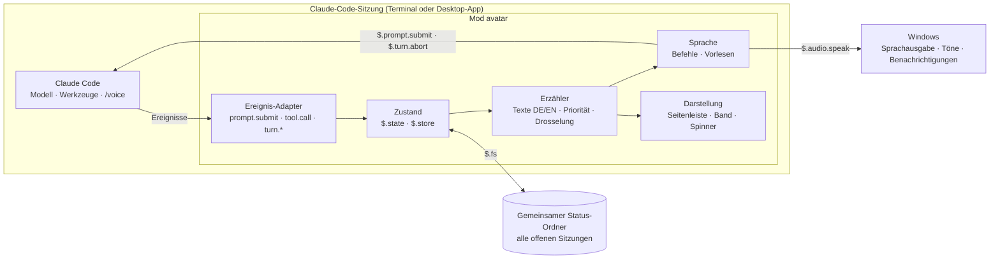
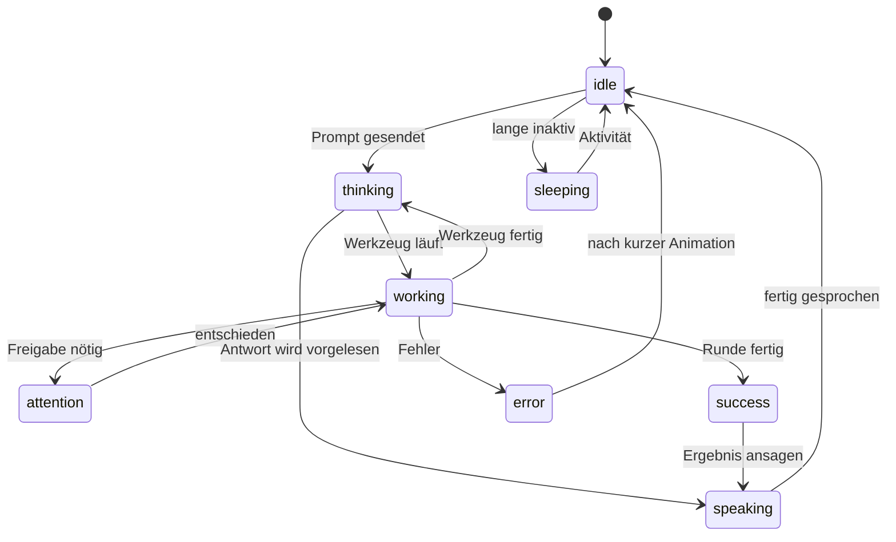
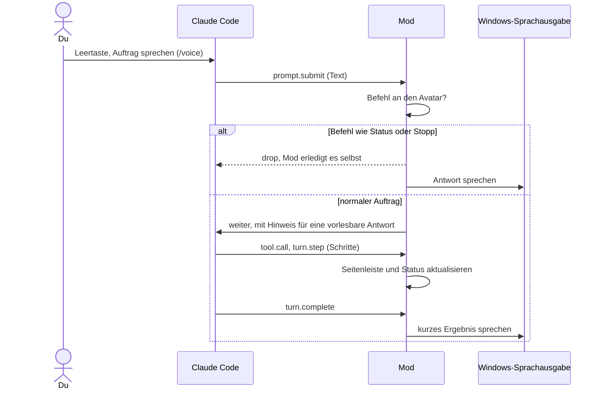

# Claude Desktop Avatar – Projektplan

> **Status:** Entwurf v0.3 · **Stand:** 5. November 2026 · **Neu:** Umsetzung als Mod für Claude Code statt als eigene App, ohne Installer, nicht kommerziell.
>
> Detailkonzepte: [Mod-Konzept](mod-design.md) · [Avatar-Vorlagen](avatar-templates.md)

## Auf einen Blick

- **Was:** ein Jarvis-artiger Assistent für Claude Code. Er lebt in deiner offenen Claude-Code-Sitzung, hört auf Sprachbefehle, sagt dir, woran Claude gerade arbeitet, und meldet sich, wenn Claude dich braucht.
- **Keine eigene App, kein Installer:** eine Erweiterung (Plugin mit Mod) für Claude Code, installiert mit einer Zeile, aktiv, solange Claude Code geöffnet ist.
- **Sprechen:** über die eingebaute Spracheingabe von Claude Code (`/voice`, Leertaste halten oder antippen), auf Deutsch und Englisch.
- **Hören:** Ansagen und Antworten über die Sprachausgabe von Windows, lokal auf dem Rechner.
- **Sehen:** ein animierter Avatar in einer Seitenleiste neben dem Chat. In der Desktop-App ist er eine animierte Vektorgrafik, im Terminal Pixel-Art. Dazu kommen ein Band über der Eingabe, eine eigene „Denkt nach"-Animation, Hinweise und Systembenachrichtigungen.
- **Über dein Abo:** Der Avatar ist Teil deiner Sitzung. Alles läuft über dein Claude-Abo, ohne API-Schlüssel und ohne Hintergrundprozess.
- **Plattform:** Windows 11, im Terminal und im Code-Tab der Claude-Desktop-App. Lizenz: MIT, nicht kommerziell.
- **Weg:** fünf Phasen, von einem Machbarkeits-Prototyp über ein MVP (Avatar, Live-Schritte, Ansagen) und die Jarvis-Sprachsteuerung bis zu Vorlagen und mehreren Sitzungen.

## 1. Vision & Kernfunktionen

Wie Jarvis bei Iron Man soll der Avatar ein Begleiter sein, mit dem man spricht, statt nur zu tippen. Er nimmt Aufträge per Stimme entgegen, gibt sie an Claude Code weiter und berichtet knapp, was passiert. Wenn Claude eine Freigabe braucht oder fertig ist, meldet er sich. Weil er eine Mod ist, braucht er kein eigenes Programm: Er nutzt, was Claude Code schon mitbringt (Sitzung, Abo, Spracheingabe), und ergänzt Präsenz, Stimme und Überblick.

| # | Deine Idee | Umsetzung als Mod |
|---|---|---|
| F1 | Avatar auf dem Desktop, verschiebbar | Der Avatar sitzt **in Claude Code**: in einer Seitenleiste neben dem Chat, deren Breite du anpassen kannst, dazu kompakt im Band über der Eingabe und in der Statuszeile. Ein frei schwebendes Desktop-Fenster entfällt, denn es bräuchte ein eigenes Programm. |
| F2 | Aussehen anpassbar, z. B. über Templates | Vorlagen mit Parametern (Farben, Teile, Name, Stimme, Stil). Jede Vorlage bringt eine Vektor-Variante für die Desktop-App und eine Pixel-Variante fürs Terminal mit. Angepasst wird in der Seitenleiste mit Live-Vorschau. |
| F3 | Schnell einen Chat starten, per Schrift oder Sprache | Tippen wie gewohnt oder `/voice`. Gesprochene Aufträge gehen als normaler Prompt an deine Sitzung; Befehle an den Avatar selbst („Jarvis, Status") erledigt die Mod direkt. |
| F4 | Aktuelle Schritte aktiver Chats ausgeben, mit Schrift und Ton | Die Mod sieht jeden Werkzeugaufruf, die Aufgabenliste und das Ende jeder Runde. Ein Erzähler formuliert kurze Texte, spielt Töne und spricht Wichtiges aus. Ein gemeinsamer Status-Ordner zeigt auch deine anderen offenen Claude-Code-Sitzungen. |

## 2. Was eine Mod kann – und was nicht

Mods sind Plugins mit einem Hooks-Modul (TypeScript), das sich in die Ereignisse und die Oberfläche von Claude Code einklinkt. Die Oberflächen heißen in der Mod-Schnittstelle `terminal`, `desktop` (Code-Tab der Claude-Desktop-App), `vscode` und `mobile`.

| Fähigkeit | Mod-Schnittstelle | Nutzen für den Avatar |
|---|---|---|
| Seitenleiste | `$.ui.open` + `ui.render` für `Pane` | Avatar, aktueller Schritt, Fortschritt, andere Sitzungen |
| Band über der Eingabe | `ui.render` für `AbovePrompt` | kompakter Status mit Mini-Avatar |
| „Denkt nach"-Zeile | `ui.render` für `Spinner` | eigene Animation statt des Standard-Spinners |
| Hintergrund | `$.ui.backdrop` (nur Desktop-App und Mobil) | optionales Jarvis-HUD hinter dem Chat |
| Statuszeile, Hinweise, Systembenachrichtigung | `$.ui.status`, `$.ui.toast`, `$.ui.notify` | Schritte, Fertig-Meldungen, „Claude braucht dich" |
| Grafik | `Svg` (Desktop-App, VS Code, Mobil; CSS- und SMIL-Animation) und `Raster` (Terminal: farbige Zeichenzellen, bildweise neu gezeichnet über `$.ui.blit`) | animierter Avatar je Oberfläche |
| Sprachausgabe, Töne | `$.audio.speak` (Sprachausgabe des Systems), `$.audio.play` | Ansagen, Antworten vorlesen |
| Prompts | `$.prompt.submit`, `$.prompt.fill`, `$.prompt.suggest`, `$.turn.abort` | Aufträge senden, Vorschläge machen, „Stopp" |
| Ereignisse | `session.start`, `prompt.submit`, `tool.call`, `turn.start`, `turn.step`, `turn.complete` | Schritte, Fortschritt, Ende einer Runde |
| KI-Aufrufe über die Sitzung | `$.model.complete`, `$.model.fork`, `$.model.classify` | „Was machst du gerade?", Zusammenfassungen, Befehlserkennung; abgerechnet über die Sitzung, also dein Abo |
| Speicher | `$.store` (dauerhaft), `$.state` (Sitzung) | Einstellungen, Profil, Zustand |
| Dateien, Prozesse, Zeitgeber | `$.fs`, `$.process`, `$.clock` | Vorlagen, gemeinsamer Status mehrerer Sitzungen, Windows-Rückfälle, Animation |
| Befehle, Optionen | `$.command.register`, `userConfig` im Manifest | `/avatar …`, Einstellungen bei der Installation |

**Grenzen, die den Plan prägen:**

- **Kein Fenster außerhalb von Claude Code:** Der Avatar erscheint nur in den Oberflächen von Claude Code.
- **Kein eigener Mikrofonzugriff:** Die Spracheingabe läuft über `/voice` von Claude Code. Laut Doku wird das Audio dabei auf Anthropics Servern in Text umgewandelt, nicht lokal (siehe Abschnitt 11).
- **Kein Zugriff auf das Audiosignal:** Ein Lippen-Sync nach Lautstärke ist nicht möglich. Der Avatar zeigt stattdessen eine Sprech-Animation, solange er spricht.
- **Töne im Windows-Terminal:** `$.audio.play` spielt dort laut Doku nichts ab. Rückfall ist der Windows-eigene Player über PowerShell.
- **Sprachausgabe unter Windows:** Wie sich `$.audio.speak` dort verhält, ist nicht dokumentiert. Rückfall ist die Windows-Sprachausgabe (`System.Speech`) über PowerShell.
- **Nur Claude Code:** In normalen Chats von Claude Desktop, in Cowork und auf claude.ai laufen keine Mods.
- **Platz im Terminal:** Die Seitenleiste braucht ein breites Fenster. Ungefragt erscheint sie ab 144 Spalten, nach dem Öffnen per Befehl in jeder Breite; neben dem Chat angedockt wird sie im Vollbild-Modus von Claude Code.

## 3. Nutzungsszenarien

1. **„Jarvis, wie ist der Stand?"** Du hältst die Leertaste und fragst. Die Mod erkennt den Befehl an sich selbst und antwortet aus dem gemeinsamen Status: „Webshop: Schritt 4 von 6, die Tests laufen. Das API-Projekt wartet auf deine Freigabe."
2. **Auftrag per Stimme:** „Behebe den fehlschlagenden Checkout-Test." Das geht als normaler Prompt an Claude. Der Avatar meldet die Schritte in der Seitenleiste und sagt am Ende: „Fertig. Alle Tests sind grün."
3. **Freigabe nötig:** Der Avatar winkt, ein Ton erklingt, und er sagt: „Ich brauche deine Freigabe für npm install." Entschieden wird im Dialog von Claude Code per Klick oder Taste, nie per Sprache.
4. **„Jarvis, stopp!"** Die laufende Runde wird abgebrochen.
5. **Eigener Look:** Mit `/avatar aussehen` wählst du Vorlage, Farbe, Name, Stimme und Stil, z. B. „knapp" oder „britischer Butler".
6. **Konzentriert arbeiten:** Nach `/avatar leise` kommen nur noch dringende Hinweise, und zwar als Ton.

## 4. Anforderungen

Prioritäten: **M** = Muss (MVP) · **S** = Soll · **K** = Kann (später)

### 4.1 Funktional

**F1 – Präsenz in Claude Code**

| ID | Anforderung | Prio |
|---|---|---|
| F1.1 | Seitenleiste mit animiertem Avatar, aktuellem Schritt und Fortschritt | M |
| F1.2 | Kompakter Status im Band über der Eingabe und in der Statuszeile | M |
| F1.3 | Eigene „Denkt nach"-Animation im Spinner | S |
| F1.4 | Läuft im Windows-Terminal und im Code-Tab der Desktop-App; VS Code mit Einschränkungen | M |
| F1.5 | Optionales HUD als Hintergrund in der Desktop-App | K |

**F2 – Aussehen**

| ID | Anforderung | Prio |
|---|---|---|
| F2.1 | 2 mitgelieferte Vorlagen, jeweils als Vektor- und Pixel-Variante | M |
| F2.2 | Farben, Teile, Name, Stimme und Stil in der Seitenleiste anpassen, mit Live-Vorschau | M |
| F2.3 | Eigene Vorlagen als Ordner, mit automatischem Neuladen beim Bearbeiten | S |
| F2.4 | Profile exportieren und importieren, Vorlagen teilen | K |

**F3 – Sprechen & Hören**

| ID | Anforderung | Prio |
|---|---|---|
| F3.1 | Spracheingabe über `/voice` (Deutsch und Englisch), Einrichtung per Anleitung in der Mod | M |
| F3.2 | Befehle an den Avatar selbst („<Name>, Status / stopp / leiser / Zusammenfassung") erledigt die Mod, ohne Claude zu fragen | S |
| F3.3 | Antworten vorlesen: ein kurzer, vorlesbarer Einstieg, Details bleiben im Chat | M |
| F3.4 | „Stopp" bricht die laufende Runde ab | S |
| F3.5 | Lokale Spracherkennung als Alternative zu `/voice` | K |

**F4 – Live-Schritte & Ansagen**

| ID | Anforderung | Prio |
|---|---|---|
| F4.1 | Schritte aus Werkzeugaufrufen, Fortschritt aus der Aufgabenliste („Schritt 3/7") | M |
| F4.2 | Dringendes (Freigabe nötig, Fehler) mit Animation, Ton, Ansage und Systembenachrichtigung | M |
| F4.3 | Ausführlichkeitsstufen, Ruhezeiten, Bündelung und Drosselung | M |
| F4.4 | Überblick über alle offenen Claude-Code-Sitzungen; nur eine Instanz spricht | S |
| F4.5 | „Was machst du gerade?" als KI-Zusammenfassung aus der Sitzung | S |
| F4.6 | Hinweis auf Nutzungslimits des Abos (z. B. 5-Stunden-Fenster) | K |
| F4.7 | Normale Claude-Desktop-Chats über eine kleine Desktop-Erweiterung (`.mcpb`), die in den gemeinsamen Status meldet | K |

### 4.2 Nicht-funktional

| Bereich | Ziel |
|---|---|
| Installation | nur das Plugin; keine eigenen Programme und keine Downloads im Standard |
| Robustheit | Die Mod darf die Sitzung nie stören: Jeder Hook reicht an `next(e)` weiter, Fehler werden abgefangen |
| Ressourcen | Animation sparsam: Im Terminal wird nur bei Änderungen neu gezeichnet (höchstens ca. 12 Bilder pro Sekunde), in der Desktop-App läuft die SVG-Animation im Rahmen der App |
| Latenz | Schritt bis Anzeige unter 200 ms; Ansage beginnt unter 1 s nach dem Ereignis |
| Datenschutz | Es verlässt nichts den Rechner, was Claude Code nicht ohnehin sendet; Ausnahme ist das Audio von `/voice` (Abschnitt 11) |
| Plattform | Windows 11 (Windows Terminal und Code-Tab der Desktop-App). Andere Systeme laufen voraussichtlich mit, werden aber nicht getestet |
| Sprachen | Deutsch und Englisch, abhängig von der Spracheinstellung von Claude Code (`language`) |
| Barrierefreiheit | Alles Gesprochene steht auch als Text da; Grafiken haben Alternativtexte; Animationen lassen sich abschalten |

### 4.3 Nicht-Ziele

- keine eigene App, kein Installer, kein frei schwebendes Desktop-Fenster
- kein Auslesen normaler Claude-Desktop- oder claude.ai-Chats auf inoffiziellen Wegen
- kein API-Schlüssel-Modus, keine kommerzielle Nutzung
- kein 3D

## 5. Architektur



- **Ereignis-Adapter:** übersetzt die Ereignisse der Sitzung in ein kleines, eigenes Ereignismodell (Schritt gestartet, Plan aktualisiert, Freigabe nötig, Runde fertig …).
- **Zustand:** Avatar-Zustand, Plan, Verlauf der letzten Schritte (`$.state`); Einstellungen und Profil dauerhaft (`$.store`).
- **Erzähler:** entscheidet, was als Text, Ton oder Ansage ausgegeben wird, auf Deutsch oder Englisch.
- **Sprache:** erkennt Befehle an den Avatar in gesprochenen Prompts, liest Antworten vor und verwaltet die Warteschlange der Ansagen.
- **Darstellung:** zeichnet den Avatar je Oberfläche (SVG oder Pixel) und alle Anzeigen.
- **Gemeinsamer Status-Ordner:** Jede Sitzung schreibt ihren Stand in eine kleine Datei. So kennt jede Instanz alle offenen Sitzungen, ohne Server.

Details zu Ereignissen, Sprache, Darstellung und mehreren Sitzungen stehen im [Mod-Konzept](mod-design.md).

### 5.1 Avatar-Zustände



### 5.2 Ablauf: Auftrag per Stimme



## 6. Technologie

| Thema | Entscheidung | Begründung |
|---|---|---|
| Form | Claude-Code-Plugin mit Hooks-Modul (Mod) | keine eigene App, kein Installer; Installation über `/plugin install` |
| Sprache | TypeScript (TSX) | Die Mod-Schnittstelle ist TypeScript; Typen liefert Claude Code mit |
| Code-Struktur | `hooks/register.tsx` plus eigene Module unter `src/`, statisch importiert | Mods können eigene Dateien importieren; dynamisches `import()` ist nicht erlaubt |
| Abhängigkeiten | keine npm-Pakete zur Laufzeit; Kleinigkeiten selbst geschrieben | Mods haben weder DOM noch Node; was gebraucht wird, liefert `$` |
| Zustand | `atom`, `read`, `update` mit Typvertrag in `types/index.d.ts` | Zeichnungen aktualisieren sich automatisch |
| Grafik | `Svg` (Desktop-App, VS Code, Mobil), `Raster` mit Halbblock-Zeichen (Terminal) | Windows Terminal kann keine Bilder über das Kitty-Protokoll anzeigen; Halbblöcke mit True Color schon |
| Sprachausgabe | `$.audio.speak`; Rückfall PowerShell mit `System.Speech` | Beides ist in Windows enthalten; nichts zu installieren |
| Spracheingabe | `/voice` von Claude Code | eingebaut, Deutsch und Englisch, über das Abo, verbraucht keine Tokens |
| KI-Hilfen | `$.model.fork` und `$.model.complete` mit `haiku` | über die Sitzung abgerechnet; nur auf Anfrage oder sparsam |
| Tests | `claude plugin validate`, `claude plugin test` mit `*.test.ts` für Terminal und Desktop | offizielle Werkzeuge für Mods |
| Entwicklung | `claude --plugin-dir <Ordner>` bzw. `CLAUDE_CODE_PLUGIN_DIRS` mit automatischem Neuladen | schnelle Schleife ohne Neuinstallation |

## 7. Datenschutz & Sicherheit

- **Nichts Zusätzliches nach außen:** Die Mod sendet selbst nichts ins Internet. KI-Aufrufe der Mod (`$.model.*`) laufen über deine Sitzung und dein Abo, wie jeder Prompt.
- **Spracheingabe:** `/voice` überträgt das Audio zur Umwandlung in Text an Anthropic. Die Mod weist bei der Einrichtung darauf hin. Eine lokale Alternative ist für später vorgesehen (F3.5).
- **Sprachausgabe:** lokal über Windows.
- **Gemeinsamer Status-Ordner:** enthält nur kurze, reduzierte Angaben (Projektname, Zustand, aktueller Schritt, Fortschritt), keine Dateiinhalte, Befehle im Wortlaut oder Prompts. Er liegt im Benutzerprofil, und veraltete Dateien werden aufgeräumt.
- **Freigaben:** Die Mod entscheidet nie selbst über Werkzeug-Freigaben und nimmt sie nie per Sprache entgegen. Sie kündigt sie nur an.
- **Prozesse:** PowerShell wird mit einer Argumentliste gestartet, ohne Shell-Zeichenkette; vorzulesender Text geht über stdin, nie in die Befehlszeile.
- **Vorlagen:** reine Daten. SVG zeichnet Claude Code ohnehin in einem Sandbox-Rahmen ohne Skripte; die Mod prüft zusätzlich Größe und Inhalt.

## 8. Projektstruktur (Vorschlag)

Das Repository ist zugleich die Mod und ihr Marketplace:

```text
claude-desktop-avatar/
├── .claude-plugin/
│   ├── plugin.json            # Manifest der Mod (Name, Version, userConfig, types)
│   └── marketplace.json       # macht das Repo installierbar
├── hooks/
│   ├── hooks.json             # { "modules": ["./register.tsx"] }
│   └── register.tsx           # Einstieg: registriert alle Hooks
├── src/
│   ├── events.ts              # Ereignis-Adapter
│   ├── narrator.ts            # Texte DE/EN, Stufen, Drosselung
│   ├── voice.ts               # Befehle, Vorlesen, Warteschlange, Windows-Rückfall
│   ├── sessions.ts            # gemeinsamer Status-Ordner, Sprecher-Wahl
│   ├── templates.ts           # Vorlagen laden und prüfen
│   └── render/                # Seitenleiste, Band, Spinner, SVG- und Pixel-Avatar
├── templates/                 # mitgelieferte Vorlagen
├── sounds/                    # Hinweistöne (WAV)
├── types/index.d.ts           # Typvertrag für $.state
├── tests/                     # claude plugin test
└── docs/                      # Plan und Konzepte
```

## 9. Roadmap

Die Aufwände sind eine grobe Orientierung für eine Person in Vollzeit.

### Phase 0 – Machbarkeit (ca. 1 Woche)

Ein Prototyp der Mod prüft unter Windows:

- Seitenleiste mit animiertem SVG im Code-Tab der Desktop-App und Pixel-Avatar per `Raster` in Windows Terminal; Aufwand pro Bild
- `$.audio.speak` unter Windows (Stimmen für Deutsch und Englisch, Warteschlange) und der PowerShell-Rückfall, einschließlich Abbrechen
- Töne über `$.audio.play` in Terminal und Desktop-App, sonst über PowerShell
- `/voice` im Zusammenspiel mit der Mod: Tap-Modus mit automatischem Senden, Erkennen von Befehlen wie „<Name>, Status" in `prompt.submit`
- Welche Daten `tool.call`, `turn.step` und `turn.complete` liefern; wie „Freigabe nötig" erkennbar ist (`tool.check` oder Benachrichtigungs-Ereignis)
- Gemeinsamer Status-Ordner mit zwei gleichzeitig offenen Sitzungen

**Fertig, wenn:** zu jedem Punkt ein Ergebnis und, wo nötig, eine Entscheidung dokumentiert ist.

### Phase 1 – MVP „Sehen & Hören" (ca. 2–3 Wochen)

- Seitenleiste mit Avatar (2 Vorlagen, Vektor und Pixel), Zuständen, aktuellem Schritt und Fortschritt; Band und Statuszeile
- Erzähler auf Deutsch und Englisch mit Ausführlichkeitsstufen
- Ansagen für „Freigabe nötig", „fertig" und „Fehler" mit Ton und Systembenachrichtigung
- Befehl `/avatar` (öffnen, leise, Stufe, Sprache), Optionen bei der Installation, Einstellungen in `$.store`
- Marketplace in diesem Repo, Tests für Terminal und Desktop

**Fertig, wenn:**

- die Mod mit einer Zeile installiert ist und in Terminal und Desktop-App erscheint,
- ein Werkzeugschritt in unter 200 ms in der Seitenleiste steht,
- eine Freigabe-Anfrage mit Animation, Ton und Ansage gemeldet wird,
- Fehler der Mod die Sitzung nie stören.

### Phase 2 – Jarvis-Sprachsteuerung (ca. 2 Wochen)

- Einrichtungshilfe für `/voice` (Modus, automatisches Senden, Sprache)
- Befehle an den Avatar selbst: Status, Stopp, leiser/lauter, Zusammenfassung, Sitzungsüberblick
- Vorlesen: Gesprochene Aufträge bekommen den Hinweis für einen vorlesbaren Einstieg; der Avatar liest ihn am Ende vor
- „Was machst du gerade?" über `$.model.fork`; Begrüßung beim Start; Persona-Stile (knapp, freundlich, Butler)

**Fertig, wenn:** ein kompletter Auftrag per Stimme läuft, also sprechen, Schritte sehen und das Ergebnis hören, und „Stopp" die Runde zuverlässig abbricht.

### Phase 3 – Aussehen & Vorlagen (ca. 2 Wochen)

- Vorlagenformat v1 (Vektor und Pixel), Anpassen in der Seitenleiste mit Live-Vorschau
- Eigene Vorlagen im Benutzerordner, automatisches Neuladen, Prüfung mit verständlichen Fehlern
- 3–5 Vorlagen, Anleitung für Vorlagen-Ersteller; optional das HUD als Hintergrund in der Desktop-App

**Fertig, wenn:** sich eine neue Vorlage ohne Änderung am Code der Mod erstellen, prüfen und nutzen lässt.

### Phase 4 – Mehrere Sitzungen & Feinschliff (ca. 2 Wochen)

- Überblick über alle offenen Sitzungen in der Seitenleiste, Sprecher-Wahl (nur eine Instanz spricht)
- Hinweise auf Nutzungslimits; Barrierefreiheit; README mit Installationszeile
- Optional: lokale Spracherkennung (F3.5), Desktop-Erweiterung für normale Claude-Desktop-Chats (F4.7)

**Fertig, wenn:** mit drei offenen Sitzungen jede Meldung genau einmal angesagt wird und die Seitenleiste alle drei zeigt.

## 10. Risiken & Gegenmaßnahmen

| Risiko | Auswirkung | Gegenmaßnahme |
|---|---|---|
| Die Mod-Schnittstelle ist jung und ändert sich | Teile brechen nach Updates | Mindestversion von Claude Code festlegen, Tests mit `claude plugin test`, Änderungen verfolgen |
| `$.audio.speak` funktioniert unter Windows nicht oder ohne Wahl der Stimme | keine oder falsche Ansagen | Rückfall auf `System.Speech` über PowerShell (in Phase 0 prüfen) |
| `$.audio.play` ist im Windows-Terminal stumm | keine Hinweistöne | Windows-Player über PowerShell; in der Desktop-App prüfen |
| `/voice` schickt das Audio an Anthropic | widerspricht „Sprache lokal" | Entscheidung bei dir (Abschnitt 11); später optional lokale Erkennung |
| `/voice` braucht die Anmeldung mit dem Claude-Konto; ein gesetzter `ANTHROPIC_API_KEY` schaltet es ab | keine Spracheingabe | Hinweis in der Einrichtung |
| Seitenleiste braucht Platz im Terminal | Avatar nur im Band sichtbar | Hinweis auf Vollbild-Modus und breites Fenster; Band und Statuszeile funktionieren immer |
| Mehrere Sitzungen sprechen gleichzeitig | doppelte Ansagen | Sprecher-Wahl über eine Lock-Datei mit Herzschlag |
| Ansagen nerven | Mod wird abgeschaltet | zurückhaltende Standards, Bündelung, Ruhezeiten, `/avatar leise` |
| Fehler in der Mod | gestörte Sitzung | jeder Hook mit Fehlerbehandlung und `next(e)`; Tests für beide Oberflächen |
| Organisationsrichtlinien können Mods oder `/voice` sperren | Funktion fehlt | klar melden statt still zu scheitern |
| Name „Jarvis" ist eine Marke von Marvel | Ärger bei öffentlicher Verbreitung | Standardname neutral, Umbenennen in den Einstellungen; „Jarvis" nur als persönliche Wahl |

## 11. Entscheidungen & offene Fragen

**Entschieden:**

| # | Frage | Entscheidung | Folgen im Plan |
|---|---|---|---|
| 1 | Plattform | Windows | Windows 11, im Terminal und im Code-Tab der Desktop-App |
| 2 | Welche Chats? | alle | alle Claude-Code-Sitzungen (jede mit eigener Mod-Instanz und gemeinsamem Überblick). Normale Desktop-Chats, Cowork und claude.ai erreichen Mods nicht; für Desktop-Chats ist eine kleine Erweiterung als spätere Option vorgesehen (F4.7) |
| 3 | Bezahlung | vorerst nur über das Abo | erfüllt: Die Mod ist Teil deiner Sitzung, alles läuft über dein Abo |
| 4 | Sprache lokal oder Cloud? | lokal, Cloud optional | Sprachausgabe lokal; Spracheingabe siehe offene Frage A |
| 5 | 2D oder 3D? | nur 2D | Vektor (SVG) und Pixel |
| 6 | Name | vorerst so lassen | Arbeitstitel bleibt; die Mod heißt `avatar`, der Name des Assistenten ist frei wählbar |
| 7 | Lizenz | MIT | `LICENSE` liegt im Repo |
| 8 | Sprachen | Deutsch und Englisch | beide von Anfang an |
| 9 | Auslieferung | Mod für Claude Code, kein Installer, nicht kommerziell | dieser Plan v0.3 |

**Offene Fragen:**

- **A – Spracheingabe:** Ist `/voice` in Ordnung, obwohl das Audio bei Anthropic in Text umgewandelt wird? Empfehlung: ja, denn der Text geht als Prompt ohnehin an Anthropic, und es ist nichts zu installieren. Die Alternative wäre eine lokale Erkennung mit einem zusätzlichen Programm oder mit der älteren, eingebauten Windows-Spracherkennung, die erst noch geprüft werden müsste.
- **B – Hauptoberfläche:** Nutzt du Claude Code vor allem im Terminal oder im Code-Tab der Desktop-App? Davon hängt ab, welche Darstellung zuerst ausgebaut wird: Pixel-Art im Terminal oder die animierte Vektorgrafik in der App.

## 12. Nächste Schritte

1. Offene Fragen A und B klären.
2. Phase 0: Prototyp der Mod schreiben und unter Windows ausprobieren.
3. Ergebnisse als ADRs unter `docs/adr/` festhalten.
4. Pro Phase einen GitHub-Meilenstein mit Issues anlegen.
