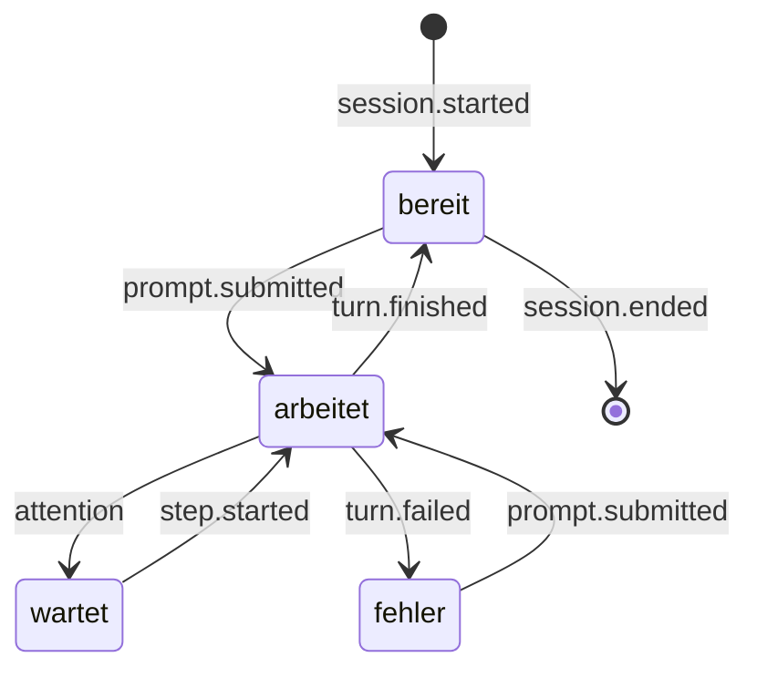

# Anbindung an Claude – Chats starten & Schritte verfolgen

> Teil des [Projektplans](PLAN.md) · Stand: 5. November 2026 (v0.2: Abo-Nutzung über Claude Code, alle Chat-Arten, Windows).
> Angaben zu Claude Code und Claude Desktop stammen aus der offiziellen Dokumentation (Quellen in Abschnitt 13). Offene Punkte werden in Phase 0 geprüft.

## 1. Abdeckung aller Chat-Arten

| Chat-Art | Abdeckung | Weg | Phase |
|---|---|---|---|
| Claude Code im Terminal (z. B. Windows Terminal) | voll | Plugin `avatar-bridge` mit HTTP-Hooks | 1 |
| Claude Code in VS Code und JetBrains | voll (in Spike B prüfen) | dieselben Hooks; laut Doku lesen alle Oberflächen dieselben Einstellungsdateien | 1 |
| Claude Code im Code-Tab von Claude Desktop | voraussichtlich voll (in Spike B prüfen) | dieselben Hooks | 1 |
| Eigene Chats des Avatars | voll | Claude Code im Headless-Modus (`stream-json`) über dein Abo | 1 |
| Übergaben und Hintergrund-Aufgaben | voll | Deep Link bzw. Claude Code headless, danach dieselben Hooks | 1 / 3 |
| Chats in Claude Desktop | teilweise: das, was Claude über die Avatar-Werkzeuge meldet; mit MCP-Proxy zusätzlich alle Aufrufe durchgeleiteter MCP-Werkzeuge | MCP-Server des Avatars als `.mcpb` | 3 |
| Cowork-Aufgaben in Claude Desktop | teilweise, wie Desktop-Chats (in Phase 3 testen) | MCP-Server des Avatars; Plugin-Hooks feuern in Cowork laut einem Fehlerbericht nicht | 3 |
| claude.ai im Browser | nicht möglich | Ein lokaler MCP-Server ist für claude.ai nicht erreichbar | – |
| Claude Code im Web (Cloud-Sitzungen) | nicht möglich | Lokale Hooks greifen dort nicht | – |
| Claude-Apps auf dem Smartphone | nicht möglich | – | – |

**Warum nur „teilweise" für Claude Desktop:** Für normale Chats gibt es keine offizielle Schnittstelle, über die eine andere App den Fortschritt mitlesen kann. Inoffizielle Wege schließt der Plan aus: das Auslesen der Oberfläche (z. B. per Windows UI Automation), interne Datenbanken der App oder Screen-Scraping. Sie brechen bei jedem Update, lesen deutlich mehr mit als nötig und vertragen sich schlecht mit den Nutzungsbedingungen, die Scraping untersagen.

**Weitere Quellen:** Der OpenTelemetry-Export von Claude Code (Ereignisse etwa alle 5 s) bleibt eine optionale spätere Ergänzung, z. B. für Kosten- und Token-Anzeigen. Transkript-Dateien (`~/.claude/projects/…/*.jsonl`) nutzt der Avatar nicht, weil ihr Format laut Doku intern ist und sich zwischen Versionen ändert.

## 2. Lokale Avatar-API

- Lauscht nur auf `127.0.0.1`, Standard-Port z. B. `47821` (einstellbar; das Plugin nutzt den Standard-Port).
- Endpunkte:
  - `POST /v1/claude-code/hook`: Eingang für alle Claude-Code-Hooks (JSON unverändert von Claude Code). Antwortet sofort mit `204`, außer beim optionalen Freigabe-Hook (Abschnitt 7).
  - `POST /v1/events`: generische Ereignisse im normalisierten Format (MCP-Brücke, eigene Skripte); Token erforderlich.
  - `/mcp`: MCP-Server des Avatars (Streamable HTTP) für den eigenen Chat und für Claude Code; Token erforderlich.
  - `GET /v1/health`: Diagnose.
- Härtung:
  - `Host` muss `127.0.0.1:<port>` oder `localhost:<port>` sein (Schutz vor DNS-Rebinding).
  - Anfragen mit `Origin`-Header (Browser) werden abgelehnt; erlaubt ist nur `Content-Type: application/json`.
  - Höchstens 256 KB pro Anfrage, Ratenlimit pro Sitzung.
- Token: Die App legt `%USERPROFILE%\.claude-desktop-avatar\endpoint.json` mit Port und Token an; die Datei liegt im Benutzerprofil und ist nur für dich lesbar. MCP-Brücke und Skripte lesen sie dort. Für Hooks ist das Token optional, weil sie nur Anzeigen auslösen. Wer es nutzen möchte, setzt `CDA_TOKEN`, z. B. im `env`-Abschnitt der Claude-Code-Einstellungen; das Plugin reicht die Variable über `allowedEnvVars` als Header weiter.

## 3. Claude-Code-Plugin `avatar-bridge`

### 3.1 Aufbau & Installation

```text
.claude-plugin/marketplace.json        # Marketplace dieses Repos
plugins/avatar-bridge/
├── .claude-plugin/plugin.json         # Manifest
└── hooks/hooks.json                   # Hook-Konfiguration
```

`.claude-plugin/marketplace.json`:

```json
{
  "name": "claude-desktop-avatar",
  "owner": { "name": "AyGeeI" },
  "plugins": [
    {
      "name": "avatar-bridge",
      "source": "./plugins/avatar-bridge",
      "description": "Meldet Schritte, Freigabe-Bedarf und Fertig-Status an den Desktop-Avatar"
    },
    {
      "name": "avatar-approvals",
      "source": "./plugins/avatar-approvals",
      "description": "Optional: Freigaben direkt am Avatar beantworten"
    }
  ]
}
```

Installation (einmalig):

```bash
claude plugin marketplace add AyGeeI/claude-desktop-avatar
```

```bash
claude plugin install avatar-bridge@claude-desktop-avatar
```

In einer laufenden Sitzung funktioniert dasselbe mit `/plugin marketplace add …` und `/plugin install …`. Die App bietet zusätzlich einen Assistenten „Claude Code verbinden", der die Befehle anzeigt und die Verbindung testet.

### 3.2 Hook-Konfiguration

Alle benötigten Ereignisse nutzen denselben HTTP-Handler. `plugins/avatar-bridge/hooks/hooks.json` (Auszug):

```json
{
  "hooks": {
    "PreToolUse": [
      {
        "matcher": "*",
        "hooks": [
          {
            "type": "http",
            "url": "http://127.0.0.1:47821/v1/claude-code/hook",
            "timeout": 2,
            "headers": { "X-Avatar-Token": "$CDA_TOKEN" },
            "allowedEnvVars": ["CDA_TOKEN"]
          }
        ]
      }
    ]
  }
}
```

Analog für `SessionStart`, `UserPromptSubmit`, `PostToolUse`, `PostToolUseFailure`, `TaskCreated`, `TaskCompleted`, `Notification`, `SubagentStart`, `SubagentStop`, `PreCompact`, `Stop`, `StopFailure` und `SessionEnd`.

Designregeln:

- **Fail-open:** Läuft der Avatar nicht, scheitert die Verbindung. Laut Doku ist das ein nicht blockierender Fehler, und Claude Code arbeitet weiter. In Spike B wird geprüft, wie sichtbar diese Fehler sind. Stören sie, wechselt das Plugin auf asynchrone Command-Hooks (`"async": true`) mit einem kleinen Weiterleiter.
- **Schnell:** Die API antwortet sofort und verarbeitet erst danach. `timeout: 2` begrenzt den schlimmsten Fall (Standard für HTTP-Hooks wären 600 s).
- **Keine Eingriffe:** `avatar-bridge` blockiert nichts und trifft keine Entscheidungen. Freigaben am Avatar sind ein separates, optionales Plugin (Abschnitt 7).
- **Datensparsam:** Der Avatar behält nur die Zusammenfassungsfelder aus der Tabelle unten. Werkzeug-Ergebnisse, Dateiinhalte und Prompt-Texte werden sofort verworfen.

### 3.3 Abbildung der Hooks

| Hook | Genutzte Felder | Ereignis | Wirkung (Standard) |
|---|---|---|---|
| `SessionStart` | `session_id`, `cwd`, `source`, `session_title` | `session.started` | Sitzung erscheint in der Liste |
| `UserPromptSubmit` | `session_id` (der Prompt-Text wird verworfen) | `prompt.submitted` | Status „arbeitet" |
| `PreToolUse` | `tool_name`, gekürzte Ziele aus `tool_input` | `step.started` | Statuszeile, z. B. „Liest `cart.ts`" |
| `PostToolUse` | `tool_name`, `duration_ms`; bei Aufgaben-Werkzeugen Titel und Status | `step.finished`, `plan.updated` | Fortschritt „Schritt 3/7" |
| `PostToolUseFailure` | `tool_name` | `step.failed` | nur in der Stufe „Gesprächig" |
| `TaskCreated`, `TaskCompleted` | Aufgabe (Felder in Spike B prüfen) | `plan.updated` | Fortschrittsring |
| `Notification` | `notification_type`, `message` | `attention.permission` (`permission_prompt`), `attention.input` (`idle_prompt`, `agent_needs_input`) | Zustand `attention`, Ton, Ansage |
| `SubagentStart`, `SubagentStop` | `agent_type` | `subagent.started`, `subagent.finished` | Statuszeile |
| `PreCompact` | – | `context.compacting` | „Fasst den Kontext zusammen …" |
| `Stop` | `last_assistant_message` (gekürzt, nur im Speicher) | `turn.finished` | Zustand `success`, Ton, Ansage |
| `StopFailure` | Fehlerart (z. B. `rate_limit`) | `turn.failed` | Zustand `error`, Ton |
| `SessionEnd` | `session_id` | `session.ended` | Sitzung verschwindet aus der Liste |

**Gekürzte Ziele:** Bei Dateiwerkzeugen nur der Dateiname ohne Pfad; bei Shell-Befehlen die ersten ca. 60 Zeichen und eine erkannte Kategorie (Tests, Build, Git, Installation); bei Suchen das Muster; bei Web-Zugriffen nur die Domain.

**Aufgabenliste:** Neuere Claude-Code-Versionen führen ihren Plan über `TaskCreate` und `TaskUpdate` (Felder u. a. `subject`, `activeForm`, `status` mit `pending`, `in_progress`, `completed`, `deleted`), ältere bzw. per Einstellung über `TodoWrite`. Der Hub unterstützt beide Varianten und liest die Felder defensiv. „Schritt N von M" ergibt sich aus erledigten und offenen Aufgaben; angezeigt wird die `activeForm` der laufenden Aufgabe.

## 4. Ereignismodell

Alle Quellen werden auf ein gemeinsames Format abgebildet (Paket `core`, validiert mit Zod):

```ts
type Severity = 'debug' | 'info' | 'milestone' | 'urgent';

type ToolCategory =
  | 'read' | 'write' | 'edit' | 'shell' | 'search'
  | 'web' | 'agent' | 'plan' | 'mcp' | 'other';

interface ActivityEvent {
  id: string;                  // ULID
  ts: number;                  // Unix-Zeit in ms
  source: 'claude-code' | 'avatar-chat' | 'background-task' | 'mcp';
  sessionId: string;
  session: {
    project?: string;          // z. B. Ordnername aus cwd
    cwd?: string;
    title?: string;            // session_title, falls vorhanden
  };
  kind:
    | 'session.started' | 'session.ended'
    | 'prompt.submitted'
    | 'step.started' | 'step.finished' | 'step.failed'
    | 'plan.updated'
    | 'subagent.started' | 'subagent.finished'
    | 'attention.permission' | 'attention.input'
    | 'turn.finished' | 'turn.failed'
    | 'context.compacting'
    | 'message';
  tool?: { name: string; category: ToolCategory; target?: string }; // bereits gekürzt
  plan?: { total: number; done: number; current?: string };
  text?: string;               // gekürzter Freitext, z. B. Hinweis oder letzte Antwort
  severity: Severity;
}
```

Sitzungsstatus:



- Sitzungen ohne beobachteten Start (der Avatar lief noch nicht) werden beim ersten Ereignis angelegt.
- Kommt 30 Minuten lang kein Ereignis, gilt eine Sitzung als inaktiv und wird ausgeblendet, falls `SessionEnd` fehlt, z. B. nach einem Absturz.
- Der Projektname ist der Ordnername aus `cwd`; er lässt sich umbenennen und bekommt eine eigene Farbe.
- Ereignisse aus dem Arbeitsverzeichnis des eigenen Schnell-Chats (Abschnitt 6) erscheinen nicht als fremde Sitzung.

## 5. Erzähler

Der Erzähler übersetzt Ereignisse in kurze Texte, Hinweistöne und Ansagen. Standardmäßig arbeitet er rein lokal mit Textvorlagen, ohne KI. Alle Vorlagen gibt es auf Deutsch und Englisch; die Tabelle zeigt die deutschen.

| Werkzeug / Ereignis | Sprechblase | Gesprochen (Stufe „Normal") |
|---|---|---|
| `Read` | Liest `app.ts` | – |
| `Write` | Erstellt `checkout.test.ts` | – |
| `Edit` | Bearbeitet `cart.ts` | – |
| `Bash`, `PowerShell` (Tests erkannt) | Führt die Tests aus | – |
| `Bash`, `PowerShell` (allgemein) | Führt aus: `docker compose up` | – |
| `Grep`, `Glob` | Durchsucht das Projekt nach „PaymentError" | – |
| `WebSearch`, `WebFetch` | Recherchiert im Web · Liest example.com | – |
| Subagent (`Agent`) | Hilfsagent: Tests analysieren | – |
| Aufgabenliste | Schritt 3/7 · Tests ausführen | – (Stufe „Gesprächig": „Nächster Schritt: Tests ausführen") |
| MCP-Werkzeug, z. B. `mcp__github__create_pr` | Nutzt github: create_pr | – |
| Freigabe nötig | webshop braucht deine Freigabe: Bash `rm -rf dist` | „Webshop braucht deine Freigabe." |
| Wartet auf Eingabe | webshop wartet auf dich | „Webshop wartet auf dich." |
| Fertig (`Stop`) | webshop ist fertig: „Alle 42 Tests grün, Commit erstellt." | „Webshop ist fertig." |
| Abbruch (`StopFailure`) | webshop abgebrochen: Rate-Limit | „Webshop wurde abgebrochen." |

**Ausführlichkeitsstufen:**

| Stufe | Sprechblase | Sprache | Hinweistöne |
|---|---|---|---|
| Still | nur Dringendes | nichts | nur Dringendes |
| Normal (Standard) | aktueller Schritt als Statuszeile, Meilensteine, Dringendes | Dringendes und „fertig" | Dringendes, fertig, Fehler |
| Gesprächig | jeder Schritt (gebündelt) | zusätzlich Planschritte | alle |

Dazu kommen Stummschalten pro Sitzung, Ruhezeiten (z. B. 20–8 Uhr ohne Sprache), „Nicht stören" (nur dringende Töne) und die automatische Ruhe bei Vollbild-Apps und Präsentationen.

**Regeln gegen Ansage-Flut:**

- **Bündeln:** Gleichartige Schritte innerhalb von 3 s werden zusammengefasst („Liest 4 Dateien"). Pro Sitzung zeigt die Statuszeile nur den jüngsten Stand.
- **Drosseln:** Höchstens eine nicht dringende Ansage pro Sitzung alle 20 s. Dringendes kommt sofort, insgesamt aber höchstens eine Ansage alle 5 s.
- **Verwerfen:** Ansagen, die beim Abspielen älter als 10 s sind, entfallen.
- **Nicht unterbrechen:** keine Ansagen, während du sprichst oder der Avatar zuhört.
- **Sprechbar formulieren:** Pfade und Befehle werden nie wörtlich vorgelesen. Gesprochen werden Dateinamen ohne Pfad und Befehlskategorien („die Tests"). Projektnamen werden lesbar gemacht (`webshop-api` → „Webshop API").

**Optionale KI-Zusammenfassung (opt-in, Phase 5):** Beim Ende einer Runde fasst Claude die `last_assistant_message` in einem Satz zusammen; in der Stufe „Gesprächig" zusätzlich etwa alle 60 s die bisherigen Schritte. Das läuft wie der Chat über Claude Code und dein Abo, verbraucht also Kontingent, und nutzt nur bereits reduzierte Daten. Ein kleines Modell genügt (z. B. `--model haiku`). Standardmäßig ist die Funktion aus.

## 6. Schnell-Chat über dein Abo

**Voraussetzung:** Claude Code ist installiert und mit deinem Claude-Abo angemeldet. Die Einrichtung findet Claude Code über den `PATH` (Pfad manuell überschreibbar), prüft die Anmeldung mit `claude auth status` (Anmeldeart `claude.ai`) und hilft sonst weiter. Der Avatar sieht und speichert dabei keine Zugangsdaten.

**Prozessmodell:** Der Avatar startet einen dauerhaft laufenden Chat-Prozess, ohne Umweg über eine Shell. Die Argumente sinngemäß:

```text
claude -p
  --input-format stream-json --output-format stream-json
  --include-partial-messages --verbose
  --system-prompt "<Persona und Sprachregeln>"
  --model sonnet
  --tools ""
  --mcp-config "<Avatar-MCP-Server über HTTP>" --strict-mcp-config
  --allowedTools "mcp__avatar__get_active_sessions,mcp__avatar__start_claude_code_task"
```

- Jede Frage geht als JSON-Zeile über stdin hinein. Die Antwort kommt als Ereignisstrom zurück: `stream_event` mit Text-Deltas für die Sprechblase und die satzweise Sprachausgabe, `assistant` für fertige Nachrichten, `result` am Ende einer Antwort.
- Die Doku deutet den Mehrrunden-Betrieb über `--input-format stream-json` an, beschreibt das Eingabeformat aber nicht vollständig; Spike C prüft ihn. Trägt er nicht, läuft jede Frage als eigener Aufruf mit `--resume <session_id>`.

**Isolation & Abo-Sicherheit:**

- eigenes Arbeitsverzeichnis (z. B. `%LOCALAPPDATA%\claude-desktop-avatar\chat`), kein Zugriff auf Projekte
- `--system-prompt` mit schlanker Persona statt des Coding-Prompts von Claude Code: schneller und sparsamer im Kontingent
- `--tools ""` schaltet alle eingebauten Werkzeuge ab; die Websuche lässt sich bei Bedarf freigeben
- `--strict-mcp-config` sorgt dafür, dass nur der MCP-Server des Avatars geladen wird; seine zwei harmlosen Werkzeuge sind über `--allowedTools` vorab erlaubt
- Deine eigenen Hooks und Plugins sollen im Chat nicht laufen; Spike C prüft dafür `--setting-sources`
- kein `--bare`: Der Bare-Modus nutzt laut Doku kein Abo-Login
- `ANTHROPIC_API_KEY` wird aus der Umgebung des Prozesses entfernt, denn im Headless-Modus würde Claude Code einen vorhandenen Schlüssel immer statt des Abos verwenden

**Modell:** wählbar über die Aliase `opus`, `sonnet` und `haiku`. Empfehlung: `sonnet` für schnelle Antworten im Alltag, `opus` für anspruchsvolle Fragen.

**System-Prompt-Bausteine:** Rolle und Persona aus dem Avatar-Profil (Name, Stil); Antwort in der Sprache der Frage (Deutsch oder Englisch); im Sprachmodus 1–3 kurze Sätze ohne Markdown; Hinweise zu den Avatar-Werkzeugen. Variable Angaben wie Datum und Uhrzeit stehen in der jeweiligen Nachricht, nicht im System-Prompt.

**Chat-Werkzeuge** (MCP, vom Avatar bereitgestellt):

- `get_active_sessions`: liefert die reduzierten Zusammenfassungen aus dem Aktivitäts-Hub. So beantwortet der Avatar Fragen wie „Was macht Claude gerade im Webshop?".
- `start_claude_code_task(project, prompt)`: schlägt eine Übergabe vor. Der Avatar zeigt Projekt und Auftrag und startet erst nach deinem Klick, wahlweise per Deep Link (Abschnitt 9) oder als Hintergrund-Aufgabe (Abschnitt 8).

**Verlauf & Limits:**

- Der Verlauf liegt lokal in SQLite mit einstellbarer Aufbewahrung. Der Avatar merkt sich die `session_id`, um Gespräche nach einem Neustart mit `--resume` fortzusetzen.
- Fragen verbrauchen das Kontingent deines Abos. Greift ein Nutzungslimit, meldet der Avatar das verständlich, statt still zu scheitern.
- **Kontext anhängen** (später): Zwischenablage oder Screenshot, nur auf ausdrücklichen Klick.

## 7. Freigaben am Avatar (optional, Phase 3)

- **Standard:** Der Avatar zeigt nur an, dass eine Freigabe nötig ist (`Notification` mit `permission_prompt`). Entschieden wird in Claude Code.
- **Opt-in-Plugin `avatar-approvals`:** ein `PermissionRequest`-HTTP-Hook mit längerem `timeout` (z. B. 60 s). Die Avatar-API hält die Anfrage offen, bis du in der Sprechblase „Erlauben" oder „Ablehnen" klickst, und antwortet dann:

  ```json
  {
    "hookSpecificOutput": {
      "hookEventName": "PermissionRequest",
      "decision": { "behavior": "allow" }
    }
  }
  ```

  Bei „Ablehnen" lautet die Antwort `"behavior": "deny"`. Kommt keine Entscheidung, antwortet die API leer, und Claude Code fährt mit dem normalen Ablauf fort (in Spike B verifizieren).
- **Hintergrund-Aufgaben:** Dort übernimmt `--permission-prompt-tool` mit einem Werkzeug des Avatar-MCP-Servers diese Rolle (Abschnitt 8).
- **Sicherheitsregeln:** Entscheidungen nur per Klick, nie per Sprache. Der vollständige Befehl und das Projekt werden immer angezeigt. In v1 gibt es kein „Immer erlauben" vom Avatar aus.
- **Nachteil:** Solange der Avatar wartet, erscheint der Dialog im Terminal erst nach Ablauf der Wartezeit. Deshalb ist das Plugin optional.

## 8. Hintergrund-Aufgaben über Claude Code (optional, Phase 3)

- **Start:** per Text, Sprache oder Chat-Werkzeug, immer nach deiner Bestätigung und nur in Ordnern, die du ausgewählt hast.
- **Aufruf** im Projektordner, sinngemäß:

  ```text
  claude -p "<Auftrag>"
    --output-format stream-json --include-partial-messages --verbose
    --mcp-config "<Avatar-MCP-Server über HTTP>"
    --permission-prompt-tool mcp__avatar__approve
  ```

- **Fortschritt:** aus dem Ereignisstrom und zusätzlich über die Hooks des Plugins.
- **Freigaben:** `claude -p` startet laut Doku im Modus „Manual": Was eine Freigabe braucht, wird abgelehnt, sofern nichts zustimmt. Über `--permission-prompt-tool` fragt Claude Code stattdessen den Avatar, und du entscheidest in der Sprechblase. Das genaue Rückgabeformat des Werkzeugs prüft Spike C.
- **Achtung:** Im Headless-Modus laufen die Hooks und `.mcp.json`-Server eines Projekts ohne Vertrauensdialog. Deshalb startet der Avatar Aufgaben nur in Ordnern, die du ausdrücklich ausgewählt hast.
- **Abbruch:** Ein Knopf in der Sprechblase beendet den Prozess.
- **Agent SDK:** entfällt vorerst, weil es für Produkte von Drittanbietern laut Anthropic API-Schlüssel voraussetzt.

## 9. Übergaben

- **An Claude Code (Terminal):** `claude-cli://open?cwd=<absoluter Pfad>&q=<URL-kodierter Auftrag>` öffnet ein neues Terminal mit Claude Code im Projektordner; unter Windows bevorzugt Windows Terminal, sonst PowerShell oder `cmd.exe`. Der Auftrag ist vorausgefüllt, wird aber erst gesendet, wenn du Enter drückst. Claude Code zeigt dazu den Hinweis „Prompt from an external link".
  - Grenzen: höchstens 5.000 Zeichen. Der Link-Handler wird registriert, sobald du in einer interaktiven Claude-Code-Sitzung einmal etwas gesendet hast.
  - Statt `cwd` geht auch `repo=<owner/name>` für Klone, die Claude Code schon kennt.
- **An VS Code:** `vscode://anthropic.claude-code/open` öffnet einen Claude-Code-Tab in VS Code.
- **An Claude Desktop:** Ein Parameter zum Vorbefüllen ist nicht dokumentiert. Der Avatar kopiert den Text deshalb in die Zwischenablage und öffnet die App.
- **Projektliste:** zuletzt gesehene `cwd`s aus Hook-Ereignissen plus manuell hinzugefügte Ordner; per Sprache auswählbar („im Projekt Webshop").

## 10. MCP-Server für Claude Desktop & Cowork (Phase 3)

- **Werkzeuge:**
  - `avatar_status(state, step?, progress?)`: setzt Zustand und Statuszeile.
  - `avatar_say(text)`: lässt den Avatar einen kurzen Satz sagen.
  - `avatar_notify(title, message, urgency)`: zeigt einen Hinweis mit Ton.
  - Für den eigenen Chat und Hintergrund-Aufgaben zusätzlich `get_active_sessions`, `start_claude_code_task` und `approve`.
- **Zwei Wege zum selben Server:**
  - **HTTP** direkt in der App (`/mcp`): für den eigenen Chat und jede Claude-Code-Sitzung, z. B. mit `claude mcp add --transport http avatar http://127.0.0.1:47821/mcp`.
  - **stdio-Brücke als `.mcpb`** für Claude Desktop: Claude Desktop startet sie als eigenen Prozess, sie leitet an die lokale Avatar-API weiter und liest das Token aus `endpoint.json`. Installation über Einstellungen → Erweiterungen, für eigene Pakete über Erweiterte Einstellungen → Extension Developer → Install Extension. Welche Laufzeit die Brücke nutzt (Node-Paket oder kleines eigenständiges Programm), wird in Phase 3 entschieden.
- **Cowork:** Laut einem Fehlerbericht startet Cowork Claude Code in einer VM, in der Plugin-Hooks nicht feuern. Lokale MCP-Server aus Claude Desktop scheinen dort verfügbar zu sein; Phase 3 testet das.
- **Grenze:** Claude ruft die Werkzeuge nur auf, wenn es das für sinnvoll hält. Gute Werkzeugbeschreibungen und ein Satz in den persönlichen Einstellungen von Claude Desktop helfen, auf Deutsch und Englisch, z. B.: „Melde größere Arbeitsschritte über avatar_status." Weitere Chat-Inhalte sieht der Avatar nicht.
- **MCP-Proxy (optional):** Vorhandene stdio-MCP-Server lassen sich durch den Avatar leiten. Statt des Originalservers steht in `%APPDATA%\Claude\claude_desktop_config.json` dann der Proxy des Avatars. Er startet den Originalserver, reicht alle Nachrichten unverändert durch und meldet jeden `tools/call` als Schritt. So werden z. B. Dateizugriffe oder GitHub-Aktionen in Desktop-Chats sichtbar, ohne dass Claude sie selbst melden muss. Eingebaute Werkzeuge wie Websuche oder Artefakte bleiben unsichtbar. Der Avatar stellt die Einträge nur auf Wunsch um und legt vorher eine Sicherung an.

## 11. Abo, Nutzungsregeln & Kosten

**Grundsatz:** Der Avatar nutzt ausschließlich dein installiertes, unverändertes Claude Code, angemeldet über Anthropics eigenen Anmeldeablauf. Er bietet keine eigene Anmeldung an und liest, speichert oder vermittelt keine Zugangsdaten.

**Was die Regeln sagen** (Claude Code, „Legal and compliance", Stand November 2026):

- „OAuth authentication … is designed to support ordinary use of Claude Code and other native Anthropic applications."
- „Anthropic does not permit third-party developers to offer Claude.ai login into their own applications, or to route requests through Free, Pro, Max, or Ultra plan credentials on behalf of their users. Moreover, developers may not collect, store, or intermediate Claude.ai credentials or session tokens — sign-in to a Claude account must complete through Anthropic's own flow."
- Zugleich hindert das niemanden daran, sich „to the unmodified Claude Code binary with their own Claude subscription" anzumelden.
- „Advertised usage limits for Pro, Max, and Ultra plans assume ordinary, individual usage of Claude Code and the Agent SDK."

**Folgerungen für den Plan:**

- nur das unveränderte Claude Code, nur deine eigene Anmeldung
- nur persönliche Nutzung: keine geteilten Zugänge, keine Anfragen anderer Personen über dein Abo
- sparsamer Verbrauch: schlanker System-Prompt, keine unnötigen Werkzeuge, KI-Zusammenfassung standardmäßig aus
- Vor einer öffentlichen Veröffentlichung prüfen, ob der Abschnitt „Can customers offer Claude Code in their products?" greift. Dieser verlangt für das Ausführen von Claude Code in eigenen Produkten die Commercial Terms.

Diese Einordnung ist keine Rechtsberatung.

**Technische Fallstricke:**

- Ein gesetztes `ANTHROPIC_API_KEY` hat im Headless-Modus Vorrang vor dem Abo. Der Avatar entfernt die Variable deshalb für seine Prozesse.
- Der Bare-Modus (`--bare`) nutzt kein Abo-Login. Laut Doku soll er künftig Standard für `-p` werden. Der Avatar prüft beim Start die Claude-Code-Version und das Verhalten; notfalls bleibt die Deep-Link-Übergabe.

**Kontingent:** Chat, Hintergrund-Aufgaben und die optionale KI-Zusammenfassung zählen gegen die Nutzungslimits deines Abos. Greift ein Limit, meldet der Avatar das.

**Später optional:** ein API-Schlüssel-Modus als zusätzlicher Anbieter (Anthropic-SDK), falls du ihn möchtest.

## 12. Datenschutz

| Daten | Verarbeitung | Verlässt den Rechner? |
|---|---|---|
| Claude-Zugangsdaten | nur in Claude Code | vom Avatar nie gelesen |
| Hook-Ereignisse | lokal, sofort reduziert, nur im Speicher | nein (Ausnahme: KI-Zusammenfassung, opt-in) |
| Schnell-Chat und Hintergrund-Aufgaben | Claude Code | ja, Claude Code sendet sie über dein Abo an Anthropic |
| Sitzungsstand im Chat (`get_active_sessions`) | reduzierte Zusammenfassungen | ja, als Teil der Chat-Anfrage und nur, wenn Claude das Werkzeug nutzt |
| Spracheingabe | lokal (whisper.cpp) | nein; Cloud-STT opt-in |
| Sprachausgabe | lokal (Windows-Stimmen, Piper) | nein; Cloud-TTS opt-in |
| Chat-Verlauf | lokal (SQLite) | nein |
| Telemetrie | keine | – |

## 13. Zu verifizieren & Quellen

**In Phase 0 zu verifizieren:**

- Spike B: Payload-Felder von `Stop`, `StopFailure`, `SessionEnd`, `TaskCreated`, `TaskCompleted` und `MessageDisplay`
- Spike B: Wie sichtbar Verbindungsfehler von HTTP-Hooks sind, wenn der Avatar nicht läuft
- Spike B: Ob die Plugin-Hooks im Code-Tab von Claude Desktop unter Windows und in VS Code feuern
- Spike B: `PermissionRequest` ohne Entscheidung – erscheint danach der normale Dialog?
- Spike B: Ob HTTP-Hooks asynchron laufen können (dokumentiert ist `async` nur für Command-Hooks)
- Spike C: Mehrrunden-Betrieb über `--input-format stream-json` und das Eingabeformat
- Spike C: Isolation des Chat-Prozesses von deinen Hooks und Plugins (`--setting-sources`), ohne die Abo-Anmeldung zu verlieren
- Spike C: Rückgabeformat für `--permission-prompt-tool`
- Spike C: Erkennbarkeit von Nutzungslimits im Ereignisstrom
- Phase 3: Verfügbarkeit des Avatar-MCP-Servers in Cowork

**Quellen:**

- Hooks: <https://code.claude.com/docs/en/hooks>
- Plugins & Marketplaces: <https://code.claude.com/docs/en/plugins/create>, <https://code.claude.com/docs/en/plugins/create-marketplace>
- Headless-Modus: <https://code.claude.com/docs/en/headless>
- CLI-Referenz: <https://code.claude.com/docs/en/cli-reference>
- Authentifizierung: <https://code.claude.com/docs/en/authentication>
- Nutzungsregeln: <https://code.claude.com/docs/en/legal-and-compliance>
- Aufgaben-Tracking: <https://code.claude.com/docs/en/agent-sdk/todo-tracking>
- Deep Links: <https://code.claude.com/docs/en/deep-links>
- Sitzungen & Transkripte: <https://code.claude.com/docs/en/sessions>
- Monitoring (OpenTelemetry): <https://code.claude.com/docs/en/monitoring-usage>
- MCP in Claude Desktop: <https://support.claude.com/en/articles/10949351-getting-started-with-model-context-protocol-mcp-on-claude-desktop>
- Quick Entry (nur macOS): <https://support.claude.com/en/articles/12626668-use-quick-entry-with-claude-desktop-on-mac>
- Fehlerbericht zu Hooks in Cowork: <https://github.com/anthropics/claude-code/issues/27398>
