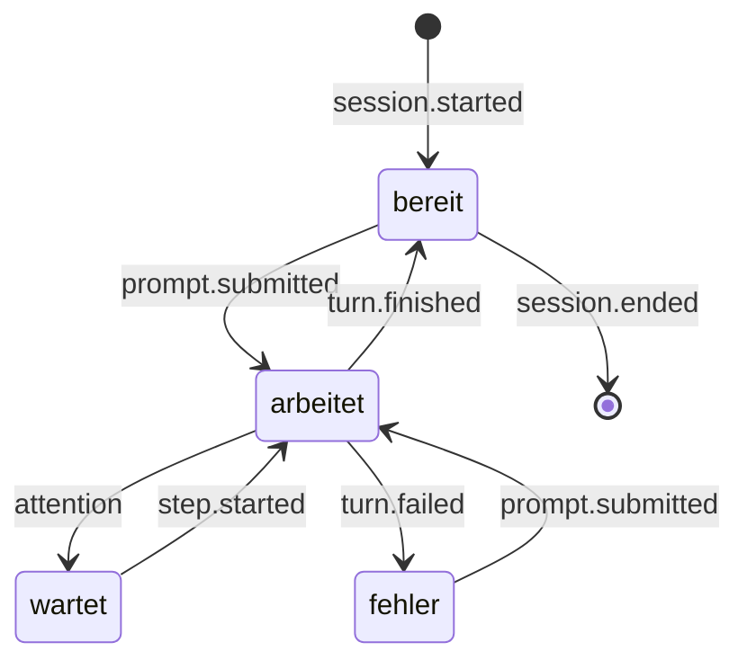

# Anbindung an Claude – Chats starten & Schritte verfolgen

> Teil des [Projektplans](PLAN.md) · Stand: 4. November 2026.
> Angaben zu Claude Code, Agent SDK und Claude Desktop stammen aus der offiziellen Dokumentation (Quellen in Abschnitt 13). Offene Punkte werden in Phase 0 (Spike B) geprüft.

## 1. Kanäle im Überblick

| Quelle | Mechanismus | Was der Avatar bekommt | Verlässlichkeit | Phase |
|---|---|---|---|---|
| Claude-Code-Sitzungen (Terminal, VS Code, JetBrains, Code-Tab der Desktop-App) | Plugin `avatar-bridge` mit HTTP-Hooks → lokale Avatar-API | Werkzeug-Schritte, Aufgabenliste, Freigabe- und Eingabebedarf, Fertig/Abbruch, letzte Antwort | hoch (offizielle Schnittstelle) | 1 |
| Avatar-eigener Schnell-Chat | Claude API (Messages, Streaming) | alles | hoch | 1 |
| Übergabe an Claude Code | Deep Link `claude-cli://open?cwd=…&q=…` | danach wie jede Claude-Code-Sitzung | hoch | 1 |
| Agent-Aufgaben aus dem Avatar | Claude Agent SDK | alle Schritte, Freigaben direkt am Avatar | hoch | 4 |
| Claude Desktop und andere MCP-Clients | MCP-Server mit Avatar-Werkzeugen (`.mcpb`) | nur, was Claude aktiv meldet | mittel (modellabhängig) | 4 |
| OpenTelemetry von Claude Code | OTLP-Export (Ereignisse etwa alle 5 s) | Tool-Ergebnisse, API-Aufrufe, Kosten | mittel | optional, später |
| Transkript-Dateien (`~/.claude/projects/…/*.jsonl`) | Dateien beobachten | Verlauf | niedrig: laut Doku internes Format, das sich zwischen Versionen ändert | nicht geplant |
| Claude Code im Web (Cloud-Sitzungen) | – | lokale Hooks greifen dort nicht | – | nicht geplant |

**Wichtig:** Für normale Chats in claude.ai und Claude Desktop gibt es keine offizielle Schnittstelle, über die eine andere App den Fortschritt mitlesen kann. Der Plan setzt deshalb auf Claude Code (Hooks) und eigene Chats und nutzt MCP als Ergänzung.

## 2. Lokale Avatar-API

- Lauscht nur auf `127.0.0.1`, Standard-Port z. B. `47821` (einstellbar; das Plugin nutzt den Standard-Port).
- Endpunkte:
  - `POST /v1/claude-code/hook`: Eingang für alle Claude-Code-Hooks (JSON unverändert von Claude Code). Antwortet sofort mit `204`, außer beim optionalen Freigabe-Hook (Abschnitt 7).
  - `POST /v1/events`: generische Ereignisse im normalisierten Format (MCP-Server, eigene Skripte); Token erforderlich.
  - `GET /v1/health`: Diagnose.
- Härtung:
  - `Host` muss `127.0.0.1:<port>` oder `localhost:<port>` sein (Schutz vor DNS-Rebinding).
  - Anfragen mit `Origin`-Header (Browser) werden abgelehnt; erlaubt ist nur `Content-Type: application/json`.
  - Höchstens 256 KB pro Anfrage, Ratenlimit pro Sitzung.
- Token: Die App legt `~/.claude-desktop-avatar/endpoint.json` mit Port und Token an (Dateirechte 0600). MCP-Server und Skripte lesen es dort. Für Hooks ist das Token optional, weil sie nur Anzeigen auslösen. Wer es nutzen möchte, setzt `CDA_TOKEN`, z. B. im `env`-Abschnitt der Claude-Code-Einstellungen; das Plugin reicht die Variable über `allowedEnvVars` als Header weiter.

## 3. Claude-Code-Plugin `avatar-bridge`

### 3.1 Aufbau & Installation

```text
.claude-plugin/marketplace.json        # Marketplace dieses Repos
plugins/avatar-bridge/
├── .claude-plugin/plugin.json         # Manifest
└── hooks/hooks.json                   # Hook-Konfiguration
```

`.claude-plugin/marketplace.json`:

```json
{
  "name": "claude-desktop-avatar",
  "owner": { "name": "AyGeeI" },
  "plugins": [
    {
      "name": "avatar-bridge",
      "source": "./plugins/avatar-bridge",
      "description": "Meldet Schritte, Freigabe-Bedarf und Fertig-Status an den Desktop-Avatar"
    },
    {
      "name": "avatar-approvals",
      "source": "./plugins/avatar-approvals",
      "description": "Optional: Freigaben direkt am Avatar beantworten"
    }
  ]
}
```

Installation (einmalig):

```bash
claude plugin marketplace add AyGeeI/claude-desktop-avatar
```

```bash
claude plugin install avatar-bridge@claude-desktop-avatar
```

In einer laufenden Sitzung funktioniert dasselbe mit `/plugin marketplace add …` und `/plugin install …`. Die App bietet zusätzlich einen Assistenten „Claude Code verbinden", der die Befehle anzeigt und die Verbindung testet.

### 3.2 Hook-Konfiguration

Alle benötigten Ereignisse nutzen denselben HTTP-Handler. `plugins/avatar-bridge/hooks/hooks.json` (Auszug):

```json
{
  "hooks": {
    "PreToolUse": [
      {
        "matcher": "*",
        "hooks": [
          {
            "type": "http",
            "url": "http://127.0.0.1:47821/v1/claude-code/hook",
            "timeout": 2,
            "headers": { "X-Avatar-Token": "$CDA_TOKEN" },
            "allowedEnvVars": ["CDA_TOKEN"]
          }
        ]
      }
    ]
  }
}
```

Analog für `SessionStart`, `UserPromptSubmit`, `PostToolUse`, `PostToolUseFailure`, `TaskCreated`, `TaskCompleted`, `Notification`, `SubagentStart`, `SubagentStop`, `PreCompact`, `Stop`, `StopFailure` und `SessionEnd`.

Designregeln:

- **Fail-open:** Läuft der Avatar nicht, scheitert die Verbindung. Laut Doku ist das ein nicht blockierender Fehler, und Claude Code arbeitet weiter. In Spike B wird geprüft, wie sichtbar diese Fehler sind. Stören sie, wechselt das Plugin auf asynchrone Command-Hooks (`"async": true`) mit einem kleinen Weiterleiter.
- **Schnell:** Die API antwortet sofort und verarbeitet erst danach. `timeout: 2` begrenzt den schlimmsten Fall (Standard für HTTP-Hooks wären 600 s).
- **Keine Eingriffe:** `avatar-bridge` blockiert nichts und trifft keine Entscheidungen. Freigaben am Avatar sind ein separates, optionales Plugin (Abschnitt 7).
- **Datensparsam:** Der Avatar behält nur die Zusammenfassungsfelder aus der Tabelle unten. Werkzeug-Ergebnisse, Dateiinhalte und Prompt-Texte werden sofort verworfen.

### 3.3 Abbildung der Hooks

| Hook | Genutzte Felder | Ereignis | Wirkung (Standard) |
|---|---|---|---|
| `SessionStart` | `session_id`, `cwd`, `source`, `session_title` | `session.started` | Sitzung erscheint in der Liste |
| `UserPromptSubmit` | `session_id` (der Prompt-Text wird verworfen) | `prompt.submitted` | Status „arbeitet" |
| `PreToolUse` | `tool_name`, gekürzte Ziele aus `tool_input` | `step.started` | Statuszeile, z. B. „Liest `cart.ts`" |
| `PostToolUse` | `tool_name`, `duration_ms`; bei Aufgaben-Werkzeugen Titel und Status | `step.finished`, `plan.updated` | Fortschritt „Schritt 3/7" |
| `PostToolUseFailure` | `tool_name` | `step.failed` | nur in der Stufe „Gesprächig" |
| `TaskCreated`, `TaskCompleted` | Aufgabe (Felder in Spike B prüfen) | `plan.updated` | Fortschrittsring |
| `Notification` | `notification_type`, `message` | `attention.permission` (`permission_prompt`), `attention.input` (`idle_prompt`, `agent_needs_input`) | Zustand `attention`, Ton, Ansage |
| `SubagentStart`, `SubagentStop` | `agent_type` | `subagent.started`, `subagent.finished` | Statuszeile |
| `PreCompact` | – | `context.compacting` | „Fasst den Kontext zusammen …" |
| `Stop` | `last_assistant_message` (gekürzt, nur im Speicher) | `turn.finished` | Zustand `success`, Ton, Ansage |
| `StopFailure` | Fehlerart (z. B. `rate_limit`) | `turn.failed` | Zustand `error`, Ton |
| `SessionEnd` | `session_id` | `session.ended` | Sitzung verschwindet aus der Liste |

**Gekürzte Ziele:** Bei Dateiwerkzeugen nur der Dateiname ohne Pfad; bei Shell-Befehlen die ersten ca. 60 Zeichen und eine erkannte Kategorie (Tests, Build, Git, Installation); bei Suchen das Muster; bei Web-Zugriffen nur die Domain.

**Aufgabenliste:** Neuere Claude-Code-Versionen führen ihren Plan über `TaskCreate` und `TaskUpdate` (Felder u. a. `subject`, `activeForm`, `status` mit `pending`, `in_progress`, `completed`, `deleted`), ältere bzw. per Einstellung über `TodoWrite`. Der Hub unterstützt beide Varianten und liest die Felder defensiv. „Schritt N von M" ergibt sich aus erledigten und offenen Aufgaben; angezeigt wird die `activeForm` der laufenden Aufgabe.

## 4. Ereignismodell

Alle Quellen werden auf ein gemeinsames Format abgebildet (Paket `core`, validiert mit Zod):

```ts
type Severity = 'debug' | 'info' | 'milestone' | 'urgent';

type ToolCategory =
  | 'read' | 'write' | 'edit' | 'shell' | 'search'
  | 'web' | 'agent' | 'plan' | 'mcp' | 'other';

interface ActivityEvent {
  id: string;                  // ULID
  ts: number;                  // Unix-Zeit in ms
  source: 'claude-code' | 'avatar-chat' | 'agent-task' | 'mcp';
  sessionId: string;
  session: {
    project?: string;          // z. B. Ordnername aus cwd
    cwd?: string;
    title?: string;            // session_title, falls vorhanden
  };
  kind:
    | 'session.started' | 'session.ended'
    | 'prompt.submitted'
    | 'step.started' | 'step.finished' | 'step.failed'
    | 'plan.updated'
    | 'subagent.started' | 'subagent.finished'
    | 'attention.permission' | 'attention.input'
    | 'turn.finished' | 'turn.failed'
    | 'context.compacting'
    | 'message';
  tool?: { name: string; category: ToolCategory; target?: string }; // bereits gekürzt
  plan?: { total: number; done: number; current?: string };
  text?: string;               // gekürzter Freitext, z. B. Hinweis oder letzte Antwort
  severity: Severity;
}
```

Sitzungsstatus:



- Sitzungen ohne beobachteten Start (der Avatar lief noch nicht) werden beim ersten Ereignis angelegt.
- Kommt 30 Minuten lang kein Ereignis, gilt eine Sitzung als inaktiv und wird ausgeblendet, falls `SessionEnd` fehlt, z. B. nach einem Absturz.
- Der Projektname ist der Ordnername aus `cwd`; er lässt sich umbenennen und bekommt eine eigene Farbe.

## 5. Erzähler

Der Erzähler übersetzt Ereignisse in kurze Texte, Hinweistöne und Ansagen. Standardmäßig arbeitet er rein lokal mit Textvorlagen, ohne KI.

| Werkzeug / Ereignis | Sprechblase | Gesprochen (Stufe „Normal") |
|---|---|---|
| `Read` | Liest `app.ts` | – |
| `Write` | Erstellt `checkout.test.ts` | – |
| `Edit` | Bearbeitet `cart.ts` | – |
| `Bash` (Tests erkannt) | Führt die Tests aus | – |
| `Bash` (allgemein) | Führt aus: `docker compose up` | – |
| `Grep`, `Glob` | Durchsucht das Projekt nach „PaymentError" | – |
| `WebSearch`, `WebFetch` | Recherchiert im Web · Liest example.com | – |
| Subagent (`Agent`) | Hilfsagent: Tests analysieren | – |
| Aufgabenliste | Schritt 3/7 · Tests ausführen | – (Stufe „Gesprächig": „Nächster Schritt: Tests ausführen") |
| MCP-Werkzeug, z. B. `mcp__github__create_pr` | Nutzt github: create_pr | – |
| Freigabe nötig | webshop braucht deine Freigabe: Bash `rm -rf dist` | „Webshop braucht deine Freigabe." |
| Wartet auf Eingabe | webshop wartet auf dich | „Webshop wartet auf dich." |
| Fertig (`Stop`) | webshop ist fertig: „Alle 42 Tests grün, Commit erstellt." | „Webshop ist fertig." |
| Abbruch (`StopFailure`) | webshop abgebrochen: Rate-Limit | „Webshop wurde abgebrochen." |

**Ausführlichkeitsstufen:**

| Stufe | Sprechblase | Sprache | Hinweistöne |
|---|---|---|---|
| Still | nur Dringendes | nichts | nur Dringendes |
| Normal (Standard) | aktueller Schritt als Statuszeile, Meilensteine, Dringendes | Dringendes und „fertig" | Dringendes, fertig, Fehler |
| Gesprächig | jeder Schritt (gebündelt) | zusätzlich Planschritte | alle |

Dazu kommen Stummschalten pro Sitzung, Ruhezeiten (z. B. 20–8 Uhr ohne Sprache) und „Nicht stören" (nur dringende Töne).

**Regeln gegen Ansage-Flut:**

- **Bündeln:** Gleichartige Schritte innerhalb von 3 s werden zusammengefasst („Liest 4 Dateien"). Pro Sitzung zeigt die Statuszeile nur den jüngsten Stand.
- **Drosseln:** Höchstens eine nicht dringende Ansage pro Sitzung alle 20 s. Dringendes kommt sofort, insgesamt aber höchstens eine Ansage alle 5 s.
- **Verwerfen:** Ansagen, die beim Abspielen älter als 10 s sind, entfallen.
- **Nicht unterbrechen:** keine Ansagen, während du sprichst oder der Avatar zuhört.
- **Sprechbar formulieren:** Pfade und Befehle werden nie wörtlich vorgelesen. Gesprochen werden Dateinamen ohne Pfad und Befehlskategorien („die Tests"). Projektnamen werden lesbar gemacht (`webshop-api` → „Webshop API").

**Optionale KI-Zusammenfassung (opt-in):** Beim Ende einer Runde fasst Claude die `last_assistant_message` in einem Satz zusammen; in der Stufe „Gesprächig" zusätzlich etwa alle 60 s die bisherigen Schritte. Dabei gehen nur bereits reduzierte Daten an die Claude API, als strukturierte Ausgabe (`text`, `severity`). Das Modell ist einstellbar. Standard ist das Chat-Modell; für diese vielen kurzen Aufrufe ist ein Haiku-Modell deutlich günstiger. Die Kosten werden angezeigt.

## 6. Schnell-Chat

- **Einstieg:** Klick auf den Avatar, globales Tastenkürzel (Vorschlag: `Strg`/`Cmd` + `Umschalt` + `Leertaste`) oder Push-to-Talk.
- **Anfrage:** Messages API mit Streaming über `@anthropic-ai/sdk`. Kurze Antworten erscheinen in der Sprechblase, längere oder solche mit Code im Panel (Markdown, Kopieren-Knopf).
- **Modell:** einstellbar. Die Auswahlliste kommt aus der Models API (`GET /v1/models`), damit neue Modelle ohne App-Update erscheinen. Standard ist das aktuelle Opus-Modell. Bei den aktuellen Opus-Modellen ist Denken immer aktiv, deshalb läuft der Chat mit niedrigem `effort` für kurze Antwortzeiten. Schnellere bzw. günstigere Optionen sind Sonnet und Haiku. Während der Denkphase zeigt der Avatar den Zustand `thinking`.
- **System-Prompt-Bausteine** (stabile Teile zuerst, damit Prompt-Caching greift):
  1. Rolle und Persona aus dem Avatar-Profil (Name, Stil)
  2. Sprache (Deutsch) und Antwortformat; im Sprachmodus 1–3 kurze Sätze ohne Markdown
  3. Beschreibung der Chat-Werkzeuge
  4. Variable Teile ganz am Ende: Datum und Uhrzeit, optional der aktuelle Stand der Sitzungen
- **Chat-Werkzeuge** (Tool Use):
  - `get_active_sessions`: liefert die reduzierten Zusammenfassungen aus dem Aktivitäts-Hub. So beantwortet der Avatar Fragen wie „Was macht Claude gerade im Webshop?".
  - `start_claude_code_task(project, prompt)`: schlägt eine Übergabe vor. Der Avatar zeigt Projekt und Auftrag und öffnet den Deep Link erst nach deinem Klick (Abschnitt 9).
  - optional die serverseitige Websuche für Fragen zu aktuellen Themen.
- **Robustheit:** `stop_reason` prüfen (u. a. `refusal`) und serverseitige Fallbacks nutzen; Netzwerkfehler verständlich melden.
- **Verlauf und Kosten:** Verlauf lokal in SQLite mit einstellbarer Aufbewahrung; Token-Verbrauch aus `usage` als Tages- und Monatssumme.
- **Kontext anhängen** (später): Zwischenablage oder Screenshot, nur auf ausdrücklichen Klick.

## 7. Freigaben am Avatar (optional, Phase 4)

- **Standard:** Der Avatar zeigt nur an, dass eine Freigabe nötig ist (`Notification` mit `permission_prompt`). Entschieden wird in Claude Code.
- **Opt-in-Plugin `avatar-approvals`:** ein `PermissionRequest`-HTTP-Hook mit längerem `timeout` (z. B. 60 s). Die Avatar-API hält die Anfrage offen, bis du in der Sprechblase „Erlauben" oder „Ablehnen" klickst, und antwortet dann:

  ```json
  {
    "hookSpecificOutput": {
      "hookEventName": "PermissionRequest",
      "decision": { "behavior": "allow" }
    }
  }
  ```

  Bei „Ablehnen" lautet die Antwort `"behavior": "deny"`. Kommt keine Entscheidung, antwortet die API leer, und Claude Code fährt mit dem normalen Ablauf fort (in Spike B verifizieren).
- **Sicherheitsregeln:** Entscheidungen nur per Klick, nie per Sprache. Der vollständige Befehl und das Projekt werden immer angezeigt. In v1 gibt es kein „Immer erlauben" vom Avatar aus.
- **Nachteil:** Solange der Avatar wartet, erscheint der Dialog im Terminal erst nach Ablauf der Wartezeit. Deshalb ist das Plugin optional.

## 8. Agent-Aufgaben mit dem Claude Agent SDK (optional, Phase 4)

- Paket `@anthropic-ai/claude-agent-sdk`: Claude Code als Bibliothek, mit eingebauten Werkzeugen.
- Ablauf: Projekt wählen → `query()` im Projektordner starten → Nachrichten streamen (`includePartialMessages`) und direkt in den Aktivitäts-Hub einspeisen → Freigaben über den `canUseTool`-Callback in der Sprechblase → Abbruch-Knopf.
- Einsatz: Hintergrundaufgaben ohne Terminal, z. B. „Fasse die offenen TODOs im Projekt zusammen". Interaktive Arbeit läuft besser über die Deep-Link-Übergabe an dein Claude Code.
- Anmeldung nur per API-Schlüssel (Abschnitt 11).

## 9. Übergaben

- **An Claude Code (Terminal):** `claude-cli://open?cwd=<absoluter Pfad>&q=<URL-kodierter Auftrag>` öffnet ein neues Terminal mit Claude Code im Projektordner. Der Auftrag ist vorausgefüllt, wird aber erst gesendet, wenn du Enter drückst. Claude Code zeigt dazu den Hinweis „Prompt from an external link".
  - Grenzen: höchstens 5.000 Zeichen. Der Link-Handler wird registriert, sobald du in einer interaktiven Claude-Code-Sitzung einmal etwas gesendet hast.
  - Statt `cwd` geht auch `repo=<owner/name>` für Klone, die Claude Code schon kennt.
- **An VS Code:** `vscode://anthropic.claude-code/open` öffnet einen Claude-Code-Tab in VS Code.
- **An Claude Desktop:** Ein Parameter zum Vorbefüllen ist nicht dokumentiert. Der Avatar kopiert den Text deshalb in die Zwischenablage und öffnet die App.
- **Projektliste:** zuletzt gesehene `cwd`s aus Hook-Ereignissen plus manuell hinzugefügte Ordner; per Sprache auswählbar („im Projekt Webshop").

## 10. MCP-Server für Claude Desktop (Phase 4)

- Werkzeuge:
  - `avatar_status(state, step?, progress?)`: setzt Zustand und Statuszeile.
  - `avatar_say(text)`: lässt den Avatar einen kurzen Satz sagen.
  - `avatar_notify(title, message, urgency)`: zeigt einen Hinweis mit Ton.
- Verbindung: Claude Desktop startet den MCP-Server als eigenen Prozess (stdio). Der Server leitet an die lokale Avatar-API weiter und liest das Token aus `endpoint.json`.
- Installation als Desktop-Erweiterung im `.mcpb`-Format: in Claude Desktop über Einstellungen → Erweiterungen, für eigene Pakete über Erweiterte Einstellungen → Extension Developer → Install Extension.
- Funktioniert auch in anderen MCP-Clients, z. B. in Claude Code.
- Grenze: Claude ruft die Werkzeuge nur auf, wenn es das für sinnvoll hält. Gute Werkzeugbeschreibungen und ein optionaler Satz in den persönlichen Einstellungen oder Projektanweisungen helfen („Melde größere Arbeitsschritte über avatar_status."). Weitere Chat-Inhalte sieht der Avatar nicht.

## 11. Authentifizierung & Kosten

- **Avatar-Chats und Agent-Aufgaben:** eigener Anthropic-API-Schlüssel (BYOK), verschlüsselt im System-Schlüsselbund (`safeStorage`). Die SDKs erkennen auch ein Profil, das mit `ant auth login` angelegt wurde (praktisch für Entwickler).
- **Kein Abo-Login:** Die Agent-SDK-Dokumentation sagt dazu: „Unless previously approved, Anthropic does not allow third party developers to offer claude.ai login or rate limits for their products, including agents built on the Claude Agent SDK." Der Avatar bietet deshalb keine Anmeldung mit Pro/Max an.
- **Abo trotzdem nutzen:** Aufgaben, die über dein Abo laufen sollen, übergibt der Avatar per Deep Link an dein eigenes Claude Code (Abschnitt 9). Der Fortschritt kommt danach über die Hooks zurück.
- **Kostenkontrolle:** Verbrauchsanzeige, optionales Tageslimit, Modellwahl pro Funktion (Chat, Zusammenfassung).

## 12. Datenschutz

| Daten | Verarbeitung | Verlässt den Rechner? |
|---|---|---|
| Hook-Ereignisse | lokal, sofort reduziert, nur im Speicher | nein (Ausnahme: KI-Zusammenfassung, opt-in) |
| Schnell-Chat | Claude API | ja, an Anthropic (deine bewusste Anfrage) |
| Sitzungsstand im Chat (`get_active_sessions`) | reduzierte Zusammenfassungen | ja, als Teil der Chat-Anfrage und nur, wenn Claude das Werkzeug nutzt |
| Spracheingabe | lokal (whisper.cpp) | nein; Cloud-STT opt-in |
| Sprachausgabe | lokal (System-Stimmen, Piper) | nein; Cloud-TTS opt-in |
| Chat-Verlauf | lokal (SQLite) | nein |
| Telemetrie | keine | – |

## 13. Zu verifizieren & Quellen

**In Spike B zu verifizieren:**

- Payload-Felder von `Stop`, `StopFailure`, `SessionEnd`, `TaskCreated`, `TaskCompleted` und `MessageDisplay`
- Wie sichtbar Verbindungsfehler von HTTP-Hooks sind, wenn der Avatar nicht läuft
- Ob die Plugin-Hooks auch im Code-Tab der Desktop-App und in den IDE-Erweiterungen feuern (laut Doku lesen alle Oberflächen dieselben Einstellungsdateien)
- `PermissionRequest` ohne Entscheidung: Erscheint danach der normale Dialog?
- Ob HTTP-Hooks asynchron laufen können (dokumentiert ist `async` nur für Command-Hooks)

**Quellen:**

- Hooks: <https://code.claude.com/docs/en/hooks>
- Plugins & Marketplaces: <https://code.claude.com/docs/en/plugins/create>, <https://code.claude.com/docs/en/plugins/create-marketplace>
- Aufgaben-Tracking: <https://code.claude.com/docs/en/agent-sdk/todo-tracking>
- Deep Links: <https://code.claude.com/docs/en/deep-links>
- Agent SDK (inkl. Authentifizierung): <https://code.claude.com/docs/en/agent-sdk/overview>
- Sitzungen & Transkripte: <https://code.claude.com/docs/en/sessions>
- Monitoring (OpenTelemetry): <https://code.claude.com/docs/en/monitoring-usage>
- MCP in Claude Desktop: <https://support.claude.com/en/articles/10949351-getting-started-with-model-context-protocol-mcp-on-claude-desktop>
- Quick Entry (macOS): <https://support.claude.com/en/articles/12626668-use-quick-entry-with-claude-desktop-on-mac>
